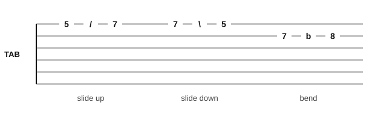

# Slides and bends

<span class="tag tag-guitar">Guitar</span>

After this lesson you can play a slide up and down, a light half-step bend and a small vibrato, and read the tab marks /, \ and b.

Before this: [Hammer-ons and pull-offs](10-hammer-ons-and-pull-offs.md), [Reading guitar tab](../01-first-sounds/11-reading-tab.md), [Whole steps, half steps, sharps and flats](../03-the-major-scale-and-keys/01-whole-and-half-steps.md). You need: your guitar, a pick and a metronome app.

## The idea

### Sliding between notes

A **slide** moves one fretting finger along the string from one fret to another, without lifting, so every pitch in between sounds. You pick the first note, slide to the second and the string keeps ringing. Slides are on one string, like hammer-ons and pull-offs.

In tab a slide up is a forward slash between the two fret numbers (`5/7`), and a slide down is a backslash (`7\5`).



In notation a slide is a curved or straight line between two notes, often with the word "slide". Listen to a slide up from fret 5 to fret 7 on string 1 and back down. The play bar plays the two notes without the sliding sound in between.

```abc
%%opts tab=guitar
X:1
M:4/4
L:1/4
Q:1/4=60
K:Em clef=treble-8
"^slide up"(a b) b2 | "^slide down"(b a) a2 |]
```

Follow these steps for a slide.

1. Pick the first note with the finger pressed firmly on the fret.
2. Keep the finger pressed and move it along the string to the second fret in one motion.
3. Keep your thumb behind the neck and your wrist relaxed.
4. Let the second note ring.

Common mistake at step 2: pressing too lightly. The note dies halfway. Keep the same pressure all the way.

### Bending a string

A **bend** pushes the string sideways across the fretboard, which raises the pitch smoothly without moving to the next fret. A small bend raises the pitch by a half step (the distance of one fret). On steel strings a half-step bend is a light push, not a pull.

In tab, `7b8` means fret 7 bent up until it sounds like fret 8. The b is the bend, and the number after it is the pitch you reach. A whole-step bend, which sounds like two frets, is `7b9`. This lesson uses half-step bends only.

Follow these steps.

1. Use string 1 or 2 at frets 5 to 8. They are the easiest strings to bend.
2. Fret the note with your third finger, and put fingers 1 and 2 on the strings behind it, so three fingers push together.
3. Pick the note, then push the string up toward the ceiling, across the fretboard, a small amount.
4. Compare to the target: play the note one fret higher and match it.
5. Release slowly, keeping the string in contact with the fret.

Stop if your fingertips or hand hurt. Steel strings are hard on fingers, and a bend that needs a lot of force is probably too big. If a string feels close to breaking, stop and ask a teacher.

Listen to the target first: fret 7 on string 2 and fret 8, then the bend that slides from one to the other. The play bar plays the two notes as separate pitches.

```abc
%%opts tab=guitar
X:1
M:4/4
L:1/4
Q:1/4=60
K:Em clef=treble-8
"^target"B c "^bend 7b8"B2 | "^target"B c "^bend"B2 |]
```

### Vibrato

A **vibrato** is a small, steady wobble in the pitch of a held note, made by rocking the fretting finger a little side to side (or up and down) on the string. It makes a long note sound like it is singing. Try it on a note held for four beats: bend a very small amount up, then back to the fret, again and again, at about two or three wobbles a second.

In notation it is a wavy line over the note, or the letters "vib.". In tab it is the same wavy line.

### A short tune

"Slow Climb" uses a slide, a bend and a long note for vibrato. It is original and in E minor.

```abc
%%opts tab=guitar
X:1
T:Slow Climb
M:4/4
L:1/4
Q:1/4=60
K:Em clef=treble-8
e g "^slide up"(a b) | "^bend"b "^vib."b2 z |
"^slide down"(b a) g e | e4 |]
```

Bar 1 climbs from the open string 1. In the slide, `5/7` joins the A and B on string 1. In bar 2 the first B is bent (`7b8`) and the half note has a vibrato.

## Try it

Exercise 1. Write the tab for "pick fret 5 on string 1, then slide up to fret 8".

<details class="solution" markdown>
<summary>Answer</summary>

`5/8` on the top line (string 1).

</details>

Exercise 2. `7b8` on string 2: what note does the bend reach, and how many half steps higher is it?

<details class="solution" markdown>
<summary>Answer</summary>

The pitch of fret 8 on string 2, one half step higher than fret 7.

</details>

Exercise 3. Which two techniques in this lesson change a note while it is ringing, without picking again?

<details class="solution" markdown>
<summary>Answer</summary>

The slide (the finger moves to a new fret) and the bend (the string is pushed across the fret). Vibrato also changes the pitch while the note rings.

</details>

<div class="practice" markdown>

### Practice routine (30 minutes)

| Minutes | What to do | Tempo | Listen for |
|---|---|---|---|
| 5 | Warm-up: hammer-ons and pull-offs on strings 3, 2 and 1 | 60 bpm | The second note as loud as the first |
| 15 | New skill: `5/7` and `7\5` on string 1, then `7b8` on string 2 against its target note, then "Slow Climb" | 50 bpm, then 60 | The bend landing on the target pitch |
| 5 | Reading: clap and count Drill 3 from lesson 11 | 3/8 = 50 | Steady counts |
| 5 | Piano: "Slow Boat" from lesson 5, hands together | 3/8 = 56 | Bass and melody together |

Repeat this routine on at least three days before you check the boxes below. Rest your fingertips if they feel sore, and stop if your hand or wrist hurts.

</div>

<div class="move-on" markdown>

### Move on when

- [ ] You can slide from fret 5 to fret 7 on string 1 and back, and the note keeps ringing the whole way.
- [ ] You can bend `7b8` on string 2 until it matches the pitch of fret 8, three times in a row.
- [ ] You can hold a note for four beats with an even vibrato.
- [ ] You can explain the tab marks /, \ and b.

</div>

## Common mistakes

Bending with one finger only. Put fingers 1 and 2 behind it so the push is shared.

Bending too far. A half step is small; compare it with the fret above.

Letting the thumb slip over the top of the neck. Keep it behind the neck for a bend, as for every other note.

## Film yourself

Record your fretting hand from the front. Watch for these.

- The finger stays pressed through the slide.
- Fingers 1 and 2 stay on the strings behind the bending finger.
- The wrist stays relaxed.

Watch: [How To Legato Slide on Guitar for Beginners (stop doing this!)](https://www.youtube.com/watch?v=063Eoa1i0Dk) by Gibson App: Learn & Play Guitar (free, on YouTube).
Watch: [Bending Strings - Technique Series - How To Play IF Stage 4 - Guitar Lesson [IM-144]](https://www.youtube.com/watch?v=xGl0urYSuug) by JustinGuitar (free, on YouTube).

## Key terms

- **Slide**: moving a finger along the string from one fret to another while the note rings.
- **Bend**: pushing a string across the fretboard to raise its pitch.
- **Vibrato**: a small, steady wobble in the pitch of a held note.
- **/, \, b**: the tab marks for a slide up, a slide down and a bend.

Next: [The damper pedal](../07-pedal-texture-and-ambient/01-damper-pedal.md)
