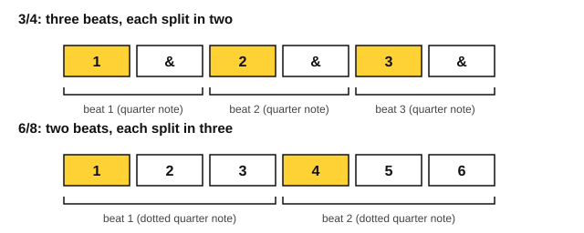
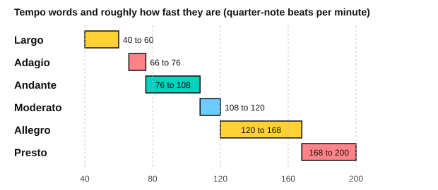
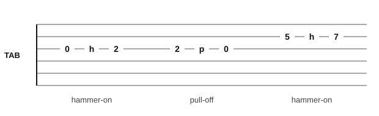
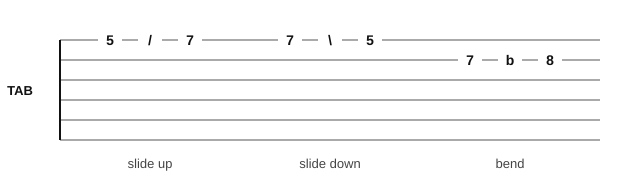

# Stage 6: Meter, terms and rhythm

This stage adds the second kind of beat, three to a beat, and the words and signs that fill a real score. You learn compound meter, triplets and syncopation, the Italian tempo and dynamics terms, and the articulation and repeat signs. On the piano you play in 6/8 and learn two Burgmüller studies. On the guitar you strum and fingerpick in 6/8 and 3/4, then learn hammer-ons, pull-offs, slides and bends. You also practise hearing and reading rhythm. It usually takes about 5 to 7 weeks at 30 minutes a day.

<!-- lessons:start -->
## Lessons

1. [Compound meter](01-compound-meter.md) (theory)
2. [Triplets and syncopation](02-triplets-and-syncopation.md) (theory)
3. [Tempo and dynamics terms](03-tempo-and-dynamics-terms.md) (theory)
4. [Articulation and repeat signs](04-articulation-and-repeat-signs.md) (theory)
5. [6/8 on piano](05-six-eight-on-piano.md) (piano)
6. [6/8 strumming](06-six-eight-strumming.md) (guitar)
7. [Fingerpicking patterns](07-fingerpicking-patterns.md) (guitar)
8. [Burgmüller: two easy studies](08-burgmuller-easy-studies.md) (piano)
9. [Rhythm by ear](09-rhythm-by-ear.md) (ear)
10. [Hammer-ons and pull-offs](10-hammer-ons-and-pull-offs.md) (guitar)
11. [Sight-reading rhythms](11-sight-reading-rhythms.md) (reading)
12. [Slides and bends](12-slides-and-bends.md) (guitar)

<!-- lessons:end -->

Download the stage 6 deck: [06-meter-terms-and-rhythm.apkg](../downloads/anki/06-meter-terms-and-rhythm.apkg)

## Cheat sheet

Everything to remember from this stage, on one page.

### Meters and how to count them

| Meter | Type | Beats per bar | The beat | Count |
|---|---|---|---|---|
| 2/4 | Simple duple | 2 | Quarter note | 1 & 2 & |
| 3/4 | Simple triple | 3 | Quarter note | 1 & 2 & 3 & |
| 4/4 | Simple quadruple | 4 | Quarter note | 1 & 2 & 3 & 4 & |
| 6/8 | Compound duple | 2 | Dotted quarter note | 1 2 3 4 5 6 (lean on 1 and 4) |
| 9/8 | Compound triple | 3 | Dotted quarter note | 1 to 9 (lean on 1, 4 and 7) |
| 12/8 | Compound quadruple | 4 | Dotted quarter note | 1 to 12 (lean on 1, 4, 7 and 10) |

- Simple meter splits the beat in two. Compound meter splits it in three.
- A triplet puts three even notes in the time of two, counted "1 trip let".
- Syncopation puts the stress on the off-beat. A tie across the beat or the bar line makes it.
- Tempo in 6/8 is counted in dotted quarter notes: 3/8 = 60.

### Italian terms

| Term | Meaning |
|---|---|
| largo, adagio | Very slow, slow |
| andante, moderato | Walking pace, moderate |
| allegro, presto | Fast, very fast |
| rit., rall. | Gradually slower |
| accel. | Gradually faster |
| a tempo | Back to the earlier speed |
| rubato | Flexible tempo |
| pp, p, mp, mf, f, ff | Very soft to very loud |
| sfz | A sudden strong accent |
| cresc., dim. | Gradually louder, gradually softer |
| poco, molto, più, meno | A little, very, more, less |
| dolce, cantabile | Sweetly, in a singing style |

### Articulation and repeat signs

| Sign | Meaning |
|---|---|
| Accent `>` | Attack harder |
| Tenuto `-` | Full length, with a lean |
| Marcato `^` | Strong and short |
| Fermata | Hold longer than written |
| Repeat sign | Go back to the matching start (or the beginning) |
| First and second endings | Play ending 1, repeat, skip it and play ending 2 |
| D.C. | Go back to the beginning |
| D.S. | Go back to the segno |
| al Fine | Play to the word Fine |
| al Coda | At To Coda, jump to the coda |

### Guitar tab marks

| Mark | Meaning | Example |
|---|---|---|
| h | Hammer-on | `0h2` |
| p | Pull-off | `2p0` |
| / | Slide up | `5/7` |
| \ | Slide down | `7\5` |
| b | Bend up (to the fret named) | `7b8` |

### Picking and strumming

- Picking fingers: p on strings 6 to 4, i on 3, m on 2, a on 1.
- 6/8 picking: p i m a i m. 3/4 picking: bass, then i m, then i m.
- 6/8 strumming patterns: down on 1 and 4; down on every count; D . U D . U.
