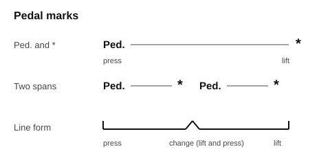

# The damper pedal

<span class="tag tag-piano">Piano</span>

After this lesson you can press and lift the right pedal on cue, hold a chord with it, and read the pedal marks under a piano part.

Before this: [Meet your piano](../01-first-sounds/02-meet-your-piano.md), [Hands together](../02-two-hands-and-first-chords/03-hands-together.md), [Legato, staccato and dynamics](../02-two-hands-and-first-chords/07-legato-staccato-and-dynamics.md). You need: your piano with its pedal unit plugged in.

## The idea

### Sound first: let the note ring

Play C4 and hold the key for two seconds, then let go. The sound stops at once. Now press the right pedal with your foot, play C4, let go of the key, and keep the pedal down. The note keeps ringing and fades by itself. Lift the pedal and the sound stops.

On an acoustic piano, each string has a felt pad called a damper resting on it. When you press a key, its damper lifts and the hammer hits the string; when you release the key, the damper falls back and stops the sound. The right pedal lifts all the dampers at once, so every string is free to ring, whether or not you hold the key. This pedal is the **damper pedal**, also called the **sustain pedal**. Your digital piano copies the effect with recorded or modelled sound.

The pedal also changes the tone. With the dampers up, strings that are not played ring a little in sympathy with the ones that are, so the sound is fuller. That is why a pedalled chord sounds bigger than the same chord with the pedal up.

### Foot position

Your right foot works the pedal while the rest of the body stays still.

1. Sit on the bench as in the [sitting lesson](../01-first-sounds/05-sitting-and-finger-numbers.md), with both feet flat on the floor.
2. Slide your right foot forward until the ball of the foot (the pad behind the toes) rests on the pedal.
3. Keep the heel on the floor. The heel is the pivot, like a hinge, and the ankle does the moving.
4. Press down and let up with a smooth motion. Do not stomp, and do not lift the whole foot off the pedal between presses. A foot that leaves the pedal makes a thump and loses its place.

Common mistake at step 3: lifting the heel and pressing with the whole leg. The leg gets tired and the pedal gets noisy. Keep the heel down.

### Press after the note

Play a chord first, then press the pedal while the keys are still down. If you press the pedal before the chord, the dampers are already up for every earlier note that was still fading, and they ring into the new sound. Pressing right after the chord catches only the new notes.

Lift the pedal when the sound should stop, usually at a rest or when the harmony changes. Lesson 2 teaches the exact timing for a change, called [legato pedalling](02-legato-pedalling.md).

### Pedal marks

Music tells you where to press and lift with marks under the bottom staff. This book writes **Ped.** where you press and an asterisk (`*`) where you lift. A change, a lift followed at once by a new press, is written `*Ped.` Printed scores also use a line that starts with an upward tick where you press and ends with another where you lift, and a notch in the line is a change.



## Hear and see

Press the pedal after the first note of the bar. Listen for the arpeggio notes blending into one chord, and for the sound stopping when you lift at the asterisk in bar 3.

```abc
X:1
M:4/4
L:1/4
Q:1/4=60
K:C
%%score {RH LH}
V:RH clef=treble
V:LH clef=bass
[V:RH] !mp!"_Ped."E G c e | [Gce]4 | "_*"z4 |]
[V:LH] C,,4 | C,,4 | z4 |]
```

Now two chords. The pedal lifts at the bar line where the harmony changes, so the C chord does not blur into F.

```abc
X:1
M:4/4
L:1/4
Q:1/4=60
K:C
%%score {RH LH}
V:RH clef=treble
V:LH clef=bass
[V:RH] !mp!"_Ped."[Ec]4 | [Ec]4 | "_*Ped."[Fc]4 | [Fc]4 | "_*"z4 |]
[V:LH] C,,2 G,,2 | C,,4 | F,,2 C,,2 | F,,4 | z4 |]
```

## Try it

Exercise 1. Which pedal is the damper pedal, and which part of your foot presses it?

<details class="solution" markdown>
<summary>Answer</summary>

The right pedal. The ball of the foot presses it, with the heel on the floor.

</details>

Exercise 2. In the second example, in which bar does the pedal change, and what is the mark?

<details class="solution" markdown>
<summary>Answer</summary>

Bar 3, where the harmony changes from C to F. The mark is `*Ped.`: lift and press again.

</details>

Exercise 3. You play a chord and then a second chord a bar later, with the pedal held down through both. What do you hear?

<details class="solution" markdown>
<summary>Answer</summary>

Both chords ring together, so the sound is blurred. Lift and press again at the second chord, as in lesson 2.

</details>

<div class="practice" markdown>

### Practice routine (30 minutes)

| Minutes | What to do | Tempo | Listen for |
|---|---|---|---|
| 5 | Warm-up: C major scale, one octave, each hand alone, no pedal | 60 bpm | Even notes |
| 15 | New skill: press and lift the pedal alone 10 times, then play C4, press after the note, count 4, lift. Then both examples above, hands together, pedal on the marks | 60 bpm | The sound stopping exactly when you lift |
| 5 | Reading: find the Ped. and * marks in the second example and say the beat of each aloud | Untimed | Pressing after the chord, not before |
| 5 | Guitar: Am, D and E, each for 2 bars, one strum per bar | 60 bpm | Every string ringing |

Repeat this routine on at least three days.

</div>

<div class="move-on" markdown>

### Move on when

- [ ] You can sit with your heel on the floor and press and lift the damper pedal 10 times without a thump.
- [ ] You can play C4, press the pedal after the note, count 4 beats, and lift on beat 1 of the next bar, 5 times in a row.
- [ ] You can play the second example at 60 bpm with the pedal on the marks and no blur between the C and F chords, three times in a row.
- [ ] You can point at Ped. and * on a page and say what each one tells your foot to do.

</div>

## Common mistakes

Pressing the pedal before the chord. Old notes get caught. Press right after the keys go down.

Holding the pedal for a whole page because it sounds nice. Notes from different chords pile up. Lift when the harmony changes.

Pedalling with the toe in the air and the heel up. The foot has no pivot, and the pedal clunks. Keep the heel down.

## Film yourself

Film your right foot and your hands from the side while you play the second example.

<!-- video: a side view of a pianist's right foot on the damper pedal, heel on the floor, pressing after a chord and lifting at a rest -->

Check that:

- the heel stays on the floor,
- the foot never leaves the pedal between presses,
- the pedal goes down after the chord, not before,
- your shoulders and neck are relaxed.

If your foot, ankle or leg aches, stop and rest. If it keeps happening, see a teacher or a doctor.

## Key terms

- **Damper**: a felt pad that rests on a piano string and stops its sound.
- **Damper pedal (sustain pedal)**: the right pedal; it lifts all the dampers so notes keep ringing.
- **Ped.**: the mark for pressing the damper pedal.
- **Asterisk**: the mark for lifting the pedal.

Next: [Legato pedalling](02-legato-pedalling.md)
