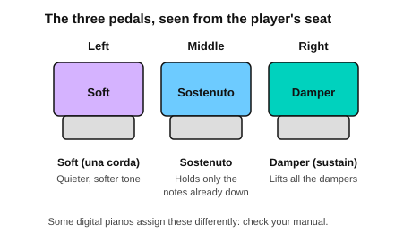

# Half pedal, una corda and sostenuto

<span class="tag tag-piano">Piano</span>

After this lesson you can try half pedalling, the left soft pedal and the middle sostenuto pedal on your piano, say what each one does on an acoustic piano, and find out from your manual how your own piano treats them.

Before this: [Legato pedalling](02-legato-pedalling.md), [Meet your piano](../01-first-sounds/02-meet-your-piano.md). You need: your piano, its manual (paper or online), and its three-pedal unit plugged in.

## The idea

### Half pedalling

The damper pedal does not have to be all the way down. On an acoustic piano the dampers touch the strings more lightly the further up they are. With the pedal about halfway, the dampers brush the strings: low notes that would blur are quieted, while high notes still ring a little. This is **half pedalling**. It is used to clear a low bass note without cutting the whole sound.

Try it on a piano that supports it. Play a low C2 and a chord above it, press the pedal partway, and listen. Then let it up a little more and listen again.

Not every digital piano can do this. Some damper pedals are a switch that is either up or down, and half pedalling then does nothing. Other pianos have a pedal that senses how far it is pressed, and a few even have a setting for it. Look in your manual for "half pedal", "continuous" or "damper resonance". If your piano does not support it, you lose nothing in this book: all the pieces here use the full pedal.

### Una corda and tre corde

The left pedal is the **soft pedal**. On a grand piano, pressing it slides the whole keyboard and action a few millimetres to the right. Most notes have three strings per hammer; after the shift, the hammer hits only two of them (and one string only for the bass notes). The Italian term is **una corda**, "one string". The notes are quieter and a little darker. The term for letting the pedal up again is **tre corde**, "three strings".

On an upright piano the left pedal moves the hammers closer to the strings, so the notes are quieter but the tone is the same. On a digital piano, the left pedal usually softens the volume and the tone. Press yours and play a chord with and without the pedal.

In music, *una corda* appears as a word above or below the staff and *tre corde* cancels it. They are marks for the left pedal.

### The sostenuto pedal

The middle pedal is the **sostenuto pedal**, from the Italian "sustained". When you press it, the dampers of the notes you are holding at that moment stay up, and notes you play afterwards are damped normally.

1. Hold a low note, C2, with your left hand.
2. Press the middle pedal while the key is still down.
3. Let go of the key. The C2 keeps ringing.
4. Play short chords above it. They stop as soon as you let go of the keys, while the C2 still rings.
5. Lift the pedal to stop the C2.

That is the use of the pedal: a low note or chord rings under music that stays clear. The damper pedal could not do this, because it holds every note.

Common mistake at step 2: pressing the pedal before the key is down. The pedal only holds notes that are already down when it is pressed.



### Check your own piano

Digital pianos differ, and this book cannot know which model you have. Check your manual for these four things.

| Question | What to look for in the manual |
|---|---|
| Does the right pedal sense half pressure? | "half pedal", "continuous", "pedal type" |
| What does the middle pedal do? | "sostenuto", or another function it can be assigned |
| What does the left pedal do? | "soft", "una corda" |
| Does the pedal unit need setting? | "pedal polarity", "pedal assign" |

Some pianos give the middle pedal another job, or hold the notes in a different way from an acoustic piano. If the middle pedal does not hold only the notes already down, trust the manual over this page, and ask a teacher if you are unsure.

## Hear and see

Play the low C2 with the left hand and press the middle pedal. Then play the right-hand chords short and clean while the bass rings. Listen for the C2 sounding under every chord. The first bar marks the sostenuto press.

```abc
X:1
M:4/4
L:1/4
Q:1/4=60
K:C
%%score {RH LH}
V:RH clef=treble
V:LH clef=bass
[V:RH] z4 | .[Ec]2 .[Dc]2 | .[Ec]2 .[Gc]2 | z4 |]
[V:LH] "^press sostenuto after this note"C,,4 | C,,4 | C,,4 | "_lift" z4 |]
```

On an acoustic piano the sostenuto pedal holds C2 here while the staccato chords stay dry. On a piano without this pedal, the damper pedal would blur the right-hand chords, so you would play the left-hand C2 and the chords without it.

Now the soft pedal. Play the same chords once without it, then with it. The notation uses words for the left pedal.

```abc
X:1
M:4/4
L:1/4
Q:1/4=60
K:C
%%score {RH LH}
V:RH clef=treble
V:LH clef=bass
[V:RH] "^una corda"!p![Ec]4 | [Dc]4 | "^tre corde"!mp![Ec]4 | [Gc]4 |]
[V:LH] C,4 | G,,4 | C,4 | C,4 |]
```

## Try it

Exercise 1. What does the sostenuto pedal hold?

<details class="solution" markdown>
<summary>Answer</summary>

Only the notes whose keys are already down when you press the pedal. Notes played afterwards are damped normally.

</details>

Exercise 2. What does "una corda" mean, and what does "tre corde" mean?

<details class="solution" markdown>
<summary>Answer</summary>

Una corda means "one string" and tells you to use the left pedal. Tre corde means "three strings" and cancels it.

</details>

Exercise 3. Your piano's right pedal is a switch. Can you half pedal?

<details class="solution" markdown>
<summary>Answer</summary>

No. A switch is either up or down, so there is no halfway effect. The pieces in this book use the full pedal.

</details>

<div class="practice" markdown>

### Practice routine (30 minutes)

| Minutes | What to do | Tempo | Listen for |
|---|---|---|---|
| 5 | Warm-up: first example of lesson 2, legato pedal changes | 60 bpm | No blur at the changes |
| 15 | New skill: look up your three pedals in the manual. Then try half pedal (if supported), the soft pedal on two chords, and the sostenuto exercise steps 1 to 5, 5 times each | Untimed, then 60 bpm | What each pedal changes in the sound |
| 5 | Reading: the two examples above, hands together | 60 bpm | The low C2 ringing under dry chords |
| 5 | Guitar: Em, Am and D, one strum per bar | 60 bpm | Every string ringing |

Repeat this routine on at least two days. Write down in a notebook what each of your pedals does.

</div>

<div class="move-on" markdown>

### Move on when

- [ ] You have written down, from your manual, what each of your three pedals does and whether the right pedal supports half pedalling.
- [ ] You can press the soft pedal and play a chord with and without it, and say how the sound changes.
- [ ] If your sostenuto works as described, you can hold C2 with it and play three short chords above without the chords ringing.
- [ ] You can say, without looking, what una corda and tre corde tell your left foot.

</div>

## Common mistakes

Pressing the sostenuto pedal before the keys. It holds nothing. Press it while the keys are down.

Using the left pedal as a loud and soft switch. It changes the tone too. Use the dynamic marks for loudness and the pedal for colour.

Expecting the same results on every digital piano. They differ. Use your manual.

## Key terms

- **Half pedalling**: pressing the damper pedal only partway so the dampers touch the strings lightly.
- **Soft pedal (una corda)**: the left pedal; it makes the sound quieter and a little darker.
- **Tre corde**: the instruction to release the soft pedal.
- **Sostenuto pedal**: the middle pedal; it holds only the notes already down when it is pressed.

Next: [Alberti bass and waltz bass](04-alberti-and-waltz-bass.md)
