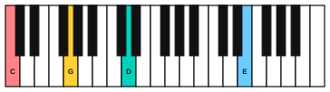

# Ambient piano

<span class="tag tag-piano">Piano</span>

After this lesson you can play a slow, quiet piano piece in an ambient style, with wide spacing, open fifths and add9 colours, the pedal held across bars, and silence treated as part of the music.

Before this: [Legato pedalling](02-legato-pedalling.md), [Half pedal, una corda and sostenuto](03-half-pedal-una-corda-and-sostenuto.md), [Alberti bass and waltz bass](04-alberti-and-waltz-bass.md), [Triads](../04-intervals-and-triads/04-triads.md), [Chord symbols and chord charts](../05-minor-keys-and-chord-charts/04-chord-symbols-and-chord-charts.md). You need: your piano.

## The idea

### Sound first: music that leaves room

Listen to the piece in this lesson once, with your eyes closed. It is slow, with long notes and silence between them, and it sounds more like a quiet room than a tune. Piano music in this style is often heard in games, films and study playlists, where it sits in the background and does not ask for attention. We call it **ambient**: music meant to set a mood rather than tell a story.

Four things make the sound.

1. A slow tempo, around 54 beats per minute, with few notes in each bar.
2. Wide spacing: low notes in the left hand and the melody far above them, with a gap in between where nothing plays.
3. Open chords, built from the root and the fifth with one colour note added.
4. The damper pedal held for a whole chord, two bars or more, so the notes blend.

### Open fifths and add9

An **open fifth** is a root and the note a fifth above it, with no third in between. C and G is an open fifth. Without the third it is neither major nor minor, so it sounds spacious and unfinished.

An **add9 chord** is a major or minor triad with the ninth added: the note a whole step above the root, one octave higher. Cadd9 is C, E, G and D. The D sounds soft against the chord and gives it a shimmer without the pull of a seventh. In this piece the left hand plays the root, the fifth and the ninth, and leaves out the third. The melody supplies the third and other notes.



The left-hand chords in the piece are:

| Chord | Left-hand notes | What they are |
|---|---|---|
| Cadd9 | C2, G2, D3 | root, fifth, ninth |
| Fadd9 | F2, C3, G3 | root, fifth, ninth |
| Am add9 | A2, E3, B3 | root, fifth, ninth |
| Gadd9 | G2, D3, A3 | root, fifth, ninth |

If C2 to D3 is too wide for your hand, roll the chord upward slowly from the bottom note, or leave out the top note.

### The pedal across bars

In lesson 2 you changed the pedal for every new chord. Here each chord lasts two bars, so the pedal stays down for both. The left hand plays the chord in the first bar and rests in the second, and the pedal keeps the chord ringing. When the next chord comes, play its low note first, then change the pedal right after it, as in legato pedalling.

Notes in the melody are all taken from the chord and its ninth, so even with the pedal down they do not clash with it.

### Silence

Rests are part of the piece. In bars 2, 4 and 6 the melody stops after a long note while the pedal keeps the sound alive, and the left hand rests in every even bar. Count the rests: they are quiet beats, not gaps to hurry through.

## Hear and see

Still Water is an original piece for this book. It is 20 bars in C major in 4/4 at about 54 bpm. Bars 1 to 8 present the idea, bars 9 to 16 climb higher, and bars 17 to 20 return and fade. The pedal marks sit under the left-hand chords: `Ped.` where you press, `*Ped.` where you change.

```abc
X:1
T:Still Water
C:Original, for this book
M:4/4
L:1/4
Q:1/4=54
K:C
%%score {RH LH}
V:RH clef=treble
V:LH clef=bass
[V:RH] !pp!z2 G2 | E3 z | z2 A2 | G3 z |
[V:LH] "_Ped."[C,,G,,D,]4 | z4 | "_*Ped."[F,,C,G,]4 | z4 |
[V:RH] z2 c2 | B3 z | z2 d2 | B2 G2 |
[V:LH] "_*Ped."[A,,E,B,]4 | z4 | "_*Ped."[G,,D,A,]4 | z4 |
[V:RH] !p!z E G c | d4 | c A F2 | G4 |
[V:LH] "_*Ped."[C,,G,,D,]4 | z4 | "_*Ped."[F,,C,G,]4 | z4 |
[V:RH] B d g2 | a4 | g e c2 | d2 c2 |
[V:LH] "_*Ped."[G,,D,A,]4 | z4 | "_*Ped."[C,,G,,D,]4 | z4 |
[V:RH] !pp!z2 A2 | G3 z | z2 E2 | !fermata!c4 |]
[V:LH] "_*Ped."[F,,C,G,]4 | z4 | "_*Ped."[C,,G,,D,]4 | "_* lift slowly"z4 |]
```

### How to learn it

Learn the piece in chunks of two bars, one chord each. These are the sections.

| Bars | Chord | What to learn |
|---|---|---|
| 1 to 2 | Cadd9 | The left-hand chord, then the two melody notes |
| 3 to 4 | Fadd9 | The pedal change after the new low F |
| 5 to 8 | Am add9, then Gadd9 | The higher melody and the rests |
| 9 to 12 | C, then F | The rising line in bar 9 |
| 13 to 16 | G, then C | The high notes G5 and A5; keep them soft |
| 17 to 20 | F, then C | The slow fade and the fermata |

Play it with the weight of your arm and no sharp attack. Use p or pp. Let each note sink into the pedal and listen to it fade before the next one. On the final C, hold the fermata and lift the pedal slowly so the sound fades out.

Common mistake: speeding up through the rests. Count "1 2 3 4" in your head through each silent bar.

If a hand, wrist or arm aches, stop and rest. If it keeps happening, see a teacher or a doctor.

## Try it

Exercise 1. Name the three notes in the left-hand chord of bars 5 and 6, and say which is the ninth.

<details class="solution" markdown>
<summary>Answer</summary>

A, E and B. A is the root, E is the fifth and B is the ninth (a whole step above A, one octave up).

</details>

Exercise 2. Why does the melody still sound clean with the pedal held for two bars?

<details class="solution" markdown>
<summary>Answer</summary>

Its notes belong to the chord (or are its ninth), so the held notes do not clash.

</details>

Exercise 3. What is an open fifth, and why does it sound neither major nor minor?

<details class="solution" markdown>
<summary>Answer</summary>

A root and the note a fifth above it. It has no third, and the third is the note that makes a chord major or minor.

</details>

<div class="practice" markdown>

### Practice routine (30 minutes)

| Minutes | What to do | Tempo | Listen for |
|---|---|---|---|
| 5 | Warm-up: play the four left-hand chords one after another, one bar each, pedal changed after each new low note | 54 bpm | Each old chord disappearing cleanly |
| 15 | New skill: Still Water in the sections above, hands separately, then together, adding the pedal last | 54 bpm | Silence counted in the rests |
| 5 | Reading: lesson 4 example Window Seat, hands together | 66 bpm | The left hand quieter than the right |
| 5 | Guitar: Am, C and G, one strum per bar | 60 bpm | Every string ringing |

Repeat this routine on at least five days. A whole piece takes more than three.

</div>

<div class="move-on" markdown>

### Move on when

- [ ] You can play Still Water with the pedal at 54 bpm, three times in a row with no stops and no blur at the chord changes.
- [ ] You can hold every rest for its full length by counting in your head.
- [ ] You can record yourself and hear the left hand quieter than the melody in every bar.
- [ ] You can name an open fifth and an add9 chord and point to one of each in the piece.

</div>

## Common mistakes

Playing the melody louder when the notes get high. Keep p or pp all the way.

Changing the pedal on every melody note. The chord has not changed, so the pedal stays.

Rushing the rests. Count them.

## Key terms

- **Ambient**: music meant to set a mood, often slow and quiet.
- **Open fifth**: a root and its fifth, with no third.
- **add9 chord**: a triad with the ninth added.
- **Spacing**: the distance between the notes of a chord or between the hands.

Next: [Sus and add9 chords](06-sus-and-add9-chords.md)
