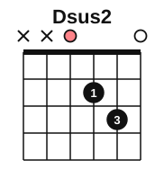
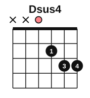
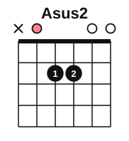
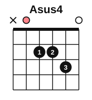
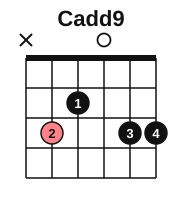
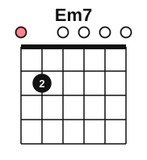

# Sus and add9 chords

<span class="tag tag-guitar">Guitar</span>

After this lesson you can play Dsus2, Dsus4, Asus2, Asus4, Cadd9 and Em7, say how each differs from the chord it grows from, and change between them at 60 bpm.

Before this: [The A minor and D chords](../02-two-hands-and-first-chords/06-chords-a-minor-and-d.md), [Chords C, G and D minor](../03-the-major-scale-and-keys/06-chords-c-g-and-d-minor.md), [Triads](../04-intervals-and-triads/04-triads.md), [Ambient piano](05-ambient-piano.md). You need: your guitar, a pick and a tuner.

## The idea

### Sound first: D that does not settle

Strum your D chord (strings 4 to 1: x x 0 2 3 2). Now lift your middle finger from string 1, so string 1 rings open, and strum again. It sounds open and light, and it leans toward the D you had before. That new chord is a Dsus2.

### What sus means

A major or minor chord has a third: the note that decides if it is major or minor. A **suspended chord** (sus chord) replaces the third with a neighbour. In a **sus2** chord the third is replaced by the 2nd, the note a whole step above the root. In a **sus4** chord it is replaced by the 4th, the note a half step above the major 3rd. Either one is neither major nor minor.

| Chord | Root, then the replacement | Notes |
|---|---|---|
| D | D, F#, A | major triad |
| Dsus2 | D, E, A | F# becomes E |
| Dsus4 | D, G, A | F# becomes G |
| A | A, C#, E | major triad |
| Asus2 | A, B, E | C# becomes B |
| Asus4 | A, D, E | C# becomes D |

Sus chords sound unsettled and often lead back to the plain chord. "Suspended" means the sound hangs, waiting to settle.

### add9 chords

An **add9 chord** is a triad with the 9th added, which is the 2nd note of the scale one octave higher. Cadd9 is C, D, E, G. Unlike a sus2 chord, it keeps the third. The extra note adds a soft shimmer. Lesson 5 used add9 chords on the piano.

### The shapes

Dsus2 and Dsus4 use strings 4 to 1.





Dsus2 is the D chord with the finger on string 1 lifted: finger 1 on string 3, fret 2, finger 3 on string 2, fret 3, and string 1 open. Dsus4 puts finger 4 on string 1, fret 3.

Asus2 and Asus4 use strings 5 to 1.





Asus2 is the A chord with two fingers: 1 on string 4, fret 2 and 2 on string 3, fret 2. Strings 2 and 1 ring open. Asus4 adds finger 3 on string 2, fret 3.

Cadd9 and Em7:





Cadd9 is x 3 2 0 3 3: finger 2 on string 5, fret 3, finger 1 on string 4, fret 2, string 3 open, finger 3 on string 2, fret 3 and finger 4 on string 1, fret 3. The notes are C, E, G, D and G. Em7 is Em with finger 3 lifted: finger 2 on string 5, fret 2, and strings 4 to 1 open. Em7 is E, G, B, D, which is Em with the 7th (D) added (7th chords get a full lesson in [Open seventh chords](../04-intervals-and-triads/06-open-seventh-chords.md)).

Common mistake: muting string 1 in Cadd9 with the underside of finger 3. Arch finger 3 so its tip presses string 2 and the string below rings.

## Hear and see

Listen to D, Dsus4 and Dsus2 in turn. Each chord is one strum for a bar, played on strings 4 to 1. The sus chords sound as if the D is about to move.

```abc
%%opts tab=guitar
X:1
M:4/4
L:1/4
Q:1/4=60
K:C clef=treble-8
"D"[DAd^f]4 | "Dsus4"[DAdg]4 | "Dsus2"[DAde]4 | "D"[DAd^f]4 |]
```

Now a four-chord loop with Cadd9 and Em7. Strum each chord once per bar and listen for the bright, open sound.

```abc
%%opts tab=guitar
X:1
M:4/4
L:1/4
Q:1/4=60
K:C clef=treble-8
"Cadd9"[CEGdg]4 | "G"[G,B,DGBg]4 | "Em7"[E,B,DGBe]4 | "Dsus4"[DAdg]4 |]
```

## Try it

Exercise 1. Spell Asus4.

<details class="solution" markdown>
<summary>Answer</summary>

A, D, E. The C# of A major is replaced by D, the 4th.

</details>

Exercise 2. How does Dsus2 differ from D?

<details class="solution" markdown>
<summary>Answer</summary>

The F# is replaced by E. D major is D, F#, A and Dsus2 is D, E, A.

</details>

Exercise 3. Which of Cadd9 and Csus2 keeps the third?

<details class="solution" markdown>
<summary>Answer</summary>

Cadd9 keeps the third (E). Csus2 is C, D, G and replaces it.

</details>

<div class="practice" markdown>

### Practice routine (30 minutes)

| Minutes | What to do | Tempo | Listen for |
|---|---|---|---|
| 5 | Warm-up: D, Dsus4, Dsus2 and back, two strums per chord | 60 bpm | Fingers 1 and 3 staying close to the fret |
| 15 | New skill: build each of the six chords, pluck each string, then play the loop in the second example; one-minute changes between Asus2 and Asus4, then Dsus2 and Dsus4 | 60 bpm | Every string ringing, no buzz |
| 5 | Piano: Still Water, bars 1 to 8, with the pedal | 54 bpm | The old chord disappearing at the change |
| 5 | Reading: name the chord tones of Asus2 and Dsus4 aloud | Untimed | The replaced third |

Repeat this routine on at least four days.

</div>

<div class="move-on" markdown>

### Move on when

- [ ] You can place each of the six chords and strum every sounding string cleanly, three times in a row.
- [ ] You can change Asus2 to Asus4 and back 15 times in one minute.
- [ ] You can play the second example at 60 bpm without stopping, three times in a row.
- [ ] You can spell Dsus2, Dsus4, Asus2, Asus4 and Cadd9 without looking.

</div>

## Common mistakes

Muting the open strings with the underside of a finger. Arch the fingers.

Playing the sus chords with all six strings. Dsus2 and Dsus4 use only strings 4 to 1; the A chords use strings 5 to 1.

Treating a sus chord as a mistake. It is a different sound, and it often leads back to the plain chord.

## Key terms

- **Suspended chord (sus chord)**: a chord with the third replaced by the 2nd (sus2) or the 4th (sus4).
- **add9 chord**: a triad with the 9th added; the third stays.
- **Em7**: E minor with the 7th, D, added.

Next: [Power chords](07-power-chords.md)
