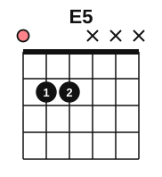
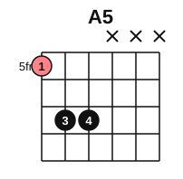

# Power chords

<span class="tag tag-guitar">Guitar</span>

After this lesson you can play a power chord on strings 6 and 5, move it to any root on string 6, and play palm-muted eighth notes with it for a driving, heroic sound.

Before this: [Notes on strings 6 and 5](../03-the-major-scale-and-keys/05-notes-on-strings-6-and-5.md), [Eighth-note strumming](../04-intervals-and-triads/09-eighth-note-strumming.md), [Muting and sixteenth-note strumming](../05-minor-keys-and-chord-charts/13-muting-and-sixteenth-strumming.md). You need: your guitar, a pick and a tuner.

## The idea

### Sound first: a chord with no third

Strum the open strings 6, 5 and 4 together, then press finger 2 on string 5, fret 2, and finger 3 on string 4, fret 2, and strum those three strings again. That is E5. It is bare and strong, and it is neither happy nor sad.

### What a power chord is

A **power chord** is a chord made of the root and the note a fifth above it, often with the root repeated an octave higher. It has no third, so it is neither major nor minor. The symbol is the root with a 5: E5, A5, G5. The notes of E5 are E and B (E, B, E with the octave added).

The sound is open and loud, which is why rock and film guitar use power chords. They also work on an acoustic guitar, though softer than on an electric one with a distorted tone.

### The shape



The open E5 is on strings 6 to 4: 0 2 2. To move the shape up the neck, the root goes on string 6 and the shape keeps the same pattern, which is a root on string 6, the 5th two frets higher on string 5, and the octave two frets higher on string 4.

1. Put finger 1 on string 6 at the fret of the note you want as the root.
2. Put finger 3 on string 5, two frets higher.
3. Put finger 4 on string 4, two frets higher, the same fret as finger 3.
4. Strum only strings 6, 5 and 4. The three higher strings must stay silent.

(Fingers 3 and 4 can be replaced by one finger laid across both strings.) The shape is **movable**, because it has no open strings. Find the root with the note names you learned on string 6.

| Root fret on string 6 | Root note | Power chord | Frets on strings 6, 5, 4 |
|---|---|---|---|
| 1 | F | F5 | 1 3 3 |
| 3 | G | G5 | 3 5 5 |
| 5 | A | A5 | 5 7 7 |
| 7 | B | B5 | 7 9 9 |
| 8 | C | C5 | 8 10 10 |
| 10 | D | D5 | 10 12 12 |




Common mistake at step 4: the thin strings ring too. Lay the underside of finger 1 lightly across strings 3 to 1 so they are muted, and aim the pick at string 6.

### Palm-muted eighths

You learned palm muting in stage 5. Rest the edge of the picking hand lightly on the strings next to the bridge, so the notes sound short and thudding. For a **palm-muted eighth** pattern, play eight down strokes in a bar, all muted, on the root note or a power chord. The effect is a steady chug underneath, like a drum.

Heroic film sound comes from this chug with a power chord opening up on the first beat: mute the strings for the chug, then lift the palm on beat 1 of the next bar to let the chord ring.

## Hear and see

Listen to palm-muted eighths on the A root, two bars of them. The staff shows the notes an octave above the sound.

```abc
X:1
M:4/4
L:1/8
Q:1/4=80
K:C clef=treble-8
"^palm mute"A,A,A,A, A,A,A,A, | "^palm mute"A,A,A,A, A,A,A,A, |]
```

Now a loop with power chords A5, F5, G5 and A5. Each chord rings for a bar. The chord roots are A (5th fret), F (1st fret) and G (3rd fret) on string 6.

```abc
X:1
M:4/4
L:1/4
Q:1/4=80
K:C clef=treble-8
"A5"[A,EA]4 | "F5"[F,CF]4 | "G5"[G,DG]4 | "A5"[A,EA]4 |]
```

Put the two together: let the chord ring on beats 1 and 4, and palm mute the four eighths on beats 2 and 3.

```abc
X:1
M:4/4
L:1/8
Q:1/4=80
K:C clef=treble-8
"A5"[A,EA]2 [A,EA][A,EA] [A,EA][A,EA] [A,EA]2 | "F5"[F,CF]2 [F,CF][F,CF] [F,CF][F,CF] [F,CF]2 | "G5"[G,DG]2 [G,DG][G,DG] [G,DG][G,DG] [G,DG]2 | "A5"[A,EA]8 |]
```

## Try it

Exercise 1. What are the notes of A5?

<details class="solution" markdown>
<summary>Answer</summary>

A and E (with A repeated an octave higher): A, E, A.

</details>

Exercise 2. Where is the G5 power chord on the neck, with the root on string 6?

<details class="solution" markdown>
<summary>Answer</summary>

Fret 3 on string 6, then fret 5 on strings 5 and 4: 3 5 5.

</details>

Exercise 3. Why is a power chord neither major nor minor?

<details class="solution" markdown>
<summary>Answer</summary>

It has no third. The third decides if a chord is major or minor.

</details>

<div class="practice" markdown>

### Practice routine (30 minutes)

| Minutes | What to do | Tempo | Listen for |
|---|---|---|---|
| 5 | Warm-up: open E5, strumming strings 6 to 4, 4 strums per bar | 60 bpm | Only three strings sounding |
| 15 | New skill: build A5, G5 and F5 on strings 6 to 4, 10 clean strums each; then palm-muted eighths on A5; then the loop A5, F5, G5, A5 | 60 bpm, then 80 | Short, even muted notes; a clean ring on beat 4 |
| 5 | Piano: Still Water, bars 1 to 8, pedal changes | 54 bpm | The old chord gone at each change |
| 5 | Reading: name the root of a power chord at frets 1, 3, 5, 7, 8 and 10 on string 6 | Untimed | Fast, accurate note names |

Repeat this routine on at least three days.

</div>

<div class="move-on" markdown>

### Move on when

- [ ] You can play A5, F5 and G5, three strings sounding and the others silent, three times in a row.
- [ ] You can play eight palm-muted eighths at 80 bpm, in time and evenly.
- [ ] You can name the root and frets of power chords on string 6 from fret 1 to fret 10.
- [ ] You can play the third example at 80 bpm through the four bars, three times in a row.

</div>

## Common mistakes

Letting strings 3 to 1 ring. They add a third and sound muddy. Mute them with the underside of finger 1.

Pressing the palm too hard on the muted eighths. The notes die. Rest the hand lightly.

Rushing the change. Count the beat out loud and move early.

## Key terms

- **Power chord**: a chord made of the root and the fifth, often with the root repeated an octave higher.
- **Movable shape**: a chord shape with no open strings, so it can be moved to any fret.
- **Palm mute**: resting the picking hand lightly on the strings near the bridge for short, thudding notes.

Next: [Hearing chord progressions](08-hearing-progressions.md)
