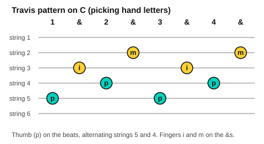

# Travis picking

<span class="tag tag-guitar">Guitar</span>

After this lesson you can play the Travis thumb pattern on C, G and Am, keep the thumb steady while the fingers move, and add melody notes on the top strings.

Before this: [Fingerpicking basics](../05-minor-keys-and-chord-charts/10-fingerpicking-basics.md), [Chords C, G and D minor](../03-the-major-scale-and-keys/06-chords-c-g-and-d-minor.md), [The A minor and D chords](../02-two-hands-and-first-chords/06-chords-a-minor-and-d.md). You need: your guitar, a pick or your fingers (this lesson uses fingers), a tuner and a metronome.

## The idea

### Sound first: a steady thumb

Listen to the first example. The low notes go on steadily, one on each beat, and the higher notes fall in between. It sounds like two players: a bass and a tune. You do it with one hand.

```abc
%%opts tab=guitar
X:1
M:4/4
L:1/8
Q:1/4=60
K:C clef=treble-8
"C"C G E c C G E c | "C"C G E c C G E c |]
```

This is **Travis picking**. The thumb plays a steady bass, alternating between two low strings on every beat, and the fingers play higher strings between the thumb notes. It is named after the guitarist Merle Travis.

### The picking hand

You use the picking-hand letters from the fingerpicking lesson: p for the thumb, i for the index, m for the middle and a for the ring finger. The thumb plays strings 6, 5 and 4. The fingers play strings 3, 2 and 1.

The pattern for a bar of 4/4 in eighth notes, counted "1 & 2 & 3 & 4 &":

| Count | 1 | & | 2 | & | 3 | & | 4 | & |
|---|---|---|---|---|---|---|---|---|
| Hand | p | i | p | m | p | i | p | m |
| C chord string | 5 | 3 | 4 | 2 | 5 | 3 | 4 | 2 |



The thumb never stops and never rushes. The fingers fit between the thumb notes. Keep your hand relaxed, with the wrist neither bent up nor down.

### Learning the pattern

Follow these steps.

1. Hold the C chord (x 3 2 0 1 0) with your fretting hand.
2. Play only the thumb: string 5, string 4, string 5, string 4, one on each beat, at 50 bpm.
3. Add the index finger on string 3 on the first "&" and the third "&".
4. Add the middle finger on string 2 on the second "&" and the fourth "&".
5. Count aloud "1 & 2 & 3 & 4 &" until the whole bar is smooth.

Common mistake at step 3: the thumb slows down when the fingers join. Keep the thumb steady, and let it lead the pattern.

### C, G and Am

The pattern is the same shape on every chord. Only the strings change.

| Chord | Frets (strings 6 to 1) | Thumb strings | Finger strings |
|---|---|---|---|
| C | x 3 2 0 1 0 | 5 then 4 | 3 then 2 |
| G | 3 2 0 0 0 3 | 6 then 4 | 3 then 2 |
| Am | x 0 2 2 1 0 | 5 then 4 | 3 then 2 |

On G the thumb plays the low G on string 6 and the open D on string 4. On C and Am the thumb plays the root on string 5 and a note on string 4. Move the pattern when the chord changes, and keep the thumb count going.

### Adding melody notes

Once the thumb pattern is steady, you can put a tune on the top strings. Replace a finger note with a melody note, usually on string 1 or string 2, and keep the thumb going underneath. Use finger m or a for the melody note. In the example below the last note of each bar is a melody note on string 1.

```abc
%%opts tab=guitar
X:1
M:4/4
L:1/8
Q:1/4=60
K:C clef=treble-8
"C"C G E c C G E e | "G"G, G D B G, G D g | "Am"A, A E c A, A E e | "C"C G E c C4 |]
```

Listen for the thumb staying even and the melody notes (e, g, e) standing out slightly. If the melody notes are too quiet, pluck them a little more firmly.

## Try it

Exercise 1. Which fingers play strings 3, 2 and 1 in Travis picking?

<details class="solution" markdown>
<summary>Answer</summary>

Index (i) on string 3, middle (m) on string 2, ring (a) on string 1. The thumb (p) plays the strings below.

</details>

Exercise 2. On a G chord, which strings does the thumb play?

<details class="solution" markdown>
<summary>Answer</summary>

String 6 (low G) and string 4 (open D).

</details>

Exercise 3. In the count "1 & 2 & 3 & 4 &", which counts does the thumb play?

<details class="solution" markdown>
<summary>Answer</summary>

The numbers: 1, 2, 3 and 4.

</details>

<div class="practice" markdown>

### Practice routine (30 minutes)

| Minutes | What to do | Tempo | Listen for |
|---|---|---|---|
| 5 | Warm-up: thumb only on C, strings 5 and 4 on every beat | 60 bpm | A steady, even thumb |
| 15 | New skill: the full pattern on C, then G, then Am, 8 bars each; then the melody example | 50 bpm, then 60 | The thumb unchanged when the fingers join |
| 5 | Piano: Still Water, bars 1 to 8 | 54 bpm | The old chord gone at the change |
| 5 | Reading: count "1 & 2 & 3 & 4 &" aloud over the thumb notes | 60 bpm | Fingers falling between the thumb notes |

Repeat this routine on at least five days.

</div>

<div class="move-on" markdown>

### Move on when

- [ ] You can play the Travis pattern on C, G and Am at 60 bpm for 8 bars each with the thumb steady.
- [ ] You can change between C, G and Am without losing the thumb count.
- [ ] You can play the melody example at 60 bpm, three times in a row with no stops.
- [ ] You can say which strings the thumb and which strings the fingers play on each of the three chords.

</div>

## Common mistakes

Letting the thumb speed up or drop out when the fingers play. The thumb is the clock. Practise it alone first.

Plucking with a bent, tense wrist. The hand tires. Keep the wrist relaxed.

Hitting the thumb strings with the fingers. Check which string each finger plays.

If a hand, wrist or arm aches, stop and rest. If it keeps happening, see a teacher or a doctor.

## Key terms

- **Travis picking**: a fingerstyle pattern in which the thumb alternates between two bass strings on every beat while the fingers play the higher strings.
- **Alternating bass**: the thumb moving between two bass strings, one on each beat.

Next: [Ambient guitar arpeggios](12-ambient-guitar-arpeggios.md)
