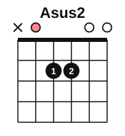
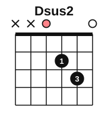
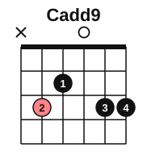
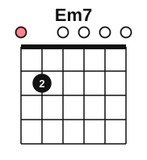

# Ambient guitar arpeggios

<span class="tag tag-guitar">Guitar</span>

After this lesson you can play an original ambient guitar piece of rolling arpeggios on sus, add9 and minor 7 shapes, let the open strings ring across the changes, and hear what a capo does to the colour.

Before this: [Sus and add9 chords](06-sus-and-add9-chords.md), [Travis picking](11-travis-picking.md), [Ambient piano](05-ambient-piano.md), [Fingerpicking basics](../05-minor-keys-and-chord-charts/10-fingerpicking-basics.md), [The capo and moving shapes](../05-minor-keys-and-chord-charts/07-capo-and-moving-shapes.md). You need: your guitar, a tuner, a metronome and your capo.

## The idea

### Sound first: strings left to ring

Play the Asus2 chord (x 0 2 2 0 0) and pluck its strings one at a time from the lowest to the highest, letting each one ring after you play it. By the time you reach string 1, the first notes are still sounding. The notes blend into one soft chord. This is a **ringing arpeggio**: a broken chord where every note is allowed to sound until the chord changes.

A guitar is good at this because its open strings keep ringing without any fretting. Chords with many open strings, like the sus and add9 shapes in lesson 6, have the most ring.

### The pattern

An **arpeggio** is a chord played one note at a time. This piece uses one pattern of eight eighth notes, rising from the bass strings to string 1 and then back down two strings:

1. Thumb (p) on the two or three lowest strings of the chord, one note each.
2. Index (i) on string 3.
3. Middle (m) on string 2.
4. Ring (a) on string 1.
5. Then middle (m), index (i), and the thumb on the way back.

Play it at a slow tempo, 60 bpm for a quarter note, and keep it even and quiet. Do not mute any string. Lift your fretting fingers only when the chord changes.

### The chords

The piece uses the shapes from lesson 6.









Asus4 and Dsus4 appear once each, for a moment of lean before the open sound returns.

### The capo for colour

A capo clamped across a fret raises the pitch of every string. The shapes stay the same. With the capo on fret 2, the Asus2 shape sounds as Bsus2 (B, C#, F#), the Dsus2 shape as Esus2 (E, F#, B), the Cadd9 shape as Dadd9 (D, F#, A, E) and the Em7 shape as F#m7 (F#, A, C#, E). Everything sounds a whole step higher and a little brighter. With the capo on fret 5 it sounds higher still, but you play the same fingers. Try the capo at several frets after you can play the piece without it, and notice how the mood changes.

## Hear and see

Open Air is an original piece for this book. It is 16 bars in 4/4 at 60 bpm, with one chord per bar. Bars 1 to 8 present four chords, two bars each. Bars 9 to 15 vary them with Asus4 and Dsus4. Bar 16 is one rolled chord that you let ring away. The staff shows the notes an octave above where they sound.

```abc
%%opts tab=guitar
X:1
T:Open Air
C:Original, for this book
M:4/4
L:1/8
Q:1/4=60
K:C clef=treble-8
"Asus2"A,EABeBAE | "Asus2"A,EABeBAB | "Dsus2"DAdedADA | "Dsus2"DAdedADA |
"Cadd9"CEGdgdGE | "Cadd9"CEGdgdGE | "Em7"E,B,DGBeBG | "Em7"E,B,DGBeBG |
"Asus2"A,EABeBAE | "Asus4"A,EAdedAE | "Dsus2"DAdedADA | "Dsus4"DAdgdADA |
"Cadd9"CEGdgdGE | "Em7"E,B,DGBeBG | "Asus2"A,EABeBAE | "Asus2"[A,EABe]8 |]
```

### How to learn it

1. Learn the pattern on Asus2 alone: four bars, then rest.
2. Add Dsus2, then Cadd9, then Em7, two bars each, in order.
3. Practise the chord changes at the bar line: when the pattern reaches its last note, your fretting hand is already moving. Keep your thumb counting.
4. Add the variations in bars 10 and 12.
5. Play the whole piece, then play it with the capo on fret 2.

Common mistake at step 3: stopping the pattern while changing. The change is part of the music. If a change is late, repeat the last two notes of the old chord until the new shape is down, then continue.

## Try it

Exercise 1. What does the capo on fret 2 do to the Cadd9 shape?

<details class="solution" markdown>
<summary>Answer</summary>

It sounds as Dadd9 (D, F#, A, E), a whole step higher. The fingers do not change.

</details>

Exercise 2. Which strings does the index finger play in the arpeggio pattern?

<details class="solution" markdown>
<summary>Answer</summary>

String 3. The middle finger plays string 2 and the ring finger plays string 1.

</details>

Exercise 3. What makes this piece ambient, in your own words?

<details class="solution" markdown>
<summary>Answer</summary>

It is slow and quiet, the arpeggio rings on without being muted, the chords are open sus and add9 shapes, and the notes blend instead of standing apart. Any answer along those lines is fine.

</details>

<div class="practice" markdown>

### Practice routine (30 minutes)

| Minutes | What to do | Tempo | Listen for |
|---|---|---|---|
| 5 | Warm-up: the pattern on Asus2 alone, 4 bars | 50 bpm | Every note ringing into the next |
| 15 | New skill: Open Air in the steps above, 4 bars at a time, then the whole piece | 50 bpm, then 60 | Even eighth notes and quiet thumb notes |
| 5 | Piano: Still Water, bars 1 to 8, with the pedal | 54 bpm | The old chord gone at the change |
| 5 | Reading: name the notes of Asus2, Dsus2, Cadd9 and Em7 from memory | Untimed | Correct spellings |

Repeat this routine on at least six days.

</div>

<div class="move-on" markdown>

### Move on when

- [ ] You can play Open Air from bar 1 to bar 16 at 60 bpm, three times in a row with no stops.
- [ ] You can hear every string ringing in the Asus2 bars, with no buzzing or muted note.
- [ ] You can play the first four bars with the capo on fret 2 and name the chords you now sound.
- [ ] You can record yourself and keep the thumb notes quieter than the fingers.

</div>

## Common mistakes

Playing too loud. Ambient music is soft. Keep the pick-hand movement small.

Muting a string with a fretting finger. Arch the fingers.

Rushing the changes. Keep the count and let a change be late rather than stopping.

If a hand, wrist or arm aches, stop and rest. If it keeps happening, see a teacher or a doctor.

## Film yourself

Film your picking hand and fretting hand.

Watch: [How to Play Arpeggios Guitar - Beginners Guide - Guitar Lesson [AR-101]](https://www.youtube.com/watch?v=6o3lWAnWCig) by JustinGuitar (free, on YouTube).

Check that:

- the thumb and fingers move a short distance from the strings,
- the wrist is relaxed,
- the fretting fingers are arched and the open strings are free.

## Key terms

- **Arpeggio**: a chord played one note at a time.
- **Ringing arpeggio**: an arpeggio in which each note is allowed to sound until the chord changes.
- **Capo**: a clamp across a fret that raises the pitch of all the strings.

Next: [Every note on the fretboard](../08-fretboard-barre-chords-and-caged/01-fretboard-all-notes.md)
