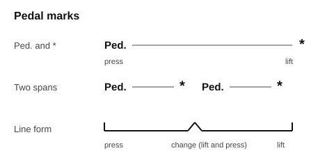
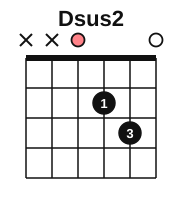
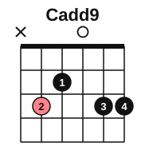
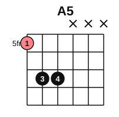
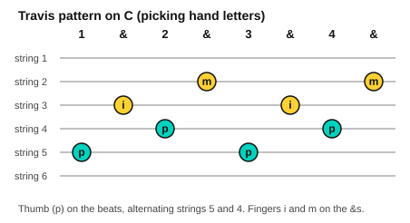

# Stage 7: Pedal, texture and ambient

This stage teaches your right foot and gives your hands new patterns. On the piano you learn the damper pedal and how to change it cleanly, what the other two pedals do, two left-hand accompaniment patterns, a quiet ambient piece, voicing a melody, and a Tchaikovsky piece. On the guitar you learn sus and add9 chords, power chords, Travis picking, and an ambient arpeggio piece. You also train your ear to follow a bass line and hear whether a progression comes home. It usually takes about 6 to 8 weeks at 30 minutes a day.

<!-- lessons:start -->
## Lessons

1. [The damper pedal](01-damper-pedal.md) (piano)
2. [Legato pedalling](02-legato-pedalling.md) (piano)
3. [Half pedal, una corda and sostenuto](03-half-pedal-una-corda-and-sostenuto.md) (piano)
4. [Alberti bass and waltz bass](04-alberti-and-waltz-bass.md) (piano)
5. [Ambient piano](05-ambient-piano.md) (piano)
6. [Sus and add9 chords](06-sus-and-add9-chords.md) (guitar)
7. [Power chords](07-power-chords.md) (guitar)
8. [Hearing chord progressions](08-hearing-progressions.md) (ear)
9. [Voicing the melody](09-voicing-the-melody.md) (piano)
10. [Tchaikovsky: Old French Song](10-tchaikovsky-album-for-the-young.md) (piano)
11. [Travis picking](11-travis-picking.md) (guitar)
12. [Ambient guitar arpeggios](12-ambient-guitar-arpeggios.md) (guitar)

<!-- lessons:end -->

Download the stage 7 deck: [07-pedal-texture-and-ambient.apkg](../downloads/anki/07-pedal-texture-and-ambient.apkg)

## Cheat sheet

Everything to remember from this stage, on one page.

### Pedal marks and pedals

| Mark or pedal | Meaning |
|---|---|
| `Ped.` | Press the damper pedal (right after the notes) |
| `*` | Lift the pedal |
| `*Ped.` | Change: lift and press again, right after the new chord |
| Right pedal | Damper (sustain): lifts all the dampers |
| Middle pedal | Sostenuto: holds only the notes already down |
| Left pedal | Soft (una corda); tre corde cancels it |

Heel on the floor, ball of the foot on the pedal. Press after the chord. Change right after the new chord, and listen for blur. Check your manual for half pedalling and for what your middle pedal does.

### Left-hand patterns

| Pattern | Time | Notes on C | Fingers |
|---|---|---|---|
| Alberti bass | 4/4, eighth notes | C3, G3, E3, G3 | 5, 1, 3, 1 |
| Waltz bass | 3/4 | C3, then E3 and G3 twice | 5, then 3 and 1 |
| Ambient fifths | slow 4/4 | C2, G2, D3 held with the pedal | 5, 2, 1 |

Voicing: melody loudest, bass next, middle pattern quietest. The weight goes on the melody finger.

### Sus, add9 and 7th shapes

| Chord | Notes | Frets (strings 6 to 1) |
|---|---|---|
| Dsus2 | D, E, A | x x 0 2 3 0 |
| Dsus4 | D, G, A | x x 0 2 3 3 |
| Asus2 | A, B, E | x 0 2 2 0 0 |
| Asus4 | A, D, E | x 0 2 2 3 0 |
| Cadd9 | C, E, G, D | x 3 2 0 3 3 |
| Em7 | E, G, B, D | 0 2 0 0 0 0 |

### Power chords

A power chord is a root and a fifth (root, fifth, octave). Root on string 6, then two frets higher on strings 5 and 4.

| Chord | Frets on strings 6, 5, 4 |
|---|---|
| E5 | 0 2 2 |
| F5 | 1 3 3 |
| G5 | 3 5 5 |
| A5 | 5 7 7 |

Palm-muted eighths: eight muted down strokes in a bar, letting the chord ring on beat 1 or beat 4.

### Travis picking

Count "1 & 2 & 3 & 4 &". The thumb plays the numbers, alternating two bass strings. The fingers play the ands: i on string 3, m on string 2. On C: p5, i3, p4, m2, p5, i3, p4, m2.

### Chord progressions by ear

The bass note is the lowest note. I is the chord on note 1 (home), V is the chord on note 5. In C, I is C and V is G. A progression comes home when it ends on I.
