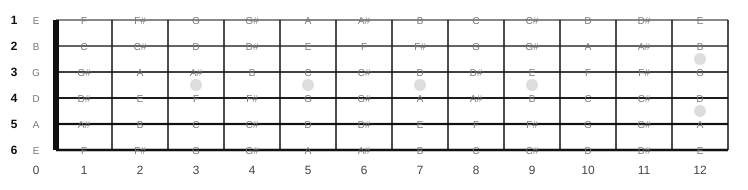
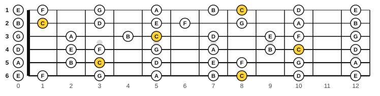
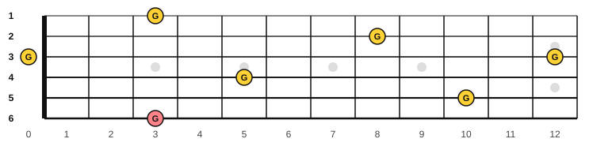

# Every note on the fretboard

<span class="tag tag-guitar">Guitar</span>

After this lesson you can name the note at any fret from 0 to 12 on all six strings, find the same note in several places using octave shapes, and use three methods to learn the neck a little each day.

Before this: [Notes on strings 6 and 5](../03-the-major-scale-and-keys/05-notes-on-strings-6-and-5.md), [Whole steps, half steps, sharps and flats](../03-the-major-scale-and-keys/01-whole-and-half-steps.md), [Reading notation on guitar](../03-the-major-scale-and-keys/11-reading-notation-on-guitar.md). You need: your guitar.

## The idea

### One pattern, six strings

You already know that one fret is one half step and that fret 12 is the open note an octave higher. The notes on every string follow the same cycle of twelve: A, A#, B, C, C#, D, D#, E, F, F#, G, G#, and then A again. Each string starts at a different place in the cycle. String 4 starts on D, so its frets give D, D#, E, F and so on. The map below shows all 72 positions from fret 0 to fret 12. Sharps are shown; every sharp also has a flat name (A# is Bb, for example).



The natural notes are easier to learn first, because there are only seven letters and the sharps fall in between. The only places where two natural notes sit one fret apart are E to F and B to C.



You know strings 6 and 5. Here are the other four, as frets from 0 to 12:

| String | Natural notes and their frets |
|---|---|
| 4 (D) | D 0, E 2, F 3, G 5, A 7, B 9, C 10, D 12 |
| 3 (G) | G 0, A 2, B 4, C 5, D 7, E 9, F 10, G 12 |
| 2 (B) | B 0, C 1, D 3, E 5, F 6, G 8, A 10, B 12 |
| 1 (E) | E 0, F 1, G 3, A 5, B 7, C 8, D 10, E 12 |

String 1 and string 6 are both tuned to E, so they have exactly the same letters at every fret. If you know string 6, you know string 1.

### Octave shapes

The same note appears on several strings. A pair of notes with the same letter name and twelve half steps apart is an octave. Octaves on the guitar form a fixed shape, because the strings are tuned the same way everywhere except between strings 3 and 2.

| Starting on string | The octave above is on | At fret |
|---|---|---|
| 6 | string 4 | 2 frets higher |
| 5 | string 3 | 2 frets higher |
| 4 | string 2 | 3 frets higher |
| 3 | string 1 | 3 frets higher |

Take G at string 6, fret 3. Skip string 5, and the octave above is on string 4, fret 5. Check it in the table above: string 4, fret 5 is G. The same rule works for any fret, so it moves with the note.



Here is the shape written as music: each pair is a note and the octave above it. The tab may show a different place for a note than the one you expect; play the note where the rule puts it.

```abc
%%opts tab=guitar
X:1
M:4/4
L:1/4
Q:1/4=70
K:C clef=treble-8
E, E A, A | D d G g |]
```

### Three ways to learn the neck

1. Anchor notes. Learn the notes on strings 6 and 5 until you can say them in two seconds. Every other note is found by counting from one of those, or by an octave shape.
2. Fret markers. The dots at frets 3, 5, 7 and 9, and the double dot at 12, help you count. On string 6, fret 5 is A and fret 7 is B; on string 5, fret 5 is D and fret 7 is E.
3. A little each day. Add one string every few days. The [fretboard drill](../practice/fretboard-drill.md) in Practice tools takes five minutes and times you.

Common mistake: counting every fret one by one from the nut. That is slow and error-prone. Jump to the nearest marker and count from there.

## Try it

Exercise 1. Name the notes at string 4 fret 7, string 3 fret 9, string 2 fret 6 and string 1 fret 10.

<details class="solution" markdown>
<summary>Answer</summary>

A, E, F and D. Check string 2: B at fret 0, C at 1, D at 3, E at 5, F at 6.

</details>

Exercise 2. B is at string 5, fret 2. Use the octave rule to find the B an octave higher.

<details class="solution" markdown>
<summary>Answer</summary>

String 3, fret 4 (string 5 to string 3, 2 frets higher). String 3 fret 4 is B.

</details>

Exercise 3. Which two frets give A on string 6 and on string 1?

<details class="solution" markdown>
<summary>Answer</summary>

Fret 5 on both. The two strings are both tuned to E, so the letters match fret for fret.

</details>

<div class="practice" markdown>

### Practice routine (30 minutes)

| Minutes | What to do | Tempo | Listen for |
|---|---|---|---|
| 5 | Warm-up: play each open string, then fret 12 on each, saying the name | 60 bpm | Fret 12 sounding in tune with the open string |
| 15 | New skill: strings 4 and 3 (then 2 and 1), frets 0 to 12 in natural notes, up and back, naming each | 60 bpm | Naming before you play, not after |
| 5 | Reading: the [fretboard drill](../practice/fretboard-drill.md), strings 6 to 3 | Untimed | Answers under 5 seconds |
| 5 | Piano: C major scale, hands separately | 60 bpm | Even volume across the thumb move |

Repeat this routine on at least three days.

</div>

<div class="move-on" markdown>

### Move on when

- [ ] You can say the note at any fret from 0 to 12 on strings 6 to 3 in under 5 seconds each.
- [ ] You can find every G from fret 0 to fret 12 in under 20 seconds.
- [ ] You can say the octave rule from any starting string (2 frets for strings 6 and 5, 3 frets for strings 4 and 3).
- [ ] You can name the naturals on strings 2 and 1 for frets 0 to 5.

</div>

## Common mistakes

Forgetting that string 2 is different. Strings 3 and 2 are a major 3rd apart, not a perfect 4th, so the octave rule changes from 2 frets to 3 frets there.

Learning flats and sharps before the naturals. Do the naturals first; the sharps are the frets in between.

Naming a note by counting from the nut every time. Use the fret markers and the octave shapes.

## Key terms

- **Octave shape**: the fixed pattern of an octave on the neck: skip a string and go up 2 frets (from strings 6 and 5) or 3 frets (from strings 4 and 3).
- **Fret marker**: the dots at frets 3, 5, 7, 9 and 12 that help you count.
- **Natural note**: a note with no sharp or flat.

Next: [E-shape barre chords](02-e-shape-barre-chords.md)
