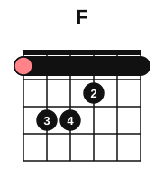
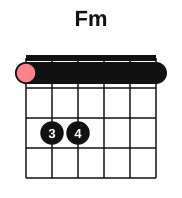
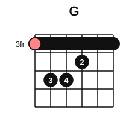
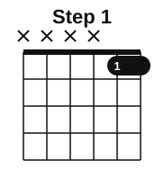
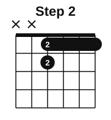

# E-shape barre chords

<span class="tag tag-guitar">Guitar</span>

After this lesson you can play the F major and F minor barre chords, move the E and Em shapes to any fret to make a major or minor chord with its root on string 6, and follow a safe plan for building barre strength.

Before this: [The E and A chords](../02-two-hands-and-first-chords/04-chords-e-and-a.md), [Chord diagrams and your first chord](../01-first-sounds/12-chord-diagrams-and-e-minor.md), [Every note on the fretboard](01-fretboard-all-notes.md), [The capo and moving shapes](../05-minor-keys-and-chord-charts/07-capo-and-moving-shapes.md). You need: your guitar and a pick.

## The idea

### A barre is a capo you hold

Last time you used a capo to move open shapes up the neck. A **barre** is the same idea with your own finger: finger 1 lies flat across all six strings at one fret and acts as a new nut. The other three fingers then play a shape in front of it. You can move the whole thing up and down the neck, so one shape gives you twelve chords. A chord played this way is a **barre chord**.

Start from the open E major chord: E, G#, B, at frets 0 2 2 1 0 0, played with fingers 2, 3 and 1. Move every finger up one fret, and shift each finger number up by one: finger 1 becomes 2, 2 becomes 3 and 3 becomes 4. Now the open strings are gone, so finger 1 takes over their job: it presses all six strings at fret 1. That is F major.



F major: F, A, C. The salmon dot is the root, F, on string 6. For F minor, lift finger 2 from string 3; the barre now plays that string. F minor: F, Ab, C. Compare the open Em, which has the same relationship to E.



Listen to the four chords below. Each one is the shape moved: F and Fm at fret 1, then G and Gm at fret 3. The tab may show a different place on the neck for a note; play the shape in the diagram.

```abc
%%opts tab=guitar
X:1
M:4/4
L:1/4
Q:1/4=60
K:C clef=treble-8
"F"[F,CFAcf]4 | "Fm"[F,CF_Acf]4 | "G"[G,DGBdg]4 | "Gm"[G,DG_Bdg]4 |]
```

### The name comes from string 6

The lowest note of an E-shape chord is its root, and the root is on string 6. So the chord's name is the note under your barre on string 6. That is why the last lesson matters: the fretboard map tells you the chord.

| Barre at fret | 1 | 2 | 3 | 4 | 5 | 6 | 7 | 8 | 9 | 10 | 11 |
|---|---|---|---|---|---|---|---|---|---|---|---|
| Root on string 6 | F | F# | G | G# | A | Bb | B | C | C# | D | Eb |

Fret 12 is E again, the open chord an octave higher. The major shape with the barre at fret 3 is G major: G, B, D. The minor shape at fret 3 is G minor: G, Bb, D. This E-shape is also the shape of the power chord you will meet in [Power chords](../07-pedal-texture-and-ambient/07-power-chords.md), with the 3rd left out.



On a chord diagram, a number on the left such as 3fr says which fret the top box is. The barre is the black bar across the strings.

### How to press a barre

1. Lay finger 1 across all six strings, close behind the fret wire, on the bony side edge of the finger. Roll the finger a little toward the headstock so the firm edge, not the soft pad, touches the strings.
2. Keep the thumb behind the neck, about opposite finger 2, with the elbow close to your body. The squeeze comes from the weight of the arm pulling the finger toward you, not from clamping the thumb.
3. Place fingers 2, 3 and 4 for the shape, curved, with the tips on the strings.
4. Strum slowly and listen string by string. A buzzing or dead string means a gap under finger 1. Roll the finger slightly or shift it a hair toward the fret wire.

Common mistake at step 2: squeezing with the thumb as hard as possible. That tires the hand in a few minutes and does not help the sound.

### A gradual plan

A full barre is the hardest thing on the guitar so far, and a steel-string acoustic needs more pressure than an electric or nylon guitar. Build it over weeks, in short sessions.

| Week | What to press | Where |
|---|---|---|
| 1 | Finger 1 across strings 1 and 2 only (a partial barre), then strings 1 to 3 | Fret 1, then fret 3 |
| 2 | Strings 1 to 4 with finger 1, plus finger 2 on string 3 | Fret 1, then fret 3 |
| 3 | The full F, all six strings, for a few seconds at a time | Fret 1; also try G at fret 3 |
| 4 on | Changes between E, Em, F, Fm and G | Slowly, with rests |





<div class="warning" markdown>

Pain is a stop sign. Barre chords stress the finger, the thumb, the wrist and the forearm. Work for one minute at a time, rest for at least a minute, and keep the barre section of a session to about ten minutes. Stop when a joint aches, a finger goes numb or tingles, or the wrist hurts. Soreness in the finger muscle that goes away overnight is normal; sharp or lasting pain is not. If it returns, see a teacher or a doctor. If the strings sit high above the fretboard, a repair shop can lower them (the action), which makes every barre chord easier.

</div>

The F chord at fret 1 is the hardest place for most hands. If it is out of reach this week, practise the same shape at fret 3 or fret 5 (G or A), where the frets are narrower.

## Try it

Exercise 1. Which chord is an E-shape major barre chord with its barre at fret 5? At fret 8?

<details class="solution" markdown>
<summary>Answer</summary>

A major at fret 5 (A, C#, E) and C major at fret 8 (C, E, G). The root is the note on string 6 under the barre.

</details>

Exercise 2. Where is the barre for B minor played as an E shape?

<details class="solution" markdown>
<summary>Answer</summary>

Fret 7: string 6, fret 7 is B. B minor: B, D, F#. The next lesson shows an easier place for B minor.

</details>

Exercise 3. You play the minor E-shape with the barre at fret 6. Name the chord.

<details class="solution" markdown>
<summary>Answer</summary>

Bb minor: Bb, Db, F. String 6, fret 6 is Bb.

</details>

<div class="practice" markdown>

### Practice routine (30 minutes)

| Minutes | What to do | Tempo | Listen for |
|---|---|---|---|
| 5 | Warm-up: change between E, Em and A, one strum per bar | 60 bpm | Every string ringing |
| 15 | New skill: the barre plan above, in three blocks of 3 minutes (the partial barre for your week, with 1 minute of rest between), then 4 minutes strumming open chords to rest the hand | 60 bpm | The strings under finger 1 ringing, no buzz |
| 5 | Reading: name the E-shape chord for barre frets 1 to 12, out loud | Untimed | Answers before you check the table |
| 5 | Piano: G major scale, hands separately | 60 bpm | Even touch |

Repeat this routine on at least three days. In week 3 and on, count only the full-barre seconds you can hold clean.

</div>

<div class="move-on" markdown>

### Move on when

- [ ] You can play F major and F minor with all six strings clear, one strum per chord, three times in a row at 60 bpm (a few seconds' rest between is fine).
- [ ] You can play G major and G minor in the same way at fret 3.
- [ ] You can name the E-shape chord for any barre fret from 1 to 12 in under 5 seconds.
- [ ] You can say what to do when the sound buzzes, and when to stop practising.

</div>

## Common mistakes

Placing finger 1 on top of the fret wire. The barre goes close behind it, as for a single note.

Pressing with the soft pad of the finger. The strings sink into the gaps in the skin and buzz. Roll toward the bony edge.

Practising for twenty minutes straight. The hand tires and form gets worse. Short blocks with rests build strength faster and safely.

## Film yourself

Record 30 seconds of the F chord from the front and 30 seconds from the side of the neck. Check:

- Does finger 1 lie flat on its bony edge, close behind the fret?
- Is the thumb behind the neck, not hooked over the top?
- Are the shoulder, elbow and wrist relaxed between attempts?
- Can you lift the hand and put it back on the chord in one movement?

<!-- video: a close view of a beginner placing an F major barre chord on a steel-string guitar, showing the edge of finger 1 behind the first fret, the thumb behind the neck and the relaxed elbow -->

## Key terms

- **Barre**: pressing one finger flat across several or all strings at one fret.
- **Barre chord**: a chord with a movable shape, played with a barre.
- **E-shape**: the barre chord shape that comes from the open E or Em chord, with its root on string 6.
- **Root**: the note the chord is named after.

Next: [A-shape barre chords](03-a-shape-barre-chords.md)
