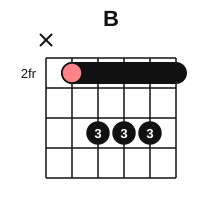
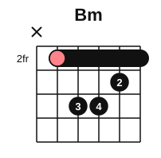
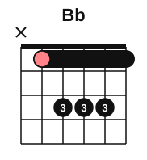
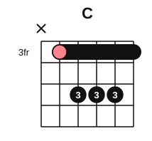

# A-shape barre chords

<span class="tag tag-guitar">Guitar</span>

After this lesson you can play B minor, B major and other A-shape barre chords with the root on string 5, and choose between the E shape and the A shape for any chord.

Before this: [E-shape barre chords](02-e-shape-barre-chords.md), [The A minor and D chords](../02-two-hands-and-first-chords/06-chords-a-minor-and-d.md), [Every note on the fretboard](01-fretboard-all-notes.md). You need: your guitar and a pick.

## The idea

### The A and Am shapes, moved

The open A chord is x 0 2 2 2 0: it skips string 6 and has its root, A, on string 5. If you move that shape up the neck, the open strings 5 and 1 need to be held down, so finger 1 barres strings 5 to 1 at the fret where the shape now sits. The chord is named after the note on string 5 under the barre.

Take the barre to fret 2. String 5, fret 2 is B, so the A shape at fret 2 is B major: B, D#, F#. The frets are x 2 4 4 4 2. Finger 1 barres fret 2, and the three notes at fret 4 on strings 4, 3 and 2 are covered by fingers 2, 3 and 4, or by one flat finger 3 across all three.



The minor version moves the open Am shape, x 0 2 2 1 0. B minor is x 2 4 4 3 2: B, D, F#. Finger 1 is the barre at fret 2, finger 2 plays string 2 at fret 3, and fingers 3 and 4 play strings 4 and 3 at fret 4.



Listen to the two chords. Only one note changes: the 3rd of the chord, on string 2.

```abc
%%opts tab=guitar
X:1
M:4/4
L:1/4
Q:1/4=60
K:C clef=treble-8
"Bm"[B,^FBd^f]4 | "B"[B,^FB^d^f]4 |]
```

String 6 is not part of an A-shape chord. Let your barre finger touch it lightly so it stays quiet, or aim your pick at string 5 and leave string 6 alone. Avoid strumming it: its open E would clash with the chord.

### Bb and C

The same shape at fret 1 is Bb major (x 1 3 3 3 1: Bb, D, F), and at fret 3 it is C major (x 3 5 5 5 3: C, E, G). The frets at the nut are wider, so Bb is the stretchiest of these; C at fret 3 is a good place to start.





Bb minor is x 1 3 3 2 1: Bb, Db, F.

### Choosing between the E shape and the A shape

Every chord has a root on string 6 (E shape) and a root on string 5 (A shape). Most of the time one of the two is nearer to the nut, so you play the lower one. It is easier on the hand, and the shape uses fewer frets to reach. This table shows the fret of each root. The open chords are noted.

| Root | E shape, string 6 fret | A shape, string 5 fret | Usual choice |
|---|---|---|---|
| F | 1 | 8 | E shape, fret 1 |
| F# | 2 | 9 | E shape, fret 2 |
| G | 3 | 10 | E shape, fret 3 (or open G) |
| Ab | 4 | 11 | E shape, fret 4 |
| A | 5 | 0 | Open A |
| Bb | 6 | 1 | A shape, fret 1 |
| B | 7 | 2 | A shape, fret 2 |
| C | 8 | 3 | A shape, fret 3 (or open C) |
| C# | 9 | 4 | A shape, fret 4 |
| D | 10 | 5 | A shape, fret 5 (or open D) |
| Eb | 11 | 6 | A shape, fret 6 |
| E | 0 | 7 | Open E |

The usual choice is the one with the lower fret. You may also choose the other shape when the next chord is nearby: G major (E shape, fret 3) and C major (A shape, fret 3) share the same barre fret, so your hand can stay still while the other fingers change.

```abc
%%opts tab=guitar
X:1
M:4/4
L:1/4
Q:1/4=60
K:C clef=treble-8
"G"[G,DGBdg]4 | "C"[CGceg]4 | "D"[DAd^fa]4 | "G"[G,DGBdg]4 |]
```

That is G (E shape, fret 3), C (A shape, fret 3), D (A shape, fret 5), then G again. The barre rolls up two frets for D, then back for G. Play it with one down strum per chord.

Common mistake: reaching for a high fret because you know the shape there. Look at the table first and take the lower fret.

### Pressing a barre in the A shape

Press the barre as in the last lesson: finger 1 on its bony edge, close behind the fret wire. The extra job here is the three fingers on strings 4 to 2. If they will not fit in the major shape, press all three with a flat finger 3. Keep the same rest-and-short-session plan, and the same stop rule. If a joint hurts, stop.

## Try it

Exercise 1. Which chord is the A-shape major barre chord at fret 7?

<details class="solution" markdown>
<summary>Answer</summary>

E major: E, G#, B. String 5, fret 7 is E. The open E chord is easier, so you would only use this one to stay in a position.

</details>

Exercise 2. Where is the best place to play Ab major?

<details class="solution" markdown>
<summary>Answer</summary>

As an E shape with the barre at fret 4 (Ab, C, Eb). The A shape would be at fret 11, which is far away.

</details>

Exercise 3. Name the chord with frets x 5 7 7 6 5.

<details class="solution" markdown>
<summary>Answer</summary>

D minor: D, F, A. It is the A-shape minor with the barre at fret 5, where string 5 is D.

</details>

<div class="practice" markdown>

### Practice routine (30 minutes)

| Minutes | What to do | Tempo | Listen for |
|---|---|---|---|
| 5 | Warm-up: F, Fm and G from the last lesson, one strum each, with rests | 60 bpm | Clear strings under the barre |
| 15 | New skill: A-shape partial barre on strings 1 to 3 at fret 2, then Bm; 3 blocks of 3 minutes with 1 minute of rest between, then 4 minutes of open chords | 60 bpm | No buzz on strings 2 and 1 |
| 5 | Reading: use the table to name the best shape for Eb, B, C#, F#, Bb, D | Untimed | Answers before you check |
| 5 | Piano: D major scale, hands separately | 60 bpm | Even touch |

Repeat this routine on at least three days.

</div>

<div class="move-on" markdown>

### Move on when

- [ ] You can play Bm and B with the strings 5 to 1 ringing clear, one strum each, three times in a row at 60 bpm.
- [ ] You can play the G, C, D, G progression above at 60 bpm, one strum per chord, with no stops.
- [ ] You can name the better of the E shape and the A shape for any root, in under 5 seconds.
- [ ] You can say what to do if your hand starts to hurt.

</div>

## Common mistakes

Strumming string 6 in an A-shape chord. The open low E clashes with the chord. Start your strum on string 5.

Letting the barre finger sag in the middle. The strings under the bend buzz. Press with the bony edge and keep the finger straight.

Playing every chord as a barre chord. The open chords you know sound fuller and are easier; use a barre when a chord has no open shape.

## Key terms

- **A-shape**: the barre chord shape that comes from the open A or Am chord, with its root on string 5.
- **Mini barre**: one finger flat across a few strings, such as finger 3 across strings 4 to 2.

Next: [Barre chord pieces](04-barre-chord-pieces.md)
