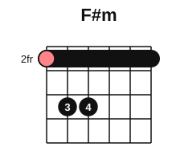
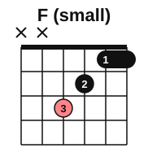

# Barre chord pieces

<span class="tag tag-guitar">Guitar</span>

After this lesson you can play two original chord pieces that mix open chords with barre chords, and change between a barre shape and an open shape without stopping.

Before this: [E-shape barre chords](02-e-shape-barre-chords.md), [A-shape barre chords](03-a-shape-barre-chords.md), [One-minute chord changes](../02-two-hands-and-first-chords/11-one-minute-changes.md), [Chord symbols and chord charts](../05-minor-keys-and-chord-charts/04-chord-symbols-and-chord-charts.md). You need: your guitar, a pick and a metronome.

## The idea

### Changes between a barre shape and an open shape

The new difficulty in this lesson is not the barre itself but the change. When you leave a barre chord for an open chord, the barre finger has to let go of six strings, and the other fingers have to find new frets. Three habits make it easier.

1. Release, do not lift. At the moment of the change, relax the pressure of finger 1 and let it float off the strings. A relaxed hand moves faster than a squeezed one.
2. Look one beat ahead. On beat 3 of the bar, your mind is already on the next chord's shape.
3. Say the change aloud with the beats: "one, two, change, four". Move on 4, so the new chord is ready for beat 1.

The chord diagrams and the table below help with the shapes you will need. Two are new: F# minor as an E-shape and G minor as an E-shape. The rest are from earlier lessons.




F# minor: F#, A, C#. G minor: G, Bb, D.

### An easier F

If the full F chord is not ready, play the small F on the top four strings: x x 3 2 1 1, with fingers 3, 2 and a barre of finger 1 across strings 2 and 1. It is F, A, C with no low root. Use it in the first piece while you build strength, and switch to the full chord when you can hold it clean.



### A piece in F major

This is an original piece in F major, 16 bars, in 4/4. It uses F (E-shape barre, fret 1), Dm (open), Bb (A-shape barre, fret 1) and C (open). Strum one down stroke on beat 1 and one on beat 3 of every bar, and let the chord ring between. Each barre chord is followed by an open one: F to Dm and Bb to C are the changes to watch.

```abc
%%opts tab=guitar
X:1
T:Harbour Lights
C:written for this book
M:4/4
L:1/4
Q:1/4=66
K:F clef=treble-8
"F"[F,CFAcf]2 "F"[F,CFAcf]2 | "F"[F,CFAcf]2 "F"[F,CFAcf]2 | "Dm"[DAdf]2 "Dm"[DAdf]2 | "Dm"[DAdf]2 "Dm"[DAdf]2 |
"Bb"[B,FBdf]2 "Bb"[B,FBdf]2 | "Bb"[B,FBdf]2 "Bb"[B,FBdf]2 | "C"[CEGce]2 "C"[CEGce]2 | "C"[CEGce]2 "C"[CEGce]2 |
"F"[F,CFAcf]2 "F"[F,CFAcf]2 | "Dm"[DAdf]2 "Dm"[DAdf]2 | "Bb"[B,FBdf]2 "Bb"[B,FBdf]2 | "C"[CEGce]2 "C"[CEGce]2 |
"F"[F,CFAcf]2 "F"[F,CFAcf]2 | "Bb"[B,FBdf]2 "Bb"[B,FBdf]2 | "C"[CEGce]2 "C"[CEGce]2 | "F"[F,CFAcf]2 "F"[F,CFAcf]2 |]
```

Play it in sections: bars 1 to 4 (F and Dm), then bars 5 to 8 (Bb and C), then bars 9 to 12 (one chord per bar), then bars 13 to 16. The harder changes are F to Dm in bar 3 and Bb to C in bar 7.

### A piece in B minor

The second piece is in B minor, also 16 bars in 4/4. It uses Bm (A-shape barre, fret 2), G, D and A (all open) and F#m (E-shape barre, fret 2). The barre sits on fret 2 for both barre chords, so the hand can stay close to the same place. The change to watch is D to F#m in bar 12, where the barre goes back on.

```abc
%%opts tab=guitar
X:1
T:Slow Tide
C:written for this book
M:4/4
L:1/4
Q:1/4=66
K:Bm clef=treble-8
"Bm"[B,FBdf]2 "Bm"[B,FBdf]2 | "G"[G,B,DGBg]2 "G"[G,B,DGBg]2 | "D"[DAdf]2 "D"[DAdf]2 | "A"[A,EAce]2 "A"[A,EAce]2 |
"Bm"[B,FBdf]2 "Bm"[B,FBdf]2 | "G"[G,B,DGBg]2 "G"[G,B,DGBg]2 | "D"[DAdf]2 "D"[DAdf]2 | "A"[A,EAce]2 "A"[A,EAce]2 |
"Bm"[B,FBdf]2 "Bm"[B,FBdf]2 | "G"[G,B,DGBg]2 "G"[G,B,DGBg]2 | "D"[DAdf]2 "D"[DAdf]2 | "F#m"[F,CFAcf]2 "F#m"[F,CFAcf]2 |
"Bm"[B,FBdf]2 "Bm"[B,FBdf]2 | "G"[G,B,DGBg]2 "G"[G,B,DGBg]2 | "A"[A,EAce]2 "A"[A,EAce]2 | "Bm"[B,FBdf]2 "Bm"[B,FBdf]2 |]
```

A tip for the change from Bm to G: leave finger 1 down for a moment while fingers 2 and 3 take their new frets, then release it as the strum lands. The change from A to Bm uses the same idea in reverse.

## Try it

Exercise 1. In bars 1 to 8 of Harbour Lights, which changes go between a barre chord and an open chord?

<details class="solution" markdown>
<summary>Answer</summary>

F to Dm (barre to open) at bar 3, Dm to Bb (open to barre) at bar 5, and Bb to C (barre to open) at bar 7. In bars 13 and 14 the change from F to Bb is barre to barre.

</details>

Exercise 2. Name the shape you use for each chord in Slow Tide.

<details class="solution" markdown>
<summary>Answer</summary>

Bm: A-shape barre at fret 2. G, D and A: open shapes. F#m: E-shape barre at fret 2.

</details>

Exercise 3. How many beats do you count before the first chord of Harbour Lights, and where does the change to Dm come?

<details class="solution" markdown>
<summary>Answer</summary>

Four counted beats, 1 2 3 4. The change to Dm is at the start of bar 3, so the new fingers move on beat 4 of bar 2.

</details>

<div class="practice" markdown>

### Practice routine (30 minutes)

| Minutes | What to do | Tempo | Listen for |
|---|---|---|---|
| 5 | Warm-up: F to C and Bm to G, 8 changes each, one strum per bar | 60 bpm | The strum landing on the click |
| 15 | New skill: Harbour Lights in sections (4 bars at a time), with a rest after each; then Slow Tide the same way. Keep barre work in blocks of 3 minutes with 1 minute of rest | 60 bpm, then 66 | No stops at the changes |
| 5 | Reading: read the chord names of Slow Tide and say the shape (open, E-shape or A-shape) before you play it | Untimed | The right shape every time |
| 5 | Piano: F major scale, hands separately | 60 bpm | Even touch, thumb under the 4th finger |

Repeat this routine on at least three days.

</div>

<div class="move-on" markdown>

### Move on when

- [ ] You can play Harbour Lights from start to finish at 60 bpm, with no stops, three times in a row.
- [ ] You can play Slow Tide at 60 bpm, with no stops, once.
- [ ] You can change between F and C eight times in a row, in time, at 60 bpm.
- [ ] You rested between sections and your hand has no sharp pain after practice.

</div>

## Common mistakes

Stopping the beat at a hard change. Keep the pulse going and let one chord be a little muted, then fix it slowly. A steady beat matters more than a clean chord.

Pressing the barre harder at the change. Press only as hard as the chord needs to ring; the squeeze tires the hand.

Starting the whole piece at full speed. Learn each four-bar section slowly and add the metronome.

## Key terms

- **Release**: letting the pressure off the strings during a change, without lifting the hand far.
- **Small F**: the four-string F chord, x x 3 2 1 1.

Next: [The CAGED chord shapes](05-caged-chords.md)
