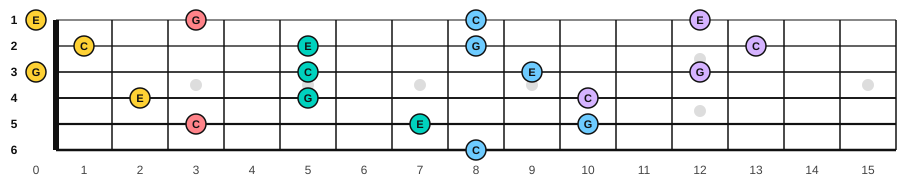
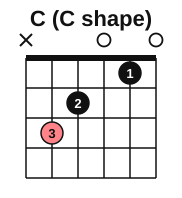
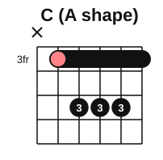
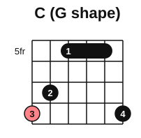
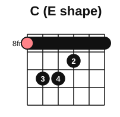
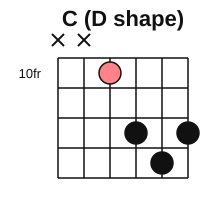

# The CAGED chord shapes

<span class="tag tag-guitar">Guitar</span>

After this lesson you can play the same major chord in five places up the neck using the five open shapes C, A, G, E and D, and name which shape you are using.

Before this: [E-shape barre chords](02-e-shape-barre-chords.md), [A-shape barre chords](03-a-shape-barre-chords.md), [The C, G and D minor chords](../03-the-major-scale-and-keys/06-chords-c-g-and-d-minor.md), [Every note on the fretboard](01-fretboard-all-notes.md). You need: your guitar and a pick.

## The idea

### Five open shapes, moved

You know five open major chords: C, A, G, E and D. Each is a finger pattern, a **shape**. The first letters, in the order they appear up the neck, spell **CAGED**. The **CAGED system** is the idea that these five shapes can each be moved up the neck, as a barre chord where needed, and that they fit together end to end, so any major chord can be played in five places.

Take C major: C, E, G. Its notes are on every string, in many places. The five shapes cover the neck like this.

| Shape | Open chord | C major from this shape | Frets, string 6 to string 1 | Moved up by |
|---|---|---|---|---|
| C | x 3 2 0 1 0 | the open C chord | x 3 2 0 1 0 | 0 |
| A | x 0 2 2 2 0 | A shape, barre at fret 3 | x 3 5 5 5 3 | 3 |
| G | 3 2 0 0 0 3 | G shape, at fret 5 | 8 7 5 5 5 8 | 5 |
| E | 0 2 2 1 0 0 | E shape, barre at fret 8 | 8 10 10 9 8 8 | 8 |
| D | x x 0 2 3 2 | D shape, at fret 10 | x x 10 12 13 12 | 10 |

The "moved up by" number is the number of half steps from the open chord's root to C: A up to C is 3, G up to C is 5, E up to C is 8 and D up to C is 10. Every fret in the open shape goes up by that number, and the open strings become fretted strings (so the A and E shapes need a barre). Past fret 12 the pattern repeats from the C shape.



Each colour in the picture is one shape. Where two shapes share a dot, the colour of the later one shows. The five shapes always come in the same order, C then A then G then E then D, and then C again an octave higher.

Now see each shape alone. Salmon marks the root. The number at the left of a diagram says which fret its top box is.











The G and D shapes are awkward when moved: the G shape needs a big stretch, and the D shape sits on only four strings. Use them to find where the chord's notes are, and play only the strings that are comfortable. The A and E shapes are the barre chords you already know.

Here are the five C chords, one per bar. Listen to how the pitch rises while the chord stays C major: the lowest note is C in every shape, and the others are E and G in different octaves. The tab may show a different place for some notes; follow the frets in the table above.

```abc
%%opts tab=guitar
X:1
M:4/4
L:1/4
Q:1/4=60
K:C clef=treble-8
"C"[CEGce]4 | "C"[CGceg]4 | "C"[CEGcec']4 | "C"[CGcegc']4 | "C"[cgc'e']4 |]
```

### The same method in any key

It works for any chord. For G major, the shapes land at these places.

| Shape | G major | Moved up by |
|---|---|---|
| C | x 10 9 7 8 7 | 7 |
| A | x 10 12 12 12 10 | 10 |
| G | 3 2 0 0 0 3 (open) | 0 |
| E | 3 5 5 4 3 3 | 3 |
| D | x x 5 7 8 7 | 5 |

The E shape for G is the barre chord you played in lesson 2. To find a chord in five places, count the half steps from each open chord's root up to the target and add that number to every fret of the shape.

For D major the five places are: the C shape at fret 2 (x 5 4 2 3 2), the open A shape moved to fret 5 (x 5 7 7 7 5), the G shape at fret 7 (10 9 7 7 7 10), the E shape at fret 10 (10 12 12 11 10 10) and the open D.

Minor chords work for the E and A shapes (the barre minors you know). The C, G and D shapes have no comfortable minor versions, so for minor chords use the E and A shapes plus the open Dm.

### Why it helps

You can play a chord close to where your hand already is, instead of jumping along the neck. You can pick a higher, brighter voicing or a lower, fuller one. And in the next lesson every shape sits inside a block of the major scale, which turns the whole neck into one map.

Common mistake: treating the five shapes as five separate things to memorize. They are one chord laid out in five places. Learn them as a ring: after the D shape, the C shape comes round again.

## Try it

Exercise 1. In which shape is the C major chord with the root on string 6, fret 8, played with a barre?

<details class="solution" markdown>
<summary>Answer</summary>

The E shape (8 10 10 9 8 8). The G shape also has its root on string 6 at fret 8, but it is not a full barre chord.

</details>

Exercise 2. Find A major in the C shape. (Hint: C up to A is how many half steps?)

<details class="solution" markdown>
<summary>Answer</summary>

C up to A is 9 half steps. Add 9 to the open C shape: x 12 11 9 10 9. This is high on the neck. The open A chord is much easier.

</details>

Exercise 3. Where is D major in the A shape?

<details class="solution" markdown>
<summary>Answer</summary>

At fret 5: x 5 7 7 7 5. A up to D is 5 half steps.

</details>

<div class="practice" markdown>

### Practice routine (30 minutes)

| Minutes | What to do | Tempo | Listen for |
|---|---|---|---|
| 5 | Warm-up: F and Bm barre chords, one strum each, with rests | 60 bpm | Clear strings under the barre |
| 15 | New skill: C major in the five places, in order, one strum each, naming the shape; then G major the same way. Work in blocks of 3 minutes with rests | 60 bpm | The same chord, higher each time |
| 5 | Reading: use the table to say the frets of D major in the E, A and C shapes | Untimed | Answers before you check |
| 5 | Piano: C major scale, two octaves, hands separately | 60 bpm | Even touch |

Repeat this routine on at least three days.

</div>

<div class="move-on" markdown>

### Move on when

- [ ] You can name the five shapes in order (C A G E D) and say which are open and which need a barre.
- [ ] You can play C major in the C, A and E shapes, one strum each, three times in a row at 60 bpm.
- [ ] You can work out the frets of G major in any of the five shapes from the open chord and the move-up number.
- [ ] You can say how to find D major in three of the five shapes.

</div>

## Common mistakes

Forgetting that open strings become fretted. The moved A shape needs the barre because the open strings 5 and 1 now sit at the fret.

Playing a string that does not belong. A moved shape can leave a string out; the diagram shows an x for it.

Skipping the rests. These shapes stretch the hand more than the earlier barre chords. Stop if anything hurts.

## Key terms

- **Shape**: the finger pattern of a chord, wherever it is played on the neck.
- **CAGED system**: the five open shapes C, A, G, E and D, each movable up the neck, which together cover the neck for a major chord.

Next: [CAGED scale shapes](06-caged-scale-shapes.md)
