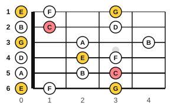
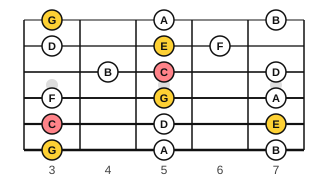
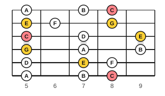
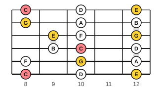
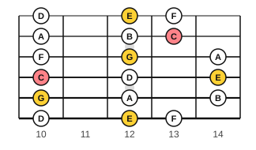

# CAGED scale shapes

<span class="tag tag-guitar">Guitar</span>

After this lesson you can play the C major scale in five blocks of the neck, say which CAGED chord shape sits inside each block, and play a tune in more than one block.

Before this: [The CAGED chord shapes](05-caged-chords.md), [The major scale](../03-the-major-scale-and-keys/02-the-major-scale.md), [Every note on the fretboard](01-fretboard-all-notes.md). You need: your guitar and a pick.

## The idea

### A scale in a block

On the piano you play a scale up one row of keys. On the guitar the same notes are spread over six strings and many frets, so a scale is learned as a **scale shape**: the pattern of its notes in one block of frets. The block usually spans five frets, and has three notes on each string.

The C major scale is C, D, E, F, G, A, B, C. In the open position those notes sit at frets 0 to 4. Further up the neck the same seven notes appear again in other blocks. Take the five CAGED chord shapes of C major from the last lesson: each one sits inside one block of the scale. Name each block after its chord shape. A chord shape is the skeleton; the scale shape fills in the other notes around it.

| Block | Frets | Chord shape inside it |
|---|---|---|
| C shape | 0 to 4 | open C: x 3 2 0 1 0 |
| A shape | 3 to 7 | A shape at fret 3: x 3 5 5 5 3 |
| G shape | 5 to 9 | G shape: 8 7 5 5 5 8 |
| E shape | 8 to 12 | E shape at fret 8: 8 10 10 9 8 8 |
| D shape | 10 to 14 | D shape: x x 10 12 13 12 |

Below, the shapes appear with salmon dots for C (the root) and yellow dots for E and G (the other notes of the C chord). White dots are the remaining scale notes D, F, A and B.











Here are the frets for every string, listed from string 6 to string 1. Each shape has three notes per string.

| Shape | String 6 | String 5 | String 4 | String 3 | String 2 | String 1 |
|---|---|---|---|---|---|---|
| C (frets 0 to 4) | 0 1 3 | 0 2 3 | 0 2 3 | 0 2 4 | 0 1 3 | 0 1 3 |
| A (frets 3 to 7) | 3 5 7 | 3 5 7 | 3 5 7 | 4 5 7 | 3 5 6 | 3 5 7 |
| G (frets 5 to 9) | 5 7 8 | 5 7 8 | 5 7 9 | 5 7 9 | 5 6 8 | 5 7 8 |
| E (frets 8 to 12) | 8 10 12 | 8 10 12 | 9 10 12 | 9 10 12 | 8 10 12 | 8 10 12 |
| D (frets 10 to 14) | 10 12 13 | 10 12 14 | 10 12 14 | 10 12 14 | 10 12 13 | 10 12 13 |

The shapes overlap: the right-hand edge of one is the left-hand edge of the next. The A shape block shares frets 5 to 7 with the G shape, for example. So you can climb from one block to the next without a gap, up to fret 14, and then the pattern starts over at fret 12 with the C shape again.

### Fingering inside a block

Place your hand so that fingers 1 to 4 sit over four consecutive frets, and play each fret with the finger above it. A block is five frets wide, so on a few strings the lowest and highest notes are four frets apart (frets 3 and 7 on string 6, for example). Stretch finger 4 by one fret, or slide the hand up a fret for that string and back for the next. Keep the thumb behind the neck and the wrist straight. Choose a fingering for each string once and use it every time.

### Playing a tune in a block

The notes of the opening of Ode to Joy (Beethoven) are all in the C major scale. Written for guitar they look like this. The tab shows one place for each note; try the same melody in the A block, then the G block.

```abc
%%opts tab=guitar
X:1
M:4/4
L:1/4
Q:1/4=80
K:C clef=treble-8
E E F G | G F E D | C C D E | E3/2 D/ D2 |]
```

In the A block (frets 3 to 7) the notes are: C at string 5 fret 3, D at string 5 fret 5, E at string 5 fret 7, F at string 4 fret 3 and G at string 4 fret 5. In the G block (frets 5 to 9) they are C at string 6 fret 8, D at string 5 fret 5, E at string 5 fret 7, F at string 5 fret 8 and G at string 4 fret 5. It is the same tune, played in a different place, which gives a slightly different sound because the string and the fret change the tone.

Common mistake: memorizing each block as a row of numbers with no landmarks. Look for the C root and the chord shape dots first, then fill in the rest.

## Try it

Exercise 1. How many notes does one shape have in total, and how many of them are C?

<details class="solution" markdown>
<summary>Answer</summary>

Eighteen notes (three on each of six strings). The C shape, A shape and D shape blocks each hold two Cs, and the G shape and E shape blocks hold three.

</details>

Exercise 2. In which block is the note at string 3, fret 5?

<details class="solution" markdown>
<summary>Answer</summary>

It is C (string 3 fret 5 is C). The note sits in the A shape block (frets 3 to 7) and the G shape block (frets 5 to 9), because the blocks overlap.

</details>

Exercise 3. Which scale degrees are the notes at the E shape block's string 6, frets 8, 10 and 12?

<details class="solution" markdown>
<summary>Answer</summary>

C, D and E: degrees 1, 2 and 3 of the C major scale.

</details>

<div class="practice" markdown>

### Practice routine (30 minutes)

| Minutes | What to do | Tempo | Listen for |
|---|---|---|---|
| 5 | Warm-up: C major in the A and E chord shapes, one strum each | 60 bpm | Clean barre |
| 15 | New skill: the C shape block, then the A shape block, up string by string in eighth notes and back, naming notes aloud; then Ode to Joy in the A block | 60 bpm | Even eighths, no pause when the hand shifts |
| 5 | Reading: from the table, say where C is on every string in the E shape block | Untimed | Answers before you check |
| 5 | Piano: C major scale, two octaves, hands separately | 60 bpm | Even touch |

Repeat this routine on at least three days, and add one new block every two or three days.

</div>

<div class="move-on" markdown>

### Move on when

- [ ] You can play the C shape block and the A shape block, up and back, in steady eighth notes at 60 bpm with no wrong notes, three times.
- [ ] You can name the chord shape that sits inside each of the five blocks.
- [ ] You can play the opening of Ode to Joy in two different blocks at 80 bpm.
- [ ] You can point to every C in a block and say its string and fret.

</div>

## Common mistakes

Playing a block with the wrong fingers. Plan the fingering of each string once, then keep it the same every time.

Treating the blocks as separate. They overlap, so a note near the edge of one block is also in the next.

Practising a block faster than the metronome. Slow practice is how the shape becomes automatic.

## Key terms

- **Scale shape**: the pattern of a scale's notes in one block of the neck.
- **Block**: a stretch of about five frets that holds one scale shape.

Next: [Reading higher up the neck](07-fretboard-reading.md)
