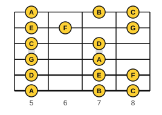
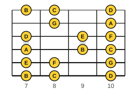

# Reading higher up the neck

<span class="tag tag-reading">Reading</span>

After this lesson you can read a melody on the staff and play it in 5th or 7th position, find where a written note sits in a position, and shift between positions without losing the beat.

Before this: [Reading notation on guitar](../03-the-major-scale-and-keys/11-reading-notation-on-guitar.md), [Every note on the fretboard](01-fretboard-all-notes.md), [CAGED scale shapes](06-caged-scale-shapes.md). You need: your guitar and a pencil.

## The idea

### Position

Until now you read in first position, where finger 1 plays fret 1 and the open strings are available. A **position** is a hand placement named by the fret under finger 1, so that fingers 1 to 4 cover four frets in a row. In 5th position finger 1 is on fret 5, finger 2 on fret 6, finger 3 on fret 7 and finger 4 on fret 8. In 7th position the hand covers frets 7 to 10.

Higher up, the hand stays in place and each finger is responsible for one fret on every string. That is the advantage of a position: you do not look for notes one at a time, you know where all of them are.





These maps show the note names. Guitar music is written an octave above the sound, so the printed letter is the same but the staff shows it one octave higher than it sounds, as in first position. If you can name the note, the position tells you where it is.

### Finding a note in a position

Most notes can be played in more than one place. The position decides which one. To read in a position:

1. Look at the whole line first. Find the lowest and highest written notes.
2. Choose a position whose four frets contain all of them, using the maps above.
3. Place finger 1 on the first fret of the position and keep the hand there.
4. Play each note with the finger above its fret. If a note is one fret outside the position, stretch a finger or shift the hand one fret, then return.

### Reading in 5th position

This is the C major scale on strings 3 to 1, all in 5th position. Finger 1 on string 3 fret 5 plays written C (c on the staff). The staff shows only the notes; there is no tab, so find each one on the map. Listen to the scale, then play it.

```abc
X:1
M:4/4
L:1/4
Q:1/4=70
K:C clef=treble-8
c d e f | g a b c' |]
```

Look at the map to find these places: c at string 3 fret 5, d at string 3 fret 7, e at string 2 fret 5, f at string 2 fret 6, g at string 2 fret 8, a at string 1 fret 5, b at string 1 fret 7 and the top c at string 1 fret 8.

### Reading in 7th position

Now a short original tune for 7th position. Fingers 1 to 4 cover frets 7 to 10. The notes lie on strings 4 and 3: A, B and c on string 4 (frets 7, 9 and 10) and d, e and f on string 3 (frets 7, 9 and 10).

```abc
X:1
M:4/4
L:1/4
Q:1/4=70
K:C clef=treble-8
e d c B | A B c2 | d e f e | d4 |]
```

### Shifting positions

When a melody goes beyond the four frets, you shift. A shift moves the hand along the neck. Two rules help: shift on a note that is not too fast, and shift with the finger that has played last, so the hand always knows where it is. Slide that finger to the new fret, then play the next note with the new finger. Below, the line starts in 5th position (g at string 2 fret 8, a at string 1 fret 5, b at fret 7, c' at fret 8). In bar 2 the top note d' is at string 1 fret 10: slide finger 4 from fret 8 to fret 10, and the hand lands in 7th position, so c' is now finger 2 and b is finger 1. In bar 3 slide finger 1 from fret 7 down to fret 5 for a, and you are back in 5th position. Practise the two shifts slowly.

```abc
X:1
M:4/4
L:1/4
Q:1/4=60
K:C clef=treble-8
g a b c' | d'2 c' b | a g e d | c4 |]
```

Common mistake: moving only the finger that plays the next note and leaving the hand behind. Move the whole hand, with the thumb behind the neck, so the other fingers keep their curve and their place.

## Try it

Exercise 1. In 5th position, where is the note d (D5) on the staff?

<details class="solution" markdown>
<summary>Answer</summary>

String 3, fret 7, played with finger 3. String 3 fret 7 is D.

</details>

Exercise 2. Which position contains both the written notes e and b?

<details class="solution" markdown>
<summary>Answer</summary>

5th position. Written e is at string 2, fret 5 (finger 1), and b is at string 1, fret 7 (finger 3).

</details>

Exercise 3. What is the note at string 5, fret 10 in 7th position, and which finger plays it?

<details class="solution" markdown>
<summary>Answer</summary>

G, played with finger 4. String 5 fret 10 is G, and fret 10 is the fourth fret of 7th position.

</details>

<div class="practice" markdown>

### Practice routine (30 minutes)

| Minutes | What to do | Tempo | Listen for |
|---|---|---|---|
| 5 | Warm-up: C major scale in the A shape block (frets 3 to 7), up and back | 60 bpm | Even eighth notes |
| 15 | New skill: the 5th position scale, then the 7th position tune, then the shifting line; slow, one at a time, then twice in a row | 60 bpm, then 70 | The beat holding through a shift |
| 5 | Reading: pick any written note from a line above, say its string and fret in 5th and in 7th position, out loud | Untimed | Answers before you check |
| 5 | Piano: C major scale, two octaves, hands separately | 60 bpm | Even touch |

Repeat this routine on at least three days.

</div>

<div class="move-on" markdown>

### Move on when

- [ ] You can play the 5th position scale from the staff at 70 bpm, three times in a row with no stops.
- [ ] You can play the 7th position tune at 70 bpm, three times in a row with no stops.
- [ ] You can play the shifting line at 60 bpm, with the beat holding through the shift, twice.
- [ ] You can say what position you would use for a line whose lowest note is at string 3 fret 5 and highest at string 1 fret 8.

</div>

## Common mistakes

Reading the tab and ignoring the staff. In this lesson the staff is the only guide, and you decide the string and fret. That is the skill.

Staying in one position when the music goes out of it. Stretching one finger past its fret hurts after a while; shift instead.

Looking at the hand on every note. Learn the map first, look at the page, and glance at the neck only at shifts.

## Key terms

- **Position**: a hand placement named by the fret under finger 1, with fingers 1 to 4 covering four frets.
- **Shift**: moving the whole hand to another position.

Next: [All twelve major scales](08-all-major-scales.md)
