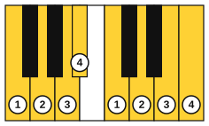
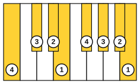
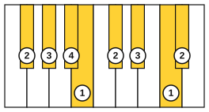

# All twelve major scales

<span class="tag tag-piano">Piano</span>

After this lesson you can play all twelve major scales one octave with each hand alone, with the standard fingering, and you can raise the tempo with a metronome in steps.

Before this: [The major scale](../03-the-major-scale-and-keys/02-the-major-scale.md), [The G and D major scales](../03-the-major-scale-and-keys/08-g-and-d-major-scales.md), [Flat keys and the circle of fifths](../03-the-major-scale-and-keys/09-flat-keys-and-the-circle-of-fifths.md). You need: your piano and a metronome.

## The idea

### Twelve scales, one pattern

A major scale follows the pattern whole, whole, half, whole, whole, whole, half from any starting note. There are twelve starting notes, so there are twelve major scales. You know C, G and D as scales and F, Bb and Eb as key signatures. This lesson adds the rest and puts the fingering for all twelve in one place.

| Scale | Notes |
|---|---|
| C major | C, D, E, F, G, A, B, C |
| G major | G, A, B, C, D, E, F#, G |
| D major | D, E, F#, G, A, B, C#, D |
| A major | A, B, C#, D, E, F#, G#, A |
| E major | E, F#, G#, A, B, C#, D#, E |
| B major | B, C#, D#, E, F#, G#, A#, B |
| F# major | F#, G#, A#, B, C#, D#, E#, F# |
| Db major | Db, Eb, F, Gb, Ab, Bb, C, Db |
| Ab major | Ab, Bb, C, Db, Eb, F, G, Ab |
| Eb major | Eb, F, G, Ab, Bb, C, D, Eb |
| Bb major | Bb, C, D, Eb, F, G, A, Bb |
| F major | F, G, A, Bb, C, D, E, F |

The key signatures follow the circle of fifths. C major has no sharps or flats. G major has one sharp, D major has two sharps, A major has three sharps, E major has four sharps, B major has five sharps and F# major has six sharps. F major has one flat, Bb major has two flats, Eb major has three flats, Ab major has four flats and Db major has five flats. F# major and Gb major sound the same and both have six signs. Db major (five flats) is used instead of C# major (seven sharps).

### Fingering groups

Every scale uses the same rule: the thumb plays white keys, and the long fingers (2, 3 and 4) play the black keys. That rule gives groups of scales that share a fingering.

| Group | Scales | Right hand | Left hand |
|---|---|---|---|
| 1 | C, G, D, A, E | 1 2 3 1 2 3 4 5 | 5 4 3 2 1 3 2 1 |
| 2 | B | 1 2 3 1 2 3 4 5 | 4 3 2 1 4 3 2 1 |
| 3 | F | 1 2 3 4 1 2 3 4 | 5 4 3 2 1 3 2 1 |
| 4 | Bb | 4 1 2 3 1 2 3 4 | 3 2 1 4 3 2 1 3 |
| 4 | Eb | 3 1 2 3 4 1 2 3 | 3 2 1 4 3 2 1 3 |
| 4 | Ab | 3 4 1 2 3 1 2 3 | 3 2 1 4 3 2 1 3 |
| 4 | Db | 2 3 1 2 3 4 1 2 | 3 2 1 4 3 2 1 3 |
| 4 | F# | 2 3 4 1 2 3 1 2 | 4 3 2 1 3 2 1 4 |

Group 1 is the fingering you learned in C major, and it works for G, D, A and E, because their black keys fall where the long fingers are. Group 2, B major, keeps the right hand but starts the left hand on finger 4, so that the left thumb lands on the white keys E and B.





In group 4, the scales with the most black keys, the thumb avoids the black keys, so the starting finger changes. Bb, Eb, Ab and Db share the same left hand, 3 2 1 4 3 2 1 3: one pattern for four scales. In F# major the right hand 2 3 4 1 2 3 1 2 puts the thumb on B and E# (the white key F), and the left hand 4 3 2 1 3 2 1 4 does the same.




### Two examples

Listen to A major and Bb major, up one octave and back, with the fingering above each note. A major has three sharps (F#, C#, G#) in the key signature, so the sharp signs are not written before the notes. Bb major has two flats (Bb and Eb). The first example plays both hands together; for now, practise each hand alone.

```abc
X:1
M:4/4
L:1/4
Q:1/4=60
K:A
%%score {RH LH}
V:RH clef=treble
V:LH clef=bass
[V:RH] !1!A !2!B !3!c !1!d | !2!e !3!f !4!g !5!a | !4!g !3!f !2!e !1!d | !3!c !2!B !1!A2 |]
[V:LH] !5!A, !4!B, !3!C !2!D | !1!E !3!F !2!G !1!A | !2!G !3!F !1!E !2!D | !3!C !4!B, !5!A,2 |]
```

```abc
X:1
M:4/4
L:1/4
Q:1/4=60
K:Bb
!4!B !1!c !2!d !3!e | !1!f !2!g !3!a !4!b | !3!a !2!g !1!f !3!e | !2!d !1!c !4!B2 |]
```

### A tempo ladder

Playing a scale evenly is the goal, not speed. A metronome shows when you rush at the thumb crossing. Use this ladder for each scale: set 60 bpm, one note per click, hands separately, and move up one step when you play it three times in a row with no stops or uneven notes. Go down a step if you miss.

| Step | Tempo (one note per click) |
|---|---|
| 1 | 60 bpm |
| 2 | 72 bpm |
| 3 | 84 bpm |
| 4 | 96 bpm |
| 5 | 108 bpm |

Common mistake: practising a scale at the one speed you already play it. Move the tempo up by one step at a time.

## Try it

Exercise 1. Which fingers play the black keys in A major, right hand, going up?

<details class="solution" markdown>
<summary>Answer</summary>

The fingering is A 1, B 2, C# 3, D 1, E 2, F# 3, G# 4, A 5. So finger 3 plays C# and F#, and finger 4 plays G#.

</details>

Exercise 2. Why does the right hand in F major use finger 4 on Bb?

<details class="solution" markdown>
<summary>Answer</summary>

Bb is the fourth note of the scale and a black key. Fingers 1 2 3 4 take F, G, A and Bb, and then the thumb passes under for C. The thumb never plays a black key.

</details>

Exercise 3. Which four scales share the left hand 3 2 1 4 3 2 1 3?

<details class="solution" markdown>
<summary>Answer</summary>

Bb, Eb, Ab and Db major.

</details>

<div class="practice" markdown>

### Practice routine (30 minutes)

| Minutes | What to do | Tempo | Listen for |
|---|---|---|---|
| 5 | Warm-up: C, G and D major, one octave, each hand alone | 72 bpm | Even notes at the thumb |
| 15 | New skill: two new scales a day, group 1 first (A, E), then B, F and the group 4 scales. Each scale: right hand, then left hand, one octave up and back | 60 bpm, then the ladder | The thumb passing under without a bump |
| 5 | Reading: name the notes and the key signature of one new scale, then check against the table | Untimed | Answers before you check |
| 5 | Guitar: C major in the five CAGED shapes, one strum each | 60 bpm | Clean strings |

Repeat this routine on at least three days for each pair of new scales; the full set takes about three weeks.

</div>

<div class="move-on" markdown>

### Move on when

- [ ] You can play every one of the twelve major scales one octave up and back with each hand alone, with the correct fingering, at 60 bpm, three times in a row.
- [ ] You can play the C, G, D, A and E major scales at 84 bpm, each hand alone, three times in a row with no stops.
- [ ] You can say the number of sharps or flats for each key without looking at the table.
- [ ] You can state the thumb rule and use it to find a fingering you have not practised.

</div>

## Common mistakes

Playing the thumb on a black key. It twists the wrist; use the starting fingers in the table.

Using the right-hand fingering for the left hand. The hands differ in B, F and the group 4 scales, so check both columns.

Raising the tempo before the scale is even. A fast uneven scale practises the unevenness.

## Key terms

- **Fingering group**: a set of scales that share the same finger numbers.
- **Tempo ladder**: raising the metronome in small, fixed steps once the current tempo is clean.

Next: [Scales and arpeggios hands together](09-scales-and-arpeggios-hands-together.md)
