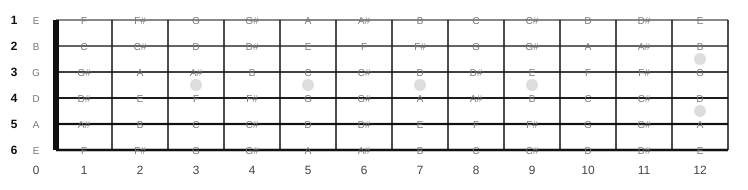
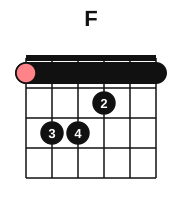
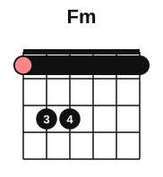
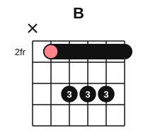
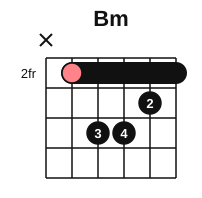
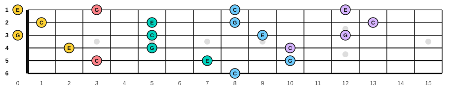

# Stage 8: Fretboard, barre chords and CAGED

This stage maps the whole guitar neck and puts the map to work. You learn every note on the fretboard, the E-shape and A-shape barre chords, short pieces with barre chords, the CAGED system for finding a chord in five places, the major scale shapes inside it, and how to read higher up the neck. On the piano you learn all twelve major scales, play two-octave scales and arpeggios with both hands, and learn Schumann's The Happy Farmer. You also practise reading with both hands and hear 6ths, 7ths and the tritone. By the end, you can play a major or minor barre chord anywhere on the neck and a two-octave scale hands together. It usually takes about 8 to 12 weeks at 30 minutes a day, because barre chords need short sessions and rests.

<!-- lessons:start -->
## Lessons

1. [Every note on the fretboard](01-fretboard-all-notes.md) (guitar)
2. [E-shape barre chords](02-e-shape-barre-chords.md) (guitar)
3. [A-shape barre chords](03-a-shape-barre-chords.md) (guitar)
4. [Barre chord pieces](04-barre-chord-pieces.md) (guitar)
5. [The CAGED chord shapes](05-caged-chords.md) (guitar)
6. [CAGED scale shapes](06-caged-scale-shapes.md) (guitar)
7. [Reading higher up the neck](07-fretboard-reading.md) (reading)
8. [All twelve major scales](08-all-major-scales.md) (piano)
9. [Scales and arpeggios hands together](09-scales-and-arpeggios-hands-together.md) (piano)
10. [Schumann: The Happy Farmer](10-the-happy-farmer.md) (piano)
11. [Sight-reading hands together](11-sight-reading-hands-together.md) (reading)
12. [Hearing intervals 2](12-hearing-intervals-2.md) (ear)

<!-- lessons:end -->

Download the stage 8 deck: [08-fretboard-barre-chords-and-caged.apkg](../downloads/anki/08-fretboard-barre-chords-and-caged.apkg)

## Cheat sheet

Everything to remember from this stage, on one page.

### The fretboard note map

Each fret is one half step. Fret 12 is the open string an octave higher. Strings 6 and 1 are both E, so they match fret for fret.

| String | Natural notes and their frets |
|---|---|
| 6 (E) | E 0, F 1, G 3, A 5, B 7, C 8, D 10, E 12 |
| 5 (A) | A 0, B 2, C 3, D 5, E 7, F 8, G 10, A 12 |
| 4 (D) | D 0, E 2, F 3, G 5, A 7, B 9, C 10, D 12 |
| 3 (G) | G 0, A 2, B 4, C 5, D 7, E 9, F 10, G 12 |
| 2 (B) | B 0, C 1, D 3, E 5, F 6, G 8, A 10, B 12 |
| 1 (E) | E 0, F 1, G 3, A 5, B 7, C 8, D 10, E 12 |

Octave shapes: from string 6 or 5, skip a string and go up 2 frets; from string 4 or 3, skip a string and go up 3 frets.

### Barre chords in the E and A shapes

The E shape has its root on string 6; the A shape has its root on string 5. The chord is named after the root under the barre. Take the shape with the lower fret.

| Root | E shape, string 6 fret | A shape, string 5 fret |
|---|---|---|
| F | 1 | 8 |
| F# | 2 | 9 |
| G | 3 | 10 |
| Ab | 4 | 11 |
| A | 5 | open |
| Bb | 6 | 1 |
| B | 7 | 2 |
| C | 8 | 3 |
| C# | 9 | 4 |
| D | 10 | 5 |
| Eb | 11 | 6 |
| E | open | 7 |

| Chord | Frets, string 6 to string 1 |
|---|---|
| E-shape major | root, root+2, root+2, root+1, root, root (barre) |
| E-shape minor | root, root+2, root+2, root, root, root (barre) |
| A-shape major | x, root, root+2, root+2, root+2, root (barre) |
| A-shape minor | x, root, root+2, root+2, root+1, root (barre) |

Here root means the fret of the barre. Build barre strength with short blocks and rests. Pain is a stop sign.

### The five CAGED shapes

C major in five places (a half-step move from each open shape):

| Shape | C major, string 6 to string 1 |
|---|---|
| C | x 3 2 0 1 0 |
| A | x 3 5 5 5 3 |
| G | 8 7 5 5 5 8 |
| E | 8 10 10 9 8 8 |
| D | x x 10 12 13 12 |

The shapes always follow each other in the order C, A, G, E, D, then C again an octave higher. To find a chord in a shape, count the half steps from the open chord's root up to the target and add them to every fret.

The C major scale lives in five blocks, one around each chord shape: frets 0 to 4 (C shape), 3 to 7 (A shape), 5 to 9 (G shape), 8 to 12 (E shape), 10 to 14 (D shape). Each block has three notes on every string.

### Major scale fingering on the piano

| Group | Scales | Right hand | Left hand |
|---|---|---|---|
| 1 | C, G, D, A, E | 1 2 3 1 2 3 4 5 | 5 4 3 2 1 3 2 1 |
| 2 | B | 1 2 3 1 2 3 4 5 | 4 3 2 1 4 3 2 1 |
| 3 | F | 1 2 3 4 1 2 3 4 | 5 4 3 2 1 3 2 1 |
| 4 | Bb | 4 1 2 3 1 2 3 4 | 3 2 1 4 3 2 1 3 |
| 4 | Eb | 3 1 2 3 4 1 2 3 | 3 2 1 4 3 2 1 3 |
| 4 | Ab | 3 4 1 2 3 1 2 3 | 3 2 1 4 3 2 1 3 |
| 4 | Db | 2 3 1 2 3 4 1 2 | 3 2 1 4 3 2 1 3 |
| 4 | F# | 2 3 4 1 2 3 1 2 | 4 3 2 1 3 2 1 4 |

The thumb plays white keys; the long fingers play the black keys. Two octaves: the right hand repeats its pattern with the thumb, the left hand ascending in C plays 5 4 3 2 1 3 2 1 4 3 2 1 3 2 1.

### Scale tempo goals

One note per click, three times in a row with no stops, before you move to the next goal.

| Goal | What | Tempo |
|---|---|---|
| 1 | C, G and D major, two octaves, hands together | 60 bpm |
| 2 | Add F and A major | 72 bpm |
| 3 | Parallel and contrary motion | 84 bpm |
| 4 | All twelve major scales, two octaves | 72 bpm |
| 5 | C, G, D and F major | 96 bpm |
| 6 | C, G, D and F major, eighth notes | 60 bpm (two notes per click) |

The one-octave tempo ladder for each new scale is 60, 72, 84, 96, 108 bpm.

### Wide intervals

| Interval | Half steps | From C |
|---|---|---|
| Minor 6th | 8 | Ab |
| Major 6th | 9 | A |
| Minor 7th | 10 | Bb |
| Major 7th | 11 | B |
| Tritone | 6 | F# (or Gb) |

An interval and its inversion add up to 9. A compound interval is an octave plus a simple interval (a 9th is an octave plus a 2nd).
