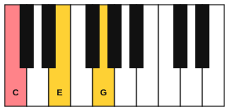
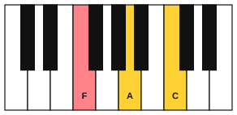
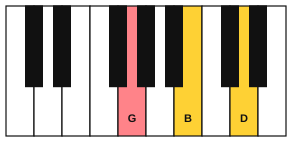

# Roman numerals

<span class="tag tag-theory">Theory</span>

After this lesson you can name the chords of any major or minor key with Roman numerals, say which chord is I, IV or V in a key, and play the same progression in two keys.

Before this: [Triads](../04-intervals-and-triads/04-triads.md), [The major scale](../03-the-major-scale-and-keys/02-the-major-scale.md), [Harmonic and melodic minor](../05-minor-keys-and-chord-charts/02-harmonic-and-melodic-minor.md), [Chord symbols and chord charts](../05-minor-keys-and-chord-charts/04-chord-symbols-and-chord-charts.md). You need: your piano.

## The idea

### The same pattern in two keys

Play these four chords in C major. The chord symbols above the staff name them, and the left hand plays the root of each.

```abc
X:1
M:4/4
L:1/4
Q:1/4=60
K:C
%%score {RH LH}
V:RH clef=treble
V:LH clef=bass
[V:RH] "C"[CEG]4 | "F"[CFA]4 | "G"[B,DG]4 | "C"[CEG]4 |]
[V:LH] C,4 | F,4 | G,4 | C,4 |]
```

Now play the same pattern in G major. The chords are G, C, D and G. Every note has moved up a 5th, and the progression sounds the same, only higher.

```abc
X:1
M:4/4
L:1/4
Q:1/4=60
K:G
%%score {RH LH}
V:RH clef=treble
V:LH clef=bass
[V:RH] "G"[GBd]4 | "C"[Gce]4 | "D"[FAd]4 | "G"[GBd]4 |]
[V:LH] G,4 | C,4 | D,4 | G,4 |]
```

The chord symbols differ (C F G C against G C D G), but the pattern is one thing. Musicians name the pattern with numbers that do not depend on the key. A **Roman numeral** names a chord by the position of its root in the scale: I (one) is the chord built on the first note of the scale, IV (four) on the fourth note, V (five) on the fifth. In C major the pattern is I IV V I, and in G major it is I IV V I again.







### Building a chord on every note

Take the C major scale: C, D, E, F, G, A, B. Build a triad on each note by stacking 3rds, using only notes of the scale (skip one scale note, take the next, skip one, take the next). On C this gives C, E, G. On D it gives D, F, A. A chord made only from the notes of a key is a **diatonic** chord, and the next lesson covers them in detail.

| Chord in C major | Notes | Numeral | Quality |
|---|---|---|---|
| C | C, E, G | I | major |
| Dm | D, F, A | ii | minor |
| Em | E, G, B | iii | minor |
| F | F, A, C | IV | major |
| G | G, B, D | V | major |
| Am | A, C, E | vi | minor |
| Bdim | B, D, F | vii° | diminished |

The case of the numeral tells you the quality. Upper case (I, IV, V) is a major triad. Lower case (ii, iii, vi) is a minor triad. A small circle after a lower-case numeral (vii°) is a diminished triad. This pattern of qualities is the same in every major key: major, minor, minor, major, major, minor, diminished.

Listen to the seven chords in order. Hear the three bright ones (I, IV, V) and the three darker ones between them.

```abc
X:1
M:4/4
L:1/4
Q:1/4=60
K:C
"C"[CEG]2 "Dm"[DFA]2 | "Em"[EGB]2 "F"[FAc]2 | "G"[GBd]2 "Am"[Ace]2 | "Bdim"[Bdf]2 "C"[ceg]2 |]
```

The same rule gives G major: G, Am, Bm, C, D, Em, F#dim, with the same numerals. In D major the chords are D, Em, F#m, G, A, Bm and C#dim.

### Numerals in a minor key

Build the triads on the A natural minor scale (A, B, C, D, E, F, G) the same way. The qualities are different, so the case of the numerals is different.

| Chord in A minor | Notes | Numeral | Quality |
|---|---|---|---|
| Am | A, C, E | i | minor |
| Bdim | B, D, F | ii° | diminished |
| C | C, E, G | III | major |
| Dm | D, F, A | iv | minor |
| Em | E, G, B | v | minor |
| F | F, A, C | VI | major |
| G | G, B, D | VII | major |

The harmonic minor scale raises the 7th note (G becomes G#). That changes two chords. The chord on 5 becomes E major, written V, and the chord on 7 becomes G#dim, written vii°. Pieces in a minor key use the major V very often, because its 3rd (G#) is the leading tone you met in stage 5, and it pulls strongly up to A.

```abc
X:1
M:4/4
L:1/4
Q:1/4=60
K:Am
"Am"[A,CE]2 "Bdim"[B,DF]2 | "C"[CEG]2 "Dm"[DFA]2 | "Em"[EGB]2 "F"[FAc]2 | "G"[GBd]2 "E"[E^GB]2 |]
```

The last chord is E major, not Em. Play it after Am and hear that E pulls home to Am harder than Em does.

## Try it

Exercise 1. In F major (one flat, Bb), write the seven chords with their numerals.

<details class="solution" markdown>
<summary>Answer</summary>

I F, ii Gm, iii Am, IV Bb, V C, vi Dm, vii° Edim. The notes are F, A, C for F; G, Bb, D for Gm; A, C, E for Am; Bb, D, F for Bb; C, E, G for C; D, F, A for Dm; E, G, Bb for Edim.

</details>

Exercise 2. In G major, which chord is IV and which is V?

<details class="solution" markdown>
<summary>Answer</summary>

IV is C (C, E, G) and V is D (D, F#, A).

</details>

Exercise 3. In E minor (one sharp, F#), what are the chords i, iv and VI?

<details class="solution" markdown>
<summary>Answer</summary>

i is Em (E, G, B), iv is Am (A, C, E) and VI is C (C, E, G).

</details>

<div class="practice" markdown>

### Practice routine (30 minutes)

| Minutes | What to do | Tempo | Listen for |
|---|---|---|---|
| 5 | Warm-up: C major scale, hands separately, then the triads C, F and G in the right hand | 60 bpm | Even volume across the fingers |
| 15 | New skill: play I IV V I in C, G and F (right-hand triad, left-hand root), then say each chord's numeral aloud as you play | 50 bpm, then 60 | The same shape of sound in every key |
| 5 | Ear training: a friend or the [chord quiz](../practice/chord-quiz.md) plays a major or minor chord, and you name the case of the numeral | Untimed | Bright for upper case, dark for lower case |
| 5 | Guitar: C, G and Am chords, four strums each, calling them I, V and vi in C | 60 bpm | Clean changes on beat 1 |

Repeat this routine on at least three days before you check the boxes below.

</div>

<div class="move-on" markdown>

### Move on when

- [ ] You can write the seven chords of C, G and F major with their numerals from memory in under 3 minutes.
- [ ] You can write the seven chords of A minor with their numerals, including the major V, in under 3 minutes.
- [ ] You can play I IV V I in C, G and F with no stops at 60 bpm.
- [ ] You can say the quality sequence of a major key: major, minor, minor, major, major, minor, diminished.

</div>

## Common mistakes

Writing the numeral from the chord symbol's letter. The numeral counts scale notes from the key's tonic. In G major, D is V, not IV, because D is the 5th note of the G scale.

Using the wrong case. Dm in C major is ii (lower case) because it is a minor chord. Writing II means D major, which is not in C major.

Forgetting that minor keys change. The natural minor v is Em, and the V in the harmonic minor is E major. Both appear in music, so check the chord symbol.

## Key terms

- **Roman numeral**: a number written in capitals or small letters that names a chord by the scale position of its root.
- **Diatonic chord**: a chord built only from the notes of a key.
- **Tonic**: the first note of the scale and the chord built on it (I or i).

Next: [The chords of a key](02-diatonic-chords.md)
