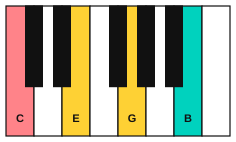
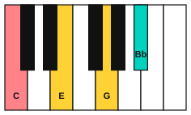
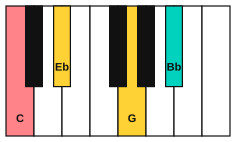

# Seventh chords

<span class="tag tag-theory">Theory</span>

After this lesson you can spell the five types of seventh chord on any note, name the seventh chords of a major key, and explain why V7 pulls so strongly to I.

Before this: [The chords of a key](02-diatonic-chords.md), [Cadences](03-cadences.md), [Open seventh chords](../04-intervals-and-triads/06-open-seventh-chords.md), [Interval qualities](../04-intervals-and-triads/02-interval-qualities.md). You need: your piano and your guitar.

## The idea

### One more third on top

A triad stacks two 3rds on a root. A **seventh chord** stacks a third 3rd on top, so it has four notes: root, 3rd, 5th and 7th. The 7th is the note a 7th above the root.

Play the C major triad (C, E, G), then add B on top, then lower B to Bb. The first gives a soft, jazzy chord, and the second a chord that leans forward and wants to move. These are two of the five seventh chord types.

```abc
X:1
M:4/4
L:1/4
Q:1/4=60
K:C
"C"[CEG]4 | "Cmaj7"[CEGB]4 | "C7"[CEG_B]4 |]
```

### The five types

Every seventh chord is one of five kinds, and each is named by a triad plus a 7th. This table builds all five on C.

| Chord | Notes | Triad | 7th above the root |
|---|---|---|---|
| Cmaj7 | C, E, G, B | major | major 7th |
| C7 | C, E, G, Bb | major | minor 7th |
| Cm7 | C, Eb, G, Bb | minor | minor 7th |
| Cm7b5 | C, Eb, Gb, Bb | diminished | minor 7th |
| Cdim7 | C, Eb, Gb, Bbb | diminished | diminished 7th |







The names have a standard wording. The **major 7th chord** (Cmaj7) is a major triad with a major 7th. The **dominant 7th chord** (C7) is a major triad with a minor 7th. The **minor 7th chord** (Cm7) is a minor triad with a minor 7th. The **half-diminished 7th chord** (Cm7b5) is a diminished triad with a minor 7th. The **diminished 7th chord** (Cdim7) is a diminished triad with a diminished 7th, and every note is a minor 3rd above the one before it.

Other books use other signs for the same chords: a triangle for major 7, a dash for minor, and a circle with a slash for half-diminished. This book uses the letters above, as chord charts do.

Listen to the five in a row, root C each time.

```abc
X:1
M:4/4
L:1/4
Q:1/4=60
K:C
"Cmaj7"[CEGB]4 | "C7"[CEG_B]4 | "Cm7"[C_EG_B]4 | "Cm7b5"[C_E_G_B]4 | "Cdim7"[C_E_G__B]4 |]
```

### The sevenths of a major key

Stack four notes of the C major scale on each degree to get the seventh chords of the key.

| Chord | Notes | Numeral | Type |
|---|---|---|---|
| Cmaj7 | C, E, G, B | Imaj7 | major 7th |
| Dm7 | D, F, A, C | ii7 | minor 7th |
| Em7 | E, G, B, D | iii7 | minor 7th |
| Fmaj7 | F, A, C, E | IVmaj7 | major 7th |
| G7 | G, B, D, F | V7 | dominant 7th |
| Am7 | A, C, E, G | vi7 | minor 7th |
| Bm7b5 | B, D, F, A | vii7b5 | half-diminished 7th |

Only V has the dominant 7th form: in every major key, V7 is the one seventh chord with a major 3rd and a minor 7th above its root. That makes it the clearest sign of where home is, and "V7" names one chord in the key.

### Why V7 pulls to I

G7 is G, B, D, F. The notes B and F are the 3rd and the 7th of the chord, and B up to F is a diminished 5th (six half steps, called the tritone). That interval sounds tense, and each note wants to step to a nearby note of the tonic chord: B rises a half step to C, and F falls a half step to E. Both of those notes belong to C major (C, E, G). This is why the tritone in V7 resolves so firmly.

Listen for the pull. The ii7 V7 I progression turns into a smooth path with the seventh chords. The voices barely move: D and F in Dm7 stay while the others step down, and in G7 to C the F falls to E.

```abc
X:1
M:4/4
L:1/4
Q:1/4=60
K:C
%%score {RH LH}
V:RH clef=treble
V:LH clef=bass
[V:RH] "Dm7"[DFAc]4 | "G7"[DFGB]4 | "Cmaj7"[CEGB]4 |]
[V:LH] D,4 | G,,4 | C,4 |]
```

In a minor key, V7 works the same way. In A minor, E7 is E, G#, B, D. The G# rises a half step to A and the D falls a half step to C, so E7 pulls to Am.

The 7th chords from stage 4 are V7 chords: A7 leans to D, D7 to G, E7 to A and B7 to E. In D major, A7 is V7 (A, C#, E, G); in G major, D7 is V7 (D, F#, A, C).

### Other 7th chords

A diminished 7th chord (Bdim7: B, D, F, Ab) has the same shape as the half-diminished one with one more half step down at the top. It appears in minor keys. In A minor, the chord on the raised 7th degree is G#dim7: G#, B, D, F, and it leans to Am.

## Try it

Exercise 1. Spell G7, Dm7 and Fmaj7.

<details class="solution" markdown>
<summary>Answer</summary>

G7: G, B, D, F. Dm7: D, F, A, C. Fmaj7: F, A, C, E.

</details>

Exercise 2. Write V7 for the keys of F major, G major and D major.

<details class="solution" markdown>
<summary>Answer</summary>

F major: C7 (C, E, G, Bb). G major: D7 (D, F#, A, C). D major: A7 (A, C#, E, G).

</details>

Exercise 3. In G7, which two notes form the tritone, and where do they go in C major?

<details class="solution" markdown>
<summary>Answer</summary>

B and F. B rises to C and F falls to E.

</details>

<div class="practice" markdown>

### Practice routine (30 minutes)

| Minutes | What to do | Tempo | Listen for |
|---|---|---|---|
| 5 | Warm-up: C major and A minor (harmonic) scales, hands separately | 60 bpm | Even volume |
| 15 | New skill: play the five types of seventh chord on C, then on G and F; say each chord's name and notes aloud as you play | 60 bpm | Major 7th soft, dominant 7th leaning |
| 5 | Ear training: play C7 then C, then Cmaj7 then C. Which one sounds like it needs to move? | Untimed | The tension in the dominant 7th |
| 5 | Guitar: A7 to D, D7 to G, E7 to A and B7 to E, one strum each | 60 bpm | The pull from the 7th chord to home |

Repeat this routine on at least three days.

</div>

<div class="move-on" markdown>

### Move on when

- [ ] You can spell all five seventh chord types on C, G and F from memory.
- [ ] You can write the seven seventh chords of C major and G major with numerals in under 4 minutes.
- [ ] You can name V7 in any major key you are given, in under 5 seconds.
- [ ] You can explain, in one sentence, which notes of V7 are the tritone and where each one goes.

</div>

## Common mistakes

Writing a major 7th as a flat 7th. Cmaj7 has B natural. C7 has Bb. The note names show the difference.

Calling every seventh chord a dominant 7th. The dominant 7th is the one built on the 5th note of the scale, with a major triad and a minor 7th. The others have their own names.

Playing the 7th as loud as the root. Let the 7th be the softest note, so the chord colour is clear.

## Key terms

- **Seventh chord**: a four-note chord of root, 3rd, 5th and 7th.
- **Major 7th chord** (maj7): major triad plus a major 7th.
- **Dominant 7th chord** (7): major triad plus a minor 7th, built on the 5th note of a scale.
- **Minor 7th chord** (m7): minor triad plus a minor 7th.
- **Half-diminished 7th chord** (m7b5): diminished triad plus a minor 7th.
- **Diminished 7th chord** (dim7): diminished triad plus a diminished 7th.
- **Tritone**: six half steps; the interval between the 3rd and 7th of V7.

Next: [Seventh chords on piano](05-seventh-chords-on-piano.md)
