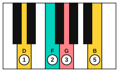
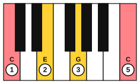

# Seventh chords on piano

<span class="tag tag-piano">Piano</span>

After this lesson you can play G7 and its inversions with the right hand, and play V7 to I in C, G and F with each voice moving as little as possible.

Before this: [Seventh chords](04-seventh-chords.md), [Inversions on piano](../04-intervals-and-triads/08-inversions-on-piano.md), [Triads and arpeggios on piano](../04-intervals-and-triads/05-triads-and-arpeggios-on-piano.md). You need: your piano.

## The idea

### A four-note chord in one hand

A seventh chord has four notes, so the right hand uses fingers 1, 2, 3 and 5 on the four notes from lowest to highest. Finger 4 stays free. The notes of G7 are G, B, D and F: G7 is G, B, D, F.

Play it in root position first: G4 with finger 1, B4 with finger 2, D5 with finger 3 and F5 with finger 5. Press all four keys together, with a relaxed hand and wrist. Then play the notes one at a time, from the bottom up, to check that your fingers sit over the right keys.

```abc
X:1
M:4/4
L:1/4
Q:1/4=60
K:C
%%score {RH LH}
V:RH clef=treble
V:LH clef=bass
[V:RH] "G7"[!1!G!2!B!3!d!5!f]4 | G B d f |]
[V:LH] G,,4 | z4 |]
```

### Inversions

As with triads, each note of the chord can be the lowest. A four-note chord has four positions. The one with the root lowest is root position, and the others are named by the note on the bottom.

| Position | Notes from the bottom | Bass note |
|---|---|---|
| Root position | G, B, D, F | G |
| 1st inversion | B, D, F, G | B |
| 2nd inversion | D, F, G, B | D |
| 3rd inversion | F, G, B, D | F |

Play all four in one hand, moving the hand up by the smallest move each time. Each inversion takes the lowest note and moves it an octave up to the top. Keep fingers 1, 2, 3 and 5 on the four notes in every position.

```abc
X:1
M:4/4
L:1/4
Q:1/4=60
K:C
"^root position"[G,B,DF]4 | "^1st inversion"[B,DFG]4 | "^2nd inversion"[DFGB]4 | "^3rd inversion"[FGBd]4 |]
```

Common mistake: pressing the notes one after another instead of together. Practise placing the whole hand shape over the keys before you press, then drop all four fingers at once.

### V7 to I with voice leading

When you play V7 and then I, move each finger by the shortest step. In G7 to C, the F falls a half step to E, the B rises a half step to C, and the G stays. G7 in 2nd inversion (D, F, G, B) leads to C in root position with the root doubled (C, E, G, C), and the hand moves very little.





Follow these steps.

1. Play G7 in 2nd inversion: D4 (finger 1), F4 (2), G4 (3), B4 (5).
2. Move to C: finger 1 falls from D to C, finger 2 falls from F to E, finger 3 stays on G, finger 5 rises from B to C.
3. Play the left hand on G2 for the G7 chord and C3 for the C chord.

```abc
X:1
M:4/4
L:1/4
Q:1/4=60
K:C
%%score {RH LH}
V:RH clef=treble
V:LH clef=bass
[V:RH] "G7"[!1!D!2!F!3!G!5!B]2 "C"[!1!C!2!E!3!G!5!c]2 | "G7"[DFGB]2 "C"[CEGc]2 |]
[V:LH] G,,2 C,2 | G,,2 C,2 |]
```

Common mistake at step 2: lifting the whole hand and finding the chord again. Keep the hand low and only change the three fingers that move.

### The same move in G and F

The pattern is the same in every key: take V7 in 2nd inversion and step to I with the root doubled. The right-hand notes change.

| Key | V7 (2nd inversion) | Resolves to |
|---|---|---|
| C major | D, F, G, B | C, E, G, C |
| G major | A, C, D, F# | G, B, D, G |
| F major | G, Bb, C, E | F, A, C, F |

In G major the V7 is D7 (D, F#, A, C), and in F major it is C7 (C, E, G, Bb).

```abc
X:1
M:4/4
L:1/4
Q:1/4=60
K:G
%%score {RH LH}
V:RH clef=treble
V:LH clef=bass
[V:RH] "D7"[A,CDF]2 "G"[G,B,DG]2 | "D7"[A,CDF]2 "G"[G,B,DG]2 |]
[V:LH] D,2 G,,2 | D,2 G,,2 |]
```

```abc
X:1
M:4/4
L:1/4
Q:1/4=60
K:F
%%score {RH LH}
V:RH clef=treble
V:LH clef=bass
[V:RH] "C7"[GBce]2 "F"[FAcf]2 | "C7"[GBce]2 "F"[FAcf]2 |]
[V:LH] C,2 F,,2 | C,2 F,,2 |]
```

## Try it

Exercise 1. Name the notes of G7 in 1st inversion and which finger plays each.

<details class="solution" markdown>
<summary>Answer</summary>

B, D, F, G, with fingers 1, 2, 3 and 5.

</details>

Exercise 2. In C7 to F, which note falls by a half step, and which rises by a half step?

<details class="solution" markdown>
<summary>Answer</summary>

Bb falls to A, and E rises to F. The G falls a whole step to F, and the C stays.

</details>

Exercise 3. Write the 2nd inversion of D7 and say where each note goes in G major.

<details class="solution" markdown>
<summary>Answer</summary>

A, C, D, F#. A falls to G, C falls to B, D stays and F# rises to G.

</details>

<div class="practice" markdown>

### Practice routine (30 minutes)

| Minutes | What to do | Tempo | Listen for |
|---|---|---|---|
| 5 | Warm-up: C and G major scales, right hand, two octaves | 60 bpm | Even touch through the thumb crossing |
| 15 | New skill: G7 in all four positions, then G7 to C with the voice leading; then D7 to G and C7 to F | 50 bpm, then 60 | The F falling to E |
| 5 | Reading: play ii7 V7 Imaj7 in C from the chord symbols (Dm7, G7, Cmaj7) | 50 bpm | Small moves between chords |
| 5 | Guitar: A7 to D, D7 to G, E7 to A, one strum each | 60 bpm | The same pull to home on the guitar |

Repeat this routine on at least three days.

</div>

<div class="move-on" markdown>

### Move on when

- [ ] You can play G7 in four positions with fingers 1, 2, 3 and 5, all notes sounding together, at 60 bpm.
- [ ] You can play G7 to C in C with the voice leading, left hand included, three times in a row at 60 bpm.
- [ ] You can play D7 to G and C7 to F, three times in a row each, with no stops.
- [ ] You can say which note of V7 falls and which rises, in each of the three keys.

</div>

## Common mistakes

Playing the chord with finger 4 instead of 5. Finger 4 is weak and short. The span from the root to the 7th is easier with finger 5 on the top note.

Hitting the keys one after another. Press all four down together and listen for a clean block.

Playing V7 and I at the same volume. Let the I chord be a little softer, as the music relaxes.

## Key terms

- **Voice leading**: moving each note of a chord to the nearest note of the next chord.
- **3rd inversion**: a seventh chord with its 7th as the lowest note.

Next: [Major 7 and minor 7 barre shapes](06-maj7-and-min7-barre-shapes.md)
