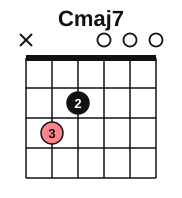
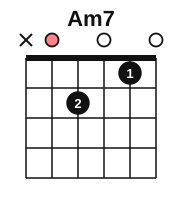
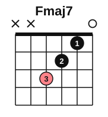
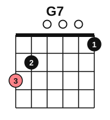
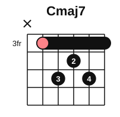
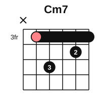
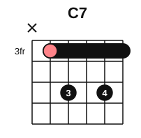
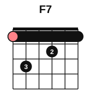
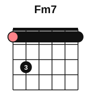

# Major 7 and minor 7 barre shapes

<span class="tag tag-guitar">Guitar</span>

After this lesson you can play the open Cmaj7, Am7, Fmaj7 and G7 chords, and the movable maj7, m7 and 7 barre shapes with the root on string 5, so you can play each of them on any root.

Before this: [Seventh chords](04-seventh-chords.md), [A-shape barre chords](../08-fretboard-barre-chords-and-caged/03-a-shape-barre-chords.md), [E-shape barre chords](../08-fretboard-barre-chords-and-caged/02-e-shape-barre-chords.md), [Every note on the fretboard](../08-fretboard-barre-chords-and-caged/01-fretboard-all-notes.md), [Open seventh chords](../04-intervals-and-triads/06-open-seventh-chords.md). You need: your guitar, a pick and a tuner.

## The idea

### Open shapes

Start with three shapes you can make by changing a chord you know. Each diagram is read as before: the left line is string 6, o is open, x is not played, and the salmon marker is the root.

Cmaj7: C, E, G, B. Play strings 5 to 1. Start from C (finger 1 on string 2, fret 1) and lift finger 1, so string 2 rings open as B. Finger 2 is on string 4, fret 2 and finger 3 is on string 5, fret 3.



Am7: A, C, E, G. Play strings 5 to 1. Start from Am (A, C, E) and lift finger 3, so string 3 rings open as G. Finger 2 is on string 4, fret 2 and finger 1 is on string 2, fret 1.



Fmaj7: F, A, C, E. Play strings 4 to 1. Finger 3 on string 4, fret 3, finger 2 on string 3, fret 2 and finger 1 on string 2, fret 1. String 1 rings open.



You also need the dominant 7th chord that leads to C: G7 (G, B, D, F). Play all six strings. Finger 3 on string 6, fret 3, finger 2 on string 5, fret 2 and finger 1 on string 1, fret 1.



Strum each one and listen. Cmaj7 and Fmaj7 sound open and calm. Am7 sounds mellow. G7 sounds like it wants to move to C.

### The movable shapes

A barre shape has no open strings, so the whole shape slides up the neck. The root on string 5 gives three shapes that use the same frets, with one or two notes changed. All three are drawn here with the root at fret 3, which is C.







Say r for the fret of the root on string 5. The frets from string 5 to string 1 are:

| Shape | Frets (string 5 to 1) | At r = 3 |
|---|---|---|
| maj7 | r, r+2, r+1, r+2, r | 3, 5, 4, 5, 3 |
| m7 | r, r+2, r, r+1, r | 3, 5, 3, 4, 3 |
| 7 | r, r+2, r, r+2, r | 3, 5, 3, 5, 3 |

At r = 3 the chords are:

| Chord | Notes |
|---|---|
| Cmaj7 | C, E, G, B |
| Cm7 | C, Eb, G, Bb |
| C7 | C, E, G, Bb |

Do not play string 6 in any of these three. Mute it with the tip of your barre finger, or avoid it with your pick.

Follow these steps for each shape.

1. Lay finger 1 across strings 5 to 1 at fret r, close behind the fret wire.
2. Add the other fingers as shown, one at a time, and pluck each string to check it rings.
3. Strum strings 5 to 1 with a down stroke and let it ring.
4. To change root, slide the whole shape. The fret of the root on string 5 tells you its name: fret 1 is Bb, 2 is B, 3 is C, 5 is D, 7 is E, 8 is F, 10 is G and 12 is A.

Common mistake at step 1: a barre that only presses strings 5 and 4. Rotate the finger slightly onto its bony side, and check strings 3, 2 and 1.

With the root on string 6, two more shapes use the E-shape barre: F7 (1, 3, 1, 2, 1, 1) and Fm7 (1, 3, 1, 1, 1, 1) from fret 1. Slide them up the neck with the root on string 6: fret 3 is G, fret 5 is A, fret 8 is C. The notes are F7: F, A, C, Eb and Fm7: F, Ab, C, Eb.





### A progression with sevenths

Play Cmaj7, Am7, Dm7 and G7. Dm7 is the m7 shape with the root at fret 5 on string 5 (frets 5, 7, 5, 6, 5). Listen for the smooth, soft sound that seventh chords give to I vi ii V.

```abc
%%opts tab=guitar
X:1
M:4/4
L:1/4
Q:1/4=60
K:C clef=treble-8
"Cmaj7"[CEGBe]4 | "Am7"[A,EGce]4 | "Dm7"[DAcfa]4 | "G7"[G,B,DGBf]4 |]
```

## Try it

Exercise 1. Where do you put the maj7 barre shape to play Fmaj7, Gmaj7 and Amaj7 with the root on string 5?

<details class="solution" markdown>
<summary>Answer</summary>

Fmaj7 at fret 8 (string 5, fret 8 is F), Gmaj7 at fret 10 and Amaj7 at fret 12 (or the open A string).

</details>

Exercise 2. What is the one note that changes between C7 and Cm7 in these shapes?

<details class="solution" markdown>
<summary>Answer</summary>

The note on string 2. In C7 it is E (fret 5) and in Cm7 it is Eb (fret 4). One note moves down a half step: the 3rd.

</details>

Exercise 3. Spell Am7, Cmaj7 and Fmaj7.

<details class="solution" markdown>
<summary>Answer</summary>

Am7: A, C, E, G. Cmaj7: C, E, G, B. Fmaj7: F, A, C, E.

</details>

<div class="practice" markdown>

### Practice routine (30 minutes)

| Minutes | What to do | Tempo | Listen for |
|---|---|---|---|
| 5 | Warm-up: Am, C, F and G chords, one strum each | 60 bpm | A clean change on beat 1 |
| 15 | New skill: Cmaj7, Am7, Fmaj7 and G7 open; then the three barre shapes at fret 3, then slide them to fret 5 (D) and fret 8 (F) | 50 bpm | Every string clear, with no buzz |
| 5 | Reading: play Cmaj7 Am7 Dm7 G7 from the chord symbols, four strums each | 50 bpm | Smooth changes |
| 5 | Piano: G7 to C with voice leading ([lesson 5](05-seventh-chords-on-piano.md)) | 60 bpm | The same pull on piano |

Repeat this routine on at least three days.

</div>

<div class="move-on" markdown>

### Move on when

- [ ] You can play Cmaj7, Am7, Fmaj7 and G7 open, every string clear, from the names.
- [ ] You can play the maj7, m7 and 7 barre shapes on root C (fret 3), each with every string clear.
- [ ] You can play Cmaj7, Am7, Dm7, G7 with four strums per bar at 60 bpm, twice through with no stops.
- [ ] You can name the chord for any root fret on string 5 in under 3 seconds.

</div>

## Common mistakes

Strumming string 6. The shapes have no string 6 note, and a low open E ruins the chord. Mute it or skip it.

A thumb that sits too low on the neck. Keep it behind the neck near the middle, so the barre has strength.

Squeezing too hard. A barre needs the right place for the finger, not extra force. Stop if your hand hurts, and see a teacher or a doctor if it keeps happening.

## Key terms

- **Movable shape**: a chord shape with no open strings, which slides to any fret to change its root.
- **Maj7, m7, 7 shapes**: the three barre shapes with the root on string 5.

Next: [Cadences at the piano](07-cadences-at-the-piano.md)
