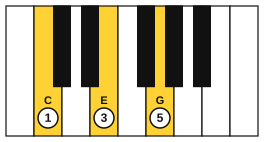
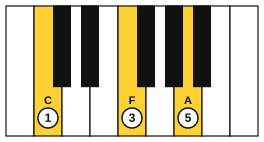
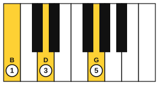

# Cadences at the piano

<span class="tag tag-piano">Piano</span>

After this lesson you can play the perfect, plagal, half and deceptive cadences in C, G, F, D and A minor, with a right-hand triad that moves by the nearest inversion and a left-hand root.

Before this: [Cadences](03-cadences.md), [Seventh chords on piano](05-seventh-chords-on-piano.md), [Inversions on piano](../04-intervals-and-triads/08-inversions-on-piano.md). You need: your piano.

## The idea

### One shape that works in every key

In lesson 3 you played the cadences as chord names. To play them well, think of the right-hand notes as three voices (the top, middle and bottom notes), and move each voice as little as possible. Three rules cover almost everything.

1. A note that two chords share stays where it is (a common tone).
2. The other notes move by the smallest step to the next chord.
3. The left hand plays the root of each chord.

In C major these rules give one shape for I, IV and V that you reuse in every key.

| Chord | Notes in the right hand (low to high) | Position | Fingers |
|---|---|---|---|
| I | C, E, G | root position | 1, 3, 5 |
| IV | C, F, A | 2nd inversion | 1, 3, 5 |
| V | B, D, G | 1st inversion | 1, 3, 5 |







Going from I to IV, the C stays and E and G step up to F and A. From IV to V, the C steps down to B, F steps down to D and A steps down to G. From V to I, B and D step up to C and E, and the G stays.

```abc
X:1
M:4/4
L:1/4
Q:1/4=60
K:C
%%score {RH LH}
V:RH clef=treble
V:LH clef=bass
[V:RH] "C"[CEG]4 | "F"[CFA]4 | "G"[B,DG]4 | "C"[CEG]4 |]
[V:LH] C,4 | F,4 | G,4 | C,4 |]
```

### The four cadences from this shape

Use the same three shapes and change the order. Notes are written low to high.

| Cadence | Chords | Right-hand notes in C |
|---|---|---|
| Perfect | IV, V, I | C, F, A then B, D, G then C, E, G |
| Plagal | V, IV, I | B, D, G then C, F, A then C, E, G |
| Half | I, IV, V | C, E, G then C, F, A then B, D, G |
| Deceptive | IV, V, vi | C, F, A then B, D, G then C, E, A |

Check the deceptive cadence. The vi chord is Am: A, C, E. From V (B, D, G), B and D step up to C and E, and G steps up to A. All three voices move up a step.

Hear the plagal and deceptive endings in C, played slowly.

```abc
X:1
M:4/4
L:1/4
Q:1/4=60
K:C
%%score {RH LH}
V:RH clef=treble
V:LH clef=bass
[V:RH] "G"[B,DG]4 | "F"[CFA]4 | "C"[CEG]4 | "F"[CFA]4 | "G"[B,DG]4 | "Am"[CEA]4 |]
[V:LH] G,4 | F,4 | C,4 | F,4 | G,4 | A,,4 |]
```

### Moving the shape to other keys

Transpose each voice by the same interval. The shape never changes: root position I, 2nd inversion IV, 1st inversion V.

| Key | I | IV | V |
|---|---|---|---|
| C major | C, E, G | C, F, A | B, D, G |
| G major | G, B, D | G, C, E | F#, A, D |
| F major | F, A, C | F, Bb, D | E, G, C |
| D major | D, F#, A | D, G, B | C#, E, A |

Play the perfect cadence IV V I in G, F and D. The left hand plays the roots.

```abc
X:1
M:4/4
L:1/4
Q:1/4=60
K:G
%%score {RH LH}
V:RH clef=treble
V:LH clef=bass
[V:RH] "G"[GBd]4 | "C"[Gce]4 | "D"[FAd]4 | "G"[GBd]4 |]
[V:LH] G,4 | C,4 | D,4 | G,4 |]
```

```abc
X:1
M:4/4
L:1/4
Q:1/4=60
K:F
%%score {RH LH}
V:RH clef=treble
V:LH clef=bass
[V:RH] "F"[FAc]4 | "Bb"[FBd]4 | "C"[EGc]4 | "F"[FAc]4 |]
[V:LH] F,4 | B,,4 | C,4 | F,4 |]
```

```abc
X:1
M:4/4
L:1/4
Q:1/4=60
K:D
%%score {RH LH}
V:RH clef=treble
V:LH clef=bass
[V:RH] "D"[DFA]4 | "G"[DGB]4 | "A"[CEA]4 | "D"[DFA]4 |]
[V:LH] D,4 | G,,4 | A,,4 | D,4 |]
```

### In a minor key

In A minor, the voices are i (C, E, A), iv (D, F, A) and V (B, E, G#). The V chord uses the raised 7th, G#. From V to i, B steps up to C, G# steps up to A and E stays.

```abc
X:1
M:4/4
L:1/4
Q:1/4=60
K:Am
%%score {RH LH}
V:RH clef=treble
V:LH clef=bass
[V:RH] "Am"[CEA]4 | "Dm"[DFA]4 | "E"[B,E^G]4 | "Am"[CEA]4 |]
[V:LH] A,,4 | D,4 | E,4 | A,,4 |]
```

## Try it

Exercise 1. In G major, write the right-hand notes for the deceptive cadence V to vi.

<details class="solution" markdown>
<summary>Answer</summary>

V is F#, A, D and vi is Em with G, B, E. F# steps up to G, A steps up to B and D steps up to E.

</details>

Exercise 2. In F major, what are the right-hand notes of the plagal cadence IV to I?

<details class="solution" markdown>
<summary>Answer</summary>

IV is F, Bb, D and I is F, A, C. The F stays, Bb steps down to A and D steps down to C.

</details>

Exercise 3. In D major, which voice stays still from I to IV?

<details class="solution" markdown>
<summary>Answer</summary>

D. The chord I is D, F#, A and IV is D, G, B, so the bottom D stays while F# and A step up to G and B.

</details>

<div class="practice" markdown>

### Practice routine (30 minutes)

| Minutes | What to do | Tempo | Listen for |
|---|---|---|---|
| 5 | Warm-up: C and G major scales, hands together if you can, hands separately if not | 60 bpm | Even volume |
| 15 | New skill: the perfect cadence in C, G, F and D; then the plagal, half and deceptive cadences in C and G | 50 bpm, then 60 | Common tones staying still, steps between the rest |
| 5 | Ear training: play a cadence in C without naming it, then name it from the sound alone | Untimed | Finished, soft, open or surprised |
| 5 | Guitar: G, C, D and G, then Am, Dm, E and Am, four strums per chord | 60 bpm | The tonic ringing at the end |

Repeat this routine on at least three days.

</div>

<div class="move-on" markdown>

### Move on when

- [ ] You can play the perfect cadence in C, G, F and D, left hand included, with no stops at 60 bpm.
- [ ] You can play all four cadence types in C from the names, three times in a row.
- [ ] You can play the perfect and plagal cadences in A minor with the raised G#.
- [ ] You can say which note stays and which move by step, for any chord change in the shape.

</div>

## Common mistakes

Lifting the whole hand between chords. Keep the hand in one place and move the fingers that need to move.

Forgetting the key signature in the new key. In F major the IV chord has Bb, and in D major the V chord has C#.

Playing the left-hand root with the wrong octave. If the left hand sits too high it muddies the right hand. Stay in the bass clef.

## Key terms

- **Common tone**: a note shared by two chords, kept in the same voice.
- **Voice**: one line of a chord's notes, such as the top note of the right hand.

Next: [Minor-key progressions on guitar](08-minor-key-progressions.md)
