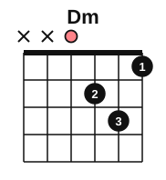
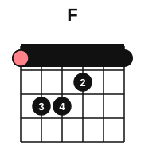

# Minor-key progressions on guitar

<span class="tag tag-guitar">Guitar</span>

After this lesson you can play the progressions i iv v, i iv V and i VI III VII on the guitar in A minor and in E minor, strumming a steady pattern, and hear the difference between a minor v and a major V.

Before this: [Roman numerals](01-roman-numerals.md), [Cadences](03-cadences.md), [Eighth-note strumming](../04-intervals-and-triads/09-eighth-note-strumming.md), [The A minor and D chords](../02-two-hands-and-first-chords/06-chords-a-minor-and-d.md), [Open seventh chords](../04-intervals-and-triads/06-open-seventh-chords.md). You need: your guitar, a pick, a tuner and a metronome.

## The idea

### Three progressions

Minor keys use three common patterns. Each one is written in numerals first and then in A minor.

| Numerals | Chords in A minor | What it sounds like |
|---|---|---|
| i iv v | Am, Dm, Em | Gentle and open. The v chord is minor, so there is no strong pull home. |
| i iv V | Am, Dm, E | Stronger. The major V has G#, which pulls up to A. |
| i VI III VII | Am, F, C, G | A loop with no pull home. Every chord is a note of the natural minor scale. |

The first two differ by one chord and by one note. Em is E, G, B and E is E, G#, B. The G rises a half step to G#, and that G# is the leading tone of A minor, a half step below the tonic.

Listen to both, bar by bar. Strum each chord once and let it ring, and hear what the E does to the end.

```abc
%%opts tab=guitar
X:1
M:4/4
L:1/4
Q:1/4=60
K:Am clef=treble-8
"Am"[A,EAce]4 | "Dm"[DAdf]4 | "Em"[E,B,EGBe]4 | "Am"[A,EAce]4 |
"Am"[A,EAce]4 | "Dm"[DAdf]4 | "E"[E,B,E^GBe]4 | "Am"[A,EAce]4 |]
```

### The shapes

All of these are shapes you know except the F, which is the barre chord from stage 8. The diagram is read the usual way: the left line is string 6, and the salmon marker is the root.







Em, C and G are the shapes from earlier stages. Em is E, G, B. C is C, E, G. G is G, B, D.

### The loop Am F C G

The third progression, i VI III VII, is the loop from the stage 5 lesson on lead sheets. It uses the same four chords as C, Am, F, G (I vi IV V in C major), in a new order. Because it begins on Am, the ear takes Am as home, and the chords turn around it. It has no V to pull back, so it can repeat without ending.

```abc
%%opts tab=guitar
X:1
M:4/4
L:1/4
Q:1/4=60
K:Am clef=treble-8
"Am"[A,EAce]4 | "F"[F,CFAcf]4 | "C"[CEGce]4 | "G"[G,B,DGBg]4 |
"Am"[A,EAce]4 | "F"[F,CFAcf]4 | "C"[CEGce]4 | "G"[G,B,DGBg]4 |]
```

### Strumming them

Follow these steps for each progression in turn.

1. Play four down strokes per bar, one on each beat, at 60 bpm. Change chord on beat 1, and keep the arm swinging through the change.
2. When you can do four clean rounds, switch to the pattern D D U U D U from stage 4: down on 1 and 2, up on the "&" of 2, up on the "&" of 3, down on 4 and up on the "&" of 4.
3. Accent the first down stroke of each bar a little, so the changes stay clear.

Common mistake at step 1: stopping the arm at the chord change. If the new chord is not ready, play the old shape and take the new one a bar later; never stop counting.

### Another key: E minor

The same three patterns work in E minor, a key that lives on the open strings. The scale has one sharp (F#), and the chords are Em, Am, Bm (or B7), C, G and D.

| Numerals | Chords in E minor |
|---|---|
| i iv v | Em, Am, Bm |
| i iv V7 | Em, Am, B7 |
| i VI III VII | Em, C, G, D |

B7 is the open shape from stage 4, B, D#, F#, A. Its D# is the leading tone of E minor.

```abc
%%opts tab=guitar
X:1
M:4/4
L:1/4
Q:1/4=60
K:Em clef=treble-8
"Em"[E,B,EGBe]4 | "Am"[A,EAce]4 | "B7"[B,^DABf]4 | "Em"[E,B,EGBe]4 |]
```

## Try it

Exercise 1. Spell E and Em, and name the note that changes.

<details class="solution" markdown>
<summary>Answer</summary>

E: E, G#, B. Em: E, G, B. The 3rd changes: G (in Em) becomes G# (in E).

</details>

Exercise 2. Write i VI III VII in E minor and in D minor.

<details class="solution" markdown>
<summary>Answer</summary>

E minor: Em, C, G, D. D minor: Dm, Bb, F, C.

</details>

Exercise 3. In A minor, which of the three progressions has the strongest pull to the last Am, and why?

<details class="solution" markdown>
<summary>Answer</summary>

i iv V. The E major chord contains G#, the leading tone, which rises a half step to A.

</details>

<div class="practice" markdown>

### Practice routine (30 minutes)

| Minutes | What to do | Tempo | Listen for |
|---|---|---|---|
| 5 | Warm-up: Am, Dm, E, Em, C and G, one strum each | 60 bpm | Every string clear |
| 15 | New skill: i iv v, i iv V and i VI III VII in A minor, four strums per bar, then D D U U D U | 50 bpm, then 60 | No gaps at the chord changes |
| 5 | Reading: from the chord symbols, play the E minor loop Em C G D | 60 bpm | Steady count through the changes |
| 5 | Piano: the A minor cadences from [lesson 7](07-cadences-at-the-piano.md) | 60 bpm | G# in the V chord |

Repeat this routine on at least three days.

</div>

<div class="move-on" markdown>

### Move on when

- [ ] You can play i iv v and i iv V in A minor, four strums per bar, three times in a row at 60 bpm.
- [ ] You can play i VI III VII in A minor, four rounds with no stops at 60 bpm.
- [ ] You can play the E minor loop Em C G D with the pattern D D U U D U for 8 bars at 60 bpm.
- [ ] You can say, without looking, the difference between Em and E in A minor.

</div>

## Common mistakes

Playing Em where the music has E. The two chords differ by one note, and the minor v has no leading tone. Check the chord symbol.

Letting the barre F buzz. Press with the side of the index finger and lay it flat on strings 1 and 2.

Strumming too hard on the first beat. A small accent is enough to show the bar.

## Key terms

- **Minor v**: the chord on the 5th note of the natural minor scale, minor in quality (Em in A minor).
- **Major V in minor**: the chord on the 5th note of the harmonic minor scale, which has the leading tone (E in A minor).

Next: [Non-chord tones](09-non-chord-tones.md)
