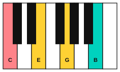
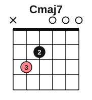

# Stage 9: Harmony

This stage shows how chords work together. You name chords with Roman numerals, learn what job each chord of a key does, and learn the four cadences that end phrases. You add seventh chords on both instruments, play minor-key progressions on the guitar, and learn the names of the notes that sit outside a chord. You then play Chopin's Prelude in A major, train your ear on progressions, and put it all together by analysing a piece. By the end, you can read the harmony of a short piece and hear where it is going. It usually takes about 4 to 6 weeks at 30 minutes a day.

<!-- lessons:start -->
## Lessons

1. [Roman numerals](01-roman-numerals.md) (theory)
2. [The chords of a key](02-diatonic-chords.md) (theory)
3. [Cadences](03-cadences.md) (theory)
4. [Seventh chords](04-seventh-chords.md) (theory)
5. [Seventh chords on piano](05-seventh-chords-on-piano.md) (piano)
6. [Major 7 and minor 7 barre shapes](06-maj7-and-min7-barre-shapes.md) (guitar)
7. [Cadences at the piano](07-cadences-at-the-piano.md) (piano)
8. [Minor-key progressions on guitar](08-minor-key-progressions.md) (guitar)
9. [Non-chord tones](09-non-chord-tones.md) (theory)
10. [Chopin: Prelude in A major](10-chopin-prelude-in-a-major.md) (piano)
11. [Hearing chord progressions 2](11-hearing-progressions-2.md) (ear)
12. [Analysing a piece](12-analysing-a-piece.md) (theory)

<!-- lessons:end -->

Download the stage 9 deck: [09-harmony.apkg](../downloads/anki/09-harmony.apkg)

## Cheat sheet

Everything to remember from this stage, on one page.

### Roman numerals

Upper case is a major chord, lower case is a minor chord, and a small circle (°) is a diminished chord. The number is the scale degree of the chord's root.

| Key | I | ii | iii | IV | V | vi | vii° |
|---|---|---|---|---|---|---|---|
| C major | C | Dm | Em | F | G | Am | Bdim |
| G major | G | Am | Bm | C | D | Em | F#dim |
| F major | F | Gm | Am | Bb | C | Dm | Edim |

In every major key the qualities are major, minor, minor, major, major, minor, diminished.

| Key | i | ii° | III | iv | v | VI | VII |
|---|---|---|---|---|---|---|---|
| A minor | Am | Bdim | C | Dm | Em | F | G |
| E minor | Em | F#dim | G | Am | Bm | C | D |

In a minor key the harmonic minor raises the 7th note, so the v becomes a major V (E in A minor) and the VII becomes a vii° (G#dim in A minor).

### Chord functions

| Function | Chords in a major key | Job |
|---|---|---|
| Tonic | I, with vi and iii | Home |
| Subdominant | IV, with ii | Leaves home |
| Dominant | V, with vii° | Tension, wants to return |

The usual path is tonic, then subdominant, then dominant, then tonic. Common progressions: I IV V I, I vi IV V, I V vi IV and ii V I.

### Cadences

| Cadence | Chords | Sound |
|---|---|---|
| Perfect (authentic) | V to I | Finished |
| Plagal | IV to I | Finished, softer |
| Half (imperfect) | any chord to V | Open |
| Deceptive | V to vi | Surprise |

In C major: G to C (perfect), F to C (plagal), C to G (half), G to Am (deceptive). In A minor: E to Am (perfect), Dm to Am (plagal), Am to E (half), E to F (deceptive).

### Seventh chords

| Chord | Notes | Made of |
|---|---|---|
| Cmaj7 | C, E, G, B | major triad, major 7th |
| C7 | C, E, G, Bb | major triad, minor 7th |
| Cm7 | C, Eb, G, Bb | minor triad, minor 7th |
| Cm7b5 | C, Eb, Gb, Bb | diminished triad, minor 7th (half-diminished) |
| Cdim7 | C, Eb, Gb, Bbb | diminished triad, diminished 7th |

The seventh chords of C major are Cmaj7, Dm7, Em7, Fmaj7, G7, Am7 and Bm7b5, with numerals Imaj7, ii7, iii7, IVmaj7, V7, vi7 and vii7b5. V7 is the only dominant 7th chord in a major key.

The tritone in V7 is the 3rd and the 7th, for example B and F in G7. B rises to C and F falls to E.

G7 in 2nd inversion (D, F, G, B) resolves to C (C, E, G, C): D falls to C, F falls to E, G stays and B rises to C.

### Guitar shapes

Open: Cmaj7 (x 3 2 0 0 0), Am7 (x 0 2 0 1 0), Fmaj7 (x x 3 2 1 0), G7 (3 2 0 0 0 1).

Movable shapes with the root on string 5 (r is the root fret): maj7 is x r r+2 r+1 r+2 r, m7 is x r r+2 r r+1 r, and 7 is x r r+2 r r+2 r.

### Non-chord tones

| Name | How it behaves |
|---|---|
| Passing tone | Steps between two chord tones, in one direction |
| Neighbour tone | Steps away from a chord tone and back |
| Suspension | Held (tied) from the old chord, then falls by step |
| Appoggiatura | Leaps onto a strong beat, then steps away |
| Anticipation | A note of the next chord, arriving early |
| Escape tone | Reached by step, left by a leap in the opposite direction |

### Analysing a piece

1. Key. 2. Time signature and phrases. 3. Chords from the bass. 4. Roman numerals. 5. Cadences at phrase ends. 6. Non-chord tones.
