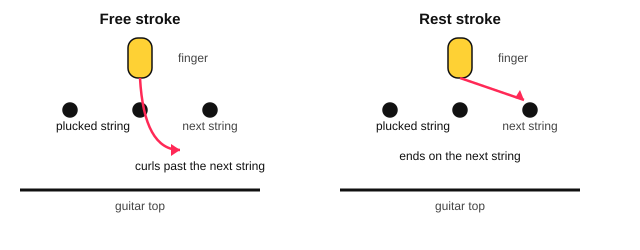

# Fingerstyle posture and studies

<span class="tag tag-guitar">Guitar</span>

After this lesson you can sit with your steel-string guitar in the classical position, play rest strokes and free strokes with p, i, m and a, and read a short guitar study written in two voices.

Before this: [Fingerpicking basics](../05-minor-keys-and-chord-charts/10-fingerpicking-basics.md), [Reading notation on guitar](../03-the-major-scale-and-keys/11-reading-notation-on-guitar.md), [Holding the guitar, tuning and the pick](../01-first-sounds/06-holding-tuning-and-the-pick.md). You need: your guitar, a footstool or a strap, and a metronome.

## The idea

### Classical pieces on a steel-string guitar

The guitar studies in this stage were written in the early 1800s by Giuliani, Carulli, Sor, Carcassi and Aguado. They were written for a guitar with gut strings, and the classical guitar today has nylon strings. You own a steel-string acoustic. Every piece in this stage can be played on it, and a few things change.

| Thing | Nylon classical guitar | Your steel-string guitar | What you do |
|---|---|---|---|
| String tension | Lower | Higher, and the strings are thin and hard | Press only as hard as needed to stop the buzz, close behind the fret |
| Fretting fingertips | Soft strings, little soreness | Sore at first, then calluses form in a few weeks | Play in short sessions and stop if a fingertip hurts |
| Picking hand | Fingernails shaped to pluck | Steel wears nails down and can split them | Use the flesh of the fingertip, or nails kept short, and play lightly |
| Sound | Round, short | Bright, rings longer | Stop a bass note with a finger or the thumb when the score has a rest |
| Neck | Wide, strings far apart | Narrower, strings closer | Curve the fingers more so they do not touch the next string |

The play bar on these pieces uses a nylon-guitar sound, so what you hear from the page is rounder and shorter than what your guitar makes. The notes are the same.

### Sitting in the classical position

Pick-playing in lesson 6 had the guitar on your right thigh. Classical players put it on the left thigh. Follow these steps.

1. Sit on the front half of a chair with no arms, back upright and feet flat.
2. Lift your left foot onto a footstool, so the left thigh slopes up. If you have no footstool, use a strap and sit with the guitar on your left thigh, letting the strap hold the neck up.
3. Let the guitar's waist rest on your left thigh and its lower curve against your chest or right thigh, so it stays still when you let go of the neck.
4. Tilt the neck up so the fretting hand reaches the low frets without twisting your wrist.
5. Rest your right forearm on the edge of the guitar, with the wrist straight and the fingers over strings 3, 2 and 1 near the soundhole.

A steel-string guitar is usually wider than a classical guitar, so you may need to move it a little to the right. If your back, shoulder, wrist or fingers hurt, stop. If it keeps happening, see a teacher or a doctor.

### Two ways to pluck

You know the finger letters from fingerpicking basics: p is the thumb, i the index, m the middle and a the ring finger. Classical playing uses two kinds of stroke with them.

In a **free stroke** the finger plucks the string and curls toward your palm in the air, passing the next string without touching it. Use it for arpeggios (chord notes played one at a time) and for chords.

In a **rest stroke** the finger pushes through the string and comes to rest on the next string. It makes a fuller, louder sound, so use it for a single melody line that should stand out.



Alternate i and m on a melody, never the same finger twice in a row. The thumb plays the bass strings and can use either stroke.

### Reading a study

A **study** (also called an etude) is a piece that practises one skill. Guitar studies are usually written in **two voices** on one staff: the melody has the stems up, and the bass has the stems down. They sound together, so the page shows two lines at once. In the tab, the bass notes sit on the lower strings.

Before you play a study, scan it in this order.

1. The key signature and the time signature.
2. Repeat signs, and any words such as Fine.
3. The lowest and the highest note.
4. The bars that look different from the others.

Common mistake at step 4: starting at bar 1 and finding the hard bar when you reach it. Find it first and practise it first.

## Hear and see

Example 1: rest strokes. Play each note with i and m alternating. Listen for an even, full tone on every note.

```abc
%%opts tab=guitar sound=nylon
X:1
M:4/4
L:1/4
Q:1/4=60
K:C clef=treble-8
e f g f | e d c d | e4 |]
```

Example 2: free strokes. The thumb plays the bass note C on string 5, then i, m and a play strings 3, 2 and 1. Keep the chord shape held for both bars.

```abc
%%opts tab=guitar sound=nylon
X:1
M:4/4
L:1/4
Q:1/4=60
K:C clef=treble-8
C G c e | G c e c | C G c e | G c e c |]
w: p i m a|i m a m|p i m a|i m a m
```

Example 3: two voices. The melody (stems up) is on strings 1 and 2, and the bass (stems down) is on strings 5 and 6. Play both together with the thumb on the bass.

```abc
%%opts tab=guitar sound=nylon
X:1
M:4/4
L:1/4
Q:1/4=60
K:C
%%score (Melody Bass)
V:Melody clef=treble-8
V:Bass clef=treble-8
V:Melody
e2 d2 | c2 B2 | c4 |]
V:Bass
C2 G,2 | C2 G,2 | C4 |]
```

## Try it

Exercise 1. Which stroke suits a melody that must stand out, and which suits an arpeggio?

<details class="solution" markdown>
<summary>Answer</summary>

A rest stroke for the melody, and a free stroke for the arpeggio.

</details>

Exercise 2. In Example 3, bar 1, which string and fret play the two bass notes?

<details class="solution" markdown>
<summary>Answer</summary>

The first bass note, C, is on string 5 at fret 3. The second, G, is on string 6 at fret 3.

</details>

Exercise 3. In Example 1, the sixth note is the first d. Which string and fret is it?

<details class="solution" markdown>
<summary>Answer</summary>

String 2, fret 3. The first five notes are e f g f e, so the sixth note is d on string 2.

</details>

<div class="practice" markdown>

### Practice routine (30 minutes)

| Minutes | What to do | Tempo | Listen for |
|---|---|---|---|
| 5 | Warm-up: set up the posture, then p i m a on the open strings 4, 3, 2, 1, free stroke | 60 bpm | Even volume on all four fingers |
| 5 | Example 1 with rest strokes, i and m alternating | 60 bpm | A full tone on every note |
| 8 | Example 2 with free strokes, then both examples back to back | 60 bpm | All strings of the chord ring together |
| 7 | Example 3, hands separately, then together | 50 bpm, then 60 | The bass does not drown the melody |
| 5 | Piano: Minuet in G, right hand | 80 bpm | Even quarter notes |

Repeat this routine on at least three days before you check the boxes below.

</div>

<div class="move-on" markdown>

### Move on when

- [ ] You can sit in the classical position for the whole routine with no pain, and the guitar stays still when you let go of the neck.
- [ ] You can play Example 1 with alternating i and m at 60 bpm, three times in a row with an even tone.
- [ ] You can play Example 2 at 60 bpm, three times in a row, with every string of the chord ringing.
- [ ] You can play Example 3 at 60 bpm, three times in a row with no stops.

</div>

## Common mistakes

Playing the same finger twice in a row on a melody. It sounds uneven and slows you down. Alternate i and m.

Plucking by lifting the string away from the guitar. The string should be pulled across and released. Curl the whole finger toward the palm.

Squeezing the neck because the strings feel stiff. Press with only enough force to stop the buzz, and keep the thumb relaxed behind the neck.

## Film yourself

Watch: [Rest Stroke vs Free Stroke: ULTIMATE GUIDE](https://www.youtube.com/watch?v=wF7idTF2oZk) by GuitarCody (free, on YouTube).

Record 30 seconds from the front and 30 seconds from the side as you play Example 2. Watch it and check:

- Is the guitar steady on your left thigh, with the neck tilted up?
- Is your right wrist straight and your forearm resting on the guitar?
- Does each finger curl toward your palm and pass the next string?
- Is your back upright and your shoulders low?

## Key terms

- **Free stroke**: a pluck where the finger curls past the next string without touching it.
- **Rest stroke**: a pluck where the finger comes to rest on the next string after the pluck.
- **Arpeggio**: the notes of a chord played one after another.
- **Study (etude)**: a piece that practises one skill.
- **Two voices**: a melody and a bass written on one staff, with stems up and stems down.

Next: [Giuliani: right-hand studies](02-giuliani-right-hand-studies.md)
