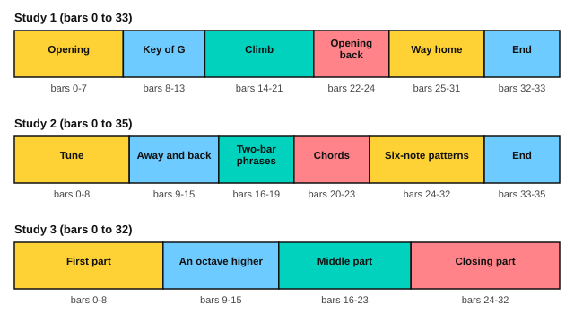

# Giuliani: right-hand studies

<span class="tag tag-guitar">Guitar</span>

After this lesson you can play the three Giuliani studies from Op. 1 in sections, keeping a bass line and an upper line apart with p and the fingers i, m and a.

Before this: [Fingerstyle posture and studies](01-fingerstyle-posture-and-studies.md), [Fingerpicking basics](../05-minor-keys-and-chord-charts/10-fingerpicking-basics.md), [Compound meter](../06-meter-terms-and-rhythm/01-compound-meter.md). You need: your guitar, a footstool or a strap, and a metronome.

## The idea

### The three studies

Mauro Giuliani (1781 to 1829) was an Italian guitarist. These are the first three studies of his Op. 1, the *Studio per la chitarra*. Each has a bass line and an upper line, and the right hand must keep them apart: the thumb p plays the bass notes, and i, m and a play the upper notes. Use free strokes except where a melody note needs to stand out.

| Study | Key | Time | Tempo word | Bars |
|---|---|---|---|---|
| 1 | C major | 4/4 | Maestoso (majestic) | 0 to 33 |
| 2 | C major | 6/8 | Allegretto grazioso (moderately fast, gracefully) | 0 to 35 |
| 3 | A minor | 2/4 | Andantino mosso (a walking pace, with motion) | 0 to 32 |

Each study starts with a short bar, a **pickup**: a first bar that holds only the last beat or two of a full bar. The book counts the pickup as bar 0, so the first full bar is bar 1. Study 3 has no key signature but is in A minor: it starts and ends on A, and the G# in bars 4, 12, 20, 23, 28, 30 and 31 is the raised 7th you know from harmonic minor.

The play bar runs at the tempo in the score. The scores give Study 1 as 112 quarter notes per minute, Study 2 as 132 eighth notes per minute and Study 3 as 96 eighth notes per minute. Start well below that, as the routine says.

### Study 1

Study 1 is built from two-bar phrases over a C chord, then a G chord. Bars 1 and 2 have the same bass line, and so do 22 and 23.

```abc
%%opts tab=guitar sound=nylon
X:1
T:Study No. 1 (Op. 1, Studio per la chitarra)
C:Mauro Giuliani (1781-1829)
M:4/4
L:1/16
Q:1/4=112
K:C
%%score (Melody Melody2)
V:Melody clef=treble-8
V:Melody2 clef=treble-8
V:Melody
"^Maestoso"!mf!G2A2 B2 | c8 c3G e3B | c8 z2G2 B2c2 | d8 d3G f3e |
V:Melody2
x6 | C2G2 E2G2 C4 x4 | C2G2 E2G2 C4 x4 | B,2G2 D2G2 B,4 x4 |
V:Melody
d8 z2G2 d2f2 | e4 e4 e4 e4 | e8 z2c2 [B,B]2[CA]2 | B2d2 z2B2 A2c2 z2A2 |
V:Melody2
B,2G2 D2G2 B,4 x4 | C2G2 E2G2 B,2^G2 D2G2 | C2A2 E2A2 A,4 x4 | D4 G2x2 D4 ^F2x2 |
V:Melody
G4 z2[Dd]2 d4 z2[Dd]2 | d4 z2[Dd]2 [^F,c]2[DB]2 [A,c]2[De]2 | d4 z2[Dd]2 d4 z2[Dd]2 | d4 z2[Dd]2 [^F,c]2[DB]2 [A,c]2[DA]2 |
V:Melody2
G,2D2 B,2x2 ^F,2D2 A,2x2 | G,2D2 B,2 x8 x2 | G,2D2 B,2x2 ^F,2D2 A,2x2 | G,2D2 B,2 x8 x2 |
V:Melody
G3D G3B d4 [^F,DAc]4 | [DGB]3D G3B d4 [DAc^f]4 | [GBg]2G2 G2G2 G2G2 B4 | c4 ^c4 d4 e4 |
V:Melody2
G,4 x12 | G,4 x12 | G,4 x8 G,2G2 | A,2G2 ^A,2G2 B,2G2 ^C2G2 |
V:Melody
f8 z4 B4 | c4 ^c4 d4 e4 | f8 z4 e4 | f4 ^c4 d4 e4 |
V:Melody2
D2G2 A2G2 G2G2 G,2G2 | A,2G2 ^A,2G2 B,2G2 ^C2G2 | D2G2 A2G2 G2G2 ^C2G2 | D2G2 E2G2 F2G2 ^C2G2 |
V:Melody
f2e2 g2f2 e2d2 c2B2 | A2G2 ^F2G2 ^G2A2 ^A2B2 | c8 c3G e3d | c8 z2G2 B2c2 |
V:Melody2
D8 x8 | x16 | C2G2 E2G2 C4 x4 | C2G2 E2G2 C4 x4 |
V:Melody
d8 d3G f3e | e2c2 e2c2 f2c2 g2c2 | z2c2 a2c2 z2A2 ^c2g2 | g2A2 f2A2 z2G2 d2f2 |
V:Melody2
B,2G2 D2G2 B,4 x4 | C4 _B4 A4 E4 | F8 E8 | D8 B,8 |
V:Melody
f2e2 d2c2 B2A2 e2d2 | z2E2 G2c2 z2D2 G2B2 | z2c2 z2e2 z2g2 z2e2 | z2c2 z2G2 z2E2 z2G2 |
V:Melody2
C8 F,8 | G,8 G,8 | C4 E4 G4 E4 | C4 G,4 E,4 G,4 |
V:Melody
[Cc]4 z4 [CGce]4 z4 | [CEGc]8 z8 |]
V:Melody2
x16 | x16 |]
```

Source: Mutopia Project Mutopia-2007/10/08-1046 (maintainer Laurent Ducos), CC BY-SA 3.0, from the Swedish Music Library scan (Statens musikbibliotek).



| Bars | What happens |
|---|---|
| 0 to 7 | Opening phrase over C, G and A minor, with a G# in bar 5 and an F# in bar 7 |
| 8 to 13 | F# in every bar: the music has moved to G major |
| 14 to 21 | A climb: the bass goes A, A#, B, C# in bars 15 to 19 |
| 22 to 24 | The opening comes back |
| 25 to 31 | The way home, with a Bb in bar 25 |
| 32 to 33 | Final chords |

### Study 2

Study 2 is in 6/8, two beats in each bar with three eighth notes in each beat (counted 1 2 3 4 5 6, as in the compound meter lesson). Bars 24 to 32 are the right-hand study itself: each half bar is a six-note arpeggio, with the bass note first and five notes above it.

```abc
%%opts tab=guitar sound=nylon
X:1
T:Study No. 2 (Op. 1, Studio per la chitarra)
C:Mauro Giuliani (1781-1829)
M:6/8
L:1/16
Q:1/8=132
K:C
%%score (Melody Melody2)
V:Melody clef=treble-8
V:Melody2 clef=treble-8
V:Melody
"^Allegretto grazioso"!mf!g2 | g4 [Gg]2 g4 [Gg]2 | g6 z2g2f2 | e4 [Ge]2 g2f2d2 |
V:Melody2
x2 | C2E2x2 B,2F2x2 | C2E2G2 C4 x2 | C2E2x2 B,4 x2 |
V:Melody
c6 z2c2e2 | d4 [Gd]2 d4 [Dd]2 | d4 [DB]2 A2c2e2 | z2G2B2 d2c2A2 |
V:Melody2
C2G2E2 C4 x2 | B,2D2x2 ^F,2A,2x2 | G,2B,2x2 C6 | D6 D6 |
V:Melody
G6 z4 G2 | c4 [Gc]2 c4 [_Bc]2 | c6 z2c2^c2 | d4 [Dd]2 d4 [Dd]2 |
V:Melody2
G,2D2B,2 G,4 x2 | C2E2x2 C2E2x2 | C2F2A2 C4 x2 | ^F,2A,2x2 F,2A,2x2 |
V:Melody
d6 z2d2e2 | f2G2[B,f]2 [Ce]2[Dd]2[Ec]2 | B2G2[FB]2 [Ec]2[Dd]2[Ce]2 | z2A2c2 B2A2B2 |
V:Melody2
G,2B,2D2 G,4 x2 | B,4 x8 | F4 x8 | F6 D6 |
V:Melody
[Ec]6 z6 | B2d2c2 B2A2G2 | [Ec]6 z6 | B2d2c2 B2A2G2 |
V:Melody2
C2C2C2 C2C2C2 | [CF]6 x6 | C2C2C2 C2C2C2 | [CF]6 x6 |
V:Melody
[Ge]2[Ge]2[Ge]2 [Ge]2[Ge]2[Ge]2 | [B,Gf]2[DGf]2[CGf]2 [B,Gf]2[A,Gf]2[G,Gf]2 | [Ge]2[Ge]2[Ge]2 [Ge]2[Ge]2[Ge]2 | [B,Gf]2[DGf]2[CGf]2 [B,Gf]2[A,Gf]2[G,Gf]2 |
V:Melody2
C6 x6 | x12 | C6 x6 | x12 |
V:Melody
zGgGEG zGgGEG | F4 Dz B,4 G,z | C4 z2 C4 z2 | zGgGzG zGgGzG |
V:Melody2
C4 x2 C4 x2 | xGgGxG xGgGxG | xGgGEG xGgGEG | F4 Dx B,4 G,x |
V:Melody
zcecec zcecec | zcecec zcecec | zcecec zcecec | zcecGc zcecGc |
V:Melody2
C6 ^G,6 | A,6 E,6 | F,6 ^F,6 | G,6 G,6 |
V:Melody
zBdBGB zBdBGB | [Cc]6 [GBdg]6 | [cegc']6 [CGce]2[G,Gce]2[E,Gce]2 | [CEGce]12 |]
V:Melody2
G,6 G,6 | x12 | x12 | x12 |]
```

Source: Mutopia Project Mutopia-2007/10/08-1047 (maintainer Laurent Ducos), CC BY-SA 3.0, from the Swedish Music Library scan (Statens musikbibliotek).

| Bars | What happens |
|---|---|
| 0 to 8 | The tune, with two-note chords; F# in bar 5 |
| 9 to 15 | A short trip away: Bb in bar 9, C# in bar 10, F# in bar 11 |
| 16 to 19 | Two-bar phrases: a held chord, then a run of eighth notes |
| 20 to 23 | Repeated chords, with the bass walking down in bars 21 and 23 |
| 24 to 32 | The six-note arpeggio pattern, with sharps in the bass in bars 28 and 30 |
| 33 to 35 | Final chords |

### Study 3

Study 3 moves in sixteenth notes over a bass. Bars 9 to 15 play the opening tune again, an octave higher. In bars 20 to 23 the two voices swap jobs: the upper voice has off-beat notes while the lower voice carries the running notes.

```abc
%%opts tab=guitar sound=nylon
X:1
T:Study No. 3 (Op. 1, Studio per la chitarra)
C:Mauro Giuliani (1781-1829)
M:2/4
L:1/16
Q:1/8=96
K:C
%%score (Melody Melody2)
V:Melody clef=treble-8
V:Melody2 clef=treble-8
V:Melody
"^Andantino mosso"!mf!E,2 | A,2A,B, C2A,D | E2E^D E2EC | A,2A,B, C2CA, |
V:Melody2
x2 | xcx3cx2 | xex3ex2 | xAx3cx2 |
V:Melody
B,2B,A, ^G,2G,E, | A,2A,B, C2CD | E2E^D E2E^F | G2GE B,2B,^D |
V:Melody2
xBx3^Gx2 | xAx3cx2 | xex3ex2 | xgx3Bx2 |
V:Melody
E4 z2E2 | A2AB c2cd | e2e^d e2ec | A2AB c2cA |
V:Melody2
xE,G,B, E,2x2 | xA,x3Cx2 | xEx3Ex2 | xA,x3Cx2 |
V:Melody
B2BA ^G2GE | A2AB c2cd | e2e^d e2e^f | g2ge zB,z2 |
V:Melody2
xB,x3^G,x2 | xA,x3Cx2 | xEx3Ex2 | xGx2 B2B^d |
V:Melody
zEGB E2ED | ^C2CD E2EF | G2FE F2FE | D2DC B,2B,A, |
V:Melody2
e4 x4 | x^cx3ex2 | xgx3fx2 | xdx3Bx2 |
V:Melody
^G,2G,F, E,z3 | zfz3dz2 | zez3cz2 | zBz3^GAB |
V:Melody2
x^Gx3EB,C | D2DC B,2A,B, | C2CB, A,2CA, | D2EF E4 |
V:Melody
A4 z2ed | ^c2cd e2ef | g2fe f2fe | d2dc B2BA |
V:Melody2
xA,CE A,2x2 | x^Cx3Ex2 | xGx3Fx2 | xDx3B,x2 |
V:Melody
^G2GF E2Bc | d2dc B2BB | c2cB A2^GA | B2cd ^G2AB |
V:Melody2
x^G,x3E,x2 | xB,x3E,x2 | xA,x3F,x2 | xDx3E,x2 |
V:Melody
A4 z4 |]
V:Melody2
xA,CE A,4 |]
```

Source: Mutopia Project Mutopia-2007/10/08-1048 (maintainer Laurent Ducos), CC BY-SA 3.0, from the Swedish Music Library scan (Statens musikbibliotek).

| Bars | What happens |
|---|---|
| 0 to 8 | First part in A minor, with D# in bars 2, 6 and 7 |
| 9 to 15 | The opening tune again, an octave higher |
| 16 to 23 | Middle part: sharps in bars 17, 20 and 23 |
| 24 to 32 | Closing part, ending on an A minor chord in bar 32 |

## Hard spots

| Bars | Why they are hard | What to do |
|---|---|---|
| 1, 3, 22 and 24, Study 1 | A dotted eighth note followed by a sixteenth note | Count in sixteenths, 1 e & a, with the dotted note lasting three of them |
| 12 and 13, Study 1 | Four-note chords | Place the left hand shape first, then pluck all four together with p i m a |
| 15 to 19, Study 1 | The bass moves by half steps | Play the bass alone first, naming each note |
| 20 to 23, Study 2 | Repeated chords, with the bass moving below | Keep the upper shape still and move only the bass finger |
| 24 to 32, Study 2 | Six notes a half bar | Practise the pattern on open strings with p i m a before adding the left hand |
| 20 to 23, Study 3 | The voices swap roles | Play the running voice alone, then add the other |

## Learning order

My suggested order is Study 1, then Study 3, then Study 2, because Study 1 is in 4/4 and Study 2 needs the 6/8 count.

1. Play only the bass line of the first section, with p, at half tempo.
2. Play only the upper line of the same section.
3. Put them together at 50 bpm, in two-bar pieces.
4. Join the sections, stopping at the end of each one the first few times.
5. Play the whole study at 60 bpm, then raise the metronome by 5 bpm at a time.

Here are the first two bars of Study 1, as an exercise. The top voice holds a long note while the bass voice plays eighth notes under it.

```abc
%%opts tab=guitar sound=nylon
X:1
M:4/4
L:1/16
Q:1/4=60
K:C
%%score (Melody Melody2)
V:Melody clef=treble-8
V:Melody2 clef=treble-8
V:Melody
c8 c3G e3B | c8 z2G2 B2c2 |]
V:Melody2
C2G2 E2G2 C4 x4 | C2G2 E2G2 C4 x4 |]
```

## Try it

Exercise 1. Study 1 has a pickup bar. What is bar 1?

<details class="solution" markdown>
<summary>Answer</summary>

Bar 1 is the first full bar, the one after the pickup, which is counted as bar 0.

</details>

Exercise 2. Which study is in A minor, and which bars of it contain a G#?

<details class="solution" markdown>
<summary>Answer</summary>

Study 3. G# appears in bars 4, 12, 20, 23, 28, 30 and 31.

</details>

Exercise 3. In the excerpt above, how many sixteenth notes does the dotted eighth note c3 last?

<details class="solution" markdown>
<summary>Answer</summary>

Three sixteenth notes. With the G after it (one sixteenth), the pair fills one beat.

</details>

<div class="practice" markdown>

### Practice routine (30 minutes)

| Minutes | What to do | Tempo | Listen for |
|---|---|---|---|
| 5 | Warm-up: p i m a on strings 4, 3, 2, 1 in order, free stroke | 60 bpm | Even volume |
| 15 | Study 1, bars 0 to 13: bass alone, upper line alone, then together | 50 bpm, then 60 | The bass note under the first beat of each bar |
| 5 | Sight reading: the excerpt above, then read ahead in Study 3, bars 0 to 8, aloud (string and fret) | Untimed | Reading a full bar before you play it |
| 5 | Piano: Minuet in G, hands together | 80 bpm | A steady left hand |

Repeat this routine on at least three days. Then move the 15 minutes to the next section, and later to Study 3.

</div>

<div class="move-on" markdown>

### Move on when

- [ ] You can play Study 1, bars 0 to 13, at 60 bpm (quarter note), three times in a row with no stops.
- [ ] You can play the opening of Study 3, bars 0 to 8, at 60 bpm (eighth note), three times in a row.
- [ ] You can play the six-note pattern of Study 2, bars 24 and 25, at 60 bpm (eighth note), three times in a row.
- [ ] You can name the key of each study and say which bars hold the sharps.

</div>

## Common mistakes

Pressing the bass notes harder than the upper notes. The thumb is strong, so soften it, or the melody disappears.

Letting a bass note ring over a rest. Steel strings ring longer than nylon, so touch the string to stop it when the score shows a rest.

Practising from bar 1 every time. Start at the hard spot, then go back one bar.

## Key terms

- **Pickup**: a short first bar that holds only the last beat or two of a full bar.
- **Voice**: one line of music, such as the melody or the bass.
- **Raised 7th**: the 7th degree of a minor scale raised by a half step, as the G# in A minor.

Next: [Carulli: a waltz](03-carulli-study.md)
