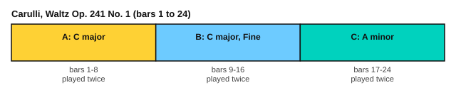

# Carulli: a waltz

<span class="tag tag-guitar">Guitar</span>

After this lesson you can play Carulli's Waltz, Op. 241 No. 1, with a bass note on the first beat and two-note chords on the others, and follow its repeats and its D.C. al Fine.

Before this: [Giuliani: right-hand studies](02-giuliani-right-hand-studies.md), [Articulation and repeat signs](../06-meter-terms-and-rhythm/04-articulation-and-repeat-signs.md), [Relative and parallel keys](../05-minor-keys-and-chord-charts/05-relative-and-parallel-keys.md). You need: your guitar and a metronome.

## The idea

### The piece

Ferdinando Carulli (1770 to 1841) was an Italian guitarist who wrote a great many teaching pieces. This lesson uses a Waltz from his Op. 241, No. 1. It is in C major and has 24 bars. The tempo words are "Tempo di Valse", which means in waltz time.

Its time signature is 3/8. That means three eighth notes in a bar, so it is a waltz with one bar for each dance step. Count the three eighth notes "1 2 3", and lean on the 1. The score gives the tempo as 72 quarter notes per minute. That is 144 eighth notes per minute, or one bar every 1.25 seconds.

```abc
%%opts tab=guitar sound=nylon
X:1
T:Waltz (Op. 241 No. 1)
C:Ferdinando Carulli (1770-1841)
M:3/8
L:1/8
Q:1/4=72
K:C
%%score (Melody Melody2)
V:Melody clef=treble-8
V:Melody2 clef=treble-8
V:Melody
|: "^Tempo di Valse"C3 | D3 | C3 | z3 |
V:Melody2
|: x[ce][ce] | x[Bf][Bf] | x[ce][ce] | dBG |
V:Melody
C3 | D3 | GAB | [Cc]2 z ::
V:Melody2
x[ce][ce] | x[Bf][Bf] | x3 | x3 ::
V:Melody
F3 | E3 | D3 | C3 |
V:Melody2
x[GB][GB] | x[Gc][Gc] | x[Bf][Bf] | x[ce][ce] |
V:Melody
F3 | E3 | fdB | "^Fine."[Cc]2 z ::
V:Melody2
x[GB][GB] | x[Gc][Gc] | D3 | x3 ::
V:Melody
Ace | Ace | dcB | cBc |
V:Melody2
A,3 | A,3 | E,3 | A,3 |
V:Melody
Ace | Ace | dcB | "^D.C. al Fine"[A,A]2 z :|]
V:Melody2
A,3 | A,3 | E,3 | x3 :|]
```

Source: Mutopia Project Mutopia-2018/12/04-1656 (maintainer Louie van Bommel), CC BY 4.0, from A. Eggers, Guitar-Skole, The Royal Library, Copenhagen.

### What the bars do

In bars 1 to 3, the lowest voice plays one long bass note on beat 1 (C, D, C), and two-note chords fall on beats 2 and 3. This is the waltz bass pattern you will meet again in [Alberti bass and waltz bass](../07-pedal-texture-and-ambient/04-alberti-and-waltz-bass.md). The bass notes sit on string 5 (C at fret 3) and string 4 (D open, E at fret 2, F at fret 3). The chords use two neighbouring strings, such as strings 2 and 1 for the C chord (C at fret 1 on string 2, E open on string 1).



| Bars | What happens |
|---|---|
| 1 to 8 | First part in C major, repeated. Bar 4 has a three-note falling run (D, B, G), and bar 7 a rising one (G, A, B). |
| 9 to 16 | Second part in C major, repeated. Bar 15 falls (F, D, B). The Fine is at the end of bar 16. |
| 17 to 24 | Third part in A minor, repeated: rising A, C, E in the first two bars, with a bass of A, A, E, A. |
| D.C. al Fine | Go back to bar 1 and play to the Fine at the end of bar 16 |

The instruction **D.C. al Fine** (Da Capo al Fine) means go back to the beginning and play until the word Fine. Players usually skip the repeat signs on the way back. The play bar plays the repeats in the score, but it does not follow the D.C.

Bars 17 to 24 are in A minor, the relative minor of C major. They share the key signature of C major, and the sound changes when the bass moves to A.

## Hard spots

| Bars | Why they are hard | What to do |
|---|---|---|
| 1 to 3, 5 to 6, 9 to 14 | The thumb plays on beat 1 and two fingers play on beats 2 and 3, with the bass quieter than the chords | Play the bass with p and each chord note with the finger that belongs to its string (i on 3, m on 2, a on 1), and count 1 2 3 out loud |
| 4 and 15 | A three-note run falls where the chord pattern pauses | Play the run alone with free strokes, then add the bass in bar 15 |
| 8 and 16 | The two notes of the final chord are a C an octave apart, on strings 5 and 2 | Play both with p and m together, then stop them by touching the strings on the rest |
| 17 to 18, 21 to 22 | Three notes rise across strings 3, 2 and 1 over a held bass | Pluck with i, m and a in turn, the bass with p at the same moment as the first note |
| 19 and 23 | The bass drops to the open low E on string 6 | Practise the thumb moving between strings 5 and 6 alone |

## Learning order

1. Play bars 1 to 8 with the thumb only: C, D, C, then rests, as the bass would sound.
2. Add the chords on beats 2 and 3, bar by bar, at 80 bpm on the eighth note.
3. Add bars 9 to 16 the same way.
4. Learn bars 17 to 24 as a separate piece, with the bass first.
5. Put the parts in order, with repeats, and finish with the D.C.
6. Raise the metronome by 5 bpm at a time, to 100 on the eighth note.

Here are bars 1 to 4 as an exercise. The first voice holds the bass note on beat 1; the second voice has the chords on beats 2 and 3, and the run in bar 4.

```abc
%%opts tab=guitar sound=nylon
X:1
M:3/8
L:1/8
Q:1/8=80
K:C
%%score (Melody Melody2)
V:Melody clef=treble-8
V:Melody2 clef=treble-8
V:Melody
C3 | D3 | C3 | z3 |]
V:Melody2
x[ce][ce] | x[Bf][Bf] | x[ce][ce] | dBG |]
```

Here are bars 17 to 20, the first bars of the A minor part.

```abc
%%opts tab=guitar sound=nylon
X:1
M:3/8
L:1/8
Q:1/8=80
K:C
%%score (Melody Melody2)
V:Melody clef=treble-8
V:Melody2 clef=treble-8
V:Melody
Ace | Ace | dcB | cBc |]
V:Melody2
A,3 | A,3 | E,3 | A,3 |]
```

## Try it

Exercise 1. How many eighth notes are in a bar of 3/8, and at 144 eighth notes per minute, how long is a bar?

<details class="solution" markdown>
<summary>Answer</summary>

Three eighth notes. A bar lasts 3 divided by 144 minutes, which is 1.25 seconds.

</details>

Exercise 2. In what order do you play the sections of the piece, including the repeats and the D.C.?

<details class="solution" markdown>
<summary>Answer</summary>

Bars 1 to 8 twice, 9 to 16 twice, 17 to 24 twice, then back to bar 1 and play to the end of bar 16, without the repeats.

</details>

Exercise 3. What key do bars 17 to 24 sound in, and which note is the bass in bar 24?

<details class="solution" markdown>
<summary>Answer</summary>

A minor. Bar 24 is an A and the A an octave above it, played together.

</details>

<div class="practice" markdown>

### Practice routine (30 minutes)

| Minutes | What to do | Tempo | Listen for |
|---|---|---|---|
| 5 | Warm-up: free-stroke arpeggios p i m a on strings 4 to 1 | 60 bpm | Even volume on every finger |
| 15 | Bars 1 to 8, then 9 to 16, bass first, then with the chords | 80 on the eighth note | The bass note stays softer than the chords |
| 5 | Sight reading: bars 17 to 20 (the exercise above) | 70 on the eighth note | Reading the bar before you play it |
| 5 | Piano: Minuet in G, hands together | 80 bpm | A steady beat |

Repeat this routine on at least three days. Then move the 15 minutes to bars 17 to 24, and later to the whole piece with the D.C.

</div>

<div class="move-on" markdown>

### Move on when

- [ ] You can play bars 1 to 16 at 80 on the eighth note, three times in a row with no stops.
- [ ] You can play bars 17 to 24 at 80 on the eighth note, three times in a row.
- [ ] You can play the whole waltz with the repeats and the D.C. al Fine, ending at the Fine.
- [ ] You can say the order of the sections from memory.

</div>

## Common mistakes

Playing the waltz too slowly because each eighth note gets a big beat. Feel one bar as one dance step, "ONE two three", with the weight on the 1.

Playing the bass as loud as the chords. The bass is on the beat only. Pluck it softly and let the chords sing above it.

Forgetting to stop the bass on a rest. On steel strings, touch the string with a finger to cut it.

## Key terms

- **3/8**: a time signature with three eighth notes in a bar.
- **D.C. al Fine**: go back to the start and play until the word Fine.
- **Fine**: Italian for "the end"; the piece ends here after a D.C.
- **Waltz**: a dance in three beats where the first beat is strongest.

Next: [Sor: two lessons from Opus 60](04-sor-op-60.md)
