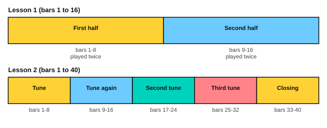

# Sor: two lessons from Opus 60

<span class="tag tag-guitar">Guitar</span>

After this lesson you can play Lessons 1 and 2 from Sor's Opus 60 in sections, read a melody that jumps between low and high notes, and play two C major pieces from the score at a slow steady tempo.

Before this: [Carulli: a waltz](03-carulli-study.md), [The C, G and D minor chords](../03-the-major-scale-and-keys/06-chords-c-g-and-d-minor.md), [Reading notation on guitar](../03-the-major-scale-and-keys/11-reading-notation-on-guitar.md). You need: your guitar and a metronome.

## The idea

### The pieces

Fernando Sor (1778 to 1839) was a Spanish guitarist and composer. His *25 Progressive Lessons*, Op. 60, are short pieces in order of difficulty, each aimed at one skill. This lesson uses the first two. Both are in C major. Lesson 1 is in 4/4 and has 16 bars. Lesson 2 is in 3/4 and has 40 bars.

| Lesson | Key | Time | Bars | Score tempo |
|---|---|---|---|---|
| 1 | C major | 4/4 | 1 to 16 | 100 quarter notes a minute |
| 2 | C major | 3/4 | 1 to 40 | 96 quarter notes a minute |

Each lesson is written as one line of notes, with no separate bass staff. Where the melody jumps between a high note and a low one, the low note is the bass and the high note is the tune, so one line carries two jobs. The tab under the score shows which string each note is on.

### Lesson 1

Lesson 1 is in two halves of 8 bars, and each half is repeated. In the first half the tune moves in half notes and quarter notes: bars 1 and 2 are the same, and bar 5 starts like them. Bar 7 has the only accidental, an F#, which leads to the G chord in bar 8. In the second half, from bar 9, the notes jump between a high note and a low one in every bar.

```abc
%%opts tab=guitar sound=nylon
X:1
T:Lesson No. 1 (25 Progressive Lessons, Op. 60)
C:Fernando Sor (1778-1839)
M:4/4
L:1/8
Q:1/4=100
K:C clef=treble-8
|: c4 B2 G2 | c4 B2 G2 | c2 d2 e2 g2 | f2 e2 d2 G2 |
c4 B2 G2 | c2 e2 d2 B2 | A2 c2 D2 ^f2 | g2 [DGB]2 G,2 z2 ::
g2 G2 e2 g2 | f2 G2 d2 f2 | e2 G2 c2 e2 | d2 B2 G2 F2 |
E2 G2 c2 E2 | F2 A2 D2 F2 | E2 G2 G,2 B,2 | C2 [Gce]2 C2 z2 :|]
```

Source: Mutopia Project Mutopia-2006/02/10-666, CC BY-SA 2.5, from the first-edition image at fernandosor.free.fr.



| Bars | What happens |
|---|---|
| 1 to 8 | Half notes and quarter notes in a tune; F# in bar 7; a chord of three notes in bar 8; repeated |
| 9 to 16 | Quarter notes that jump between low and high notes; the last bar has a chord; repeated |

### Lesson 2

Lesson 2 has no repeat signs. Bars 9 to 12 repeat bars 1 to 4 note for note, then the tune goes elsewhere. Look for the notes with a sharp or a natural sign: C# in bars 8 and 28, F# and then F natural in bar 21, and G# in bar 34. These are neighbour notes that decorate the tune, and they are the hard part of the lesson.

```abc
%%opts tab=guitar sound=nylon
X:1
T:Lesson No. 2 (25 Progressive Lessons, Op. 60)
C:Fernando Sor (1778-1839)
M:3/4
L:1/8
Q:1/4=96
K:C
%%score (Melody Melody2)
V:Melody clef=treble-8
V:Melody2 clef=treble-8
V:Melody
G2 e2 c2 | c2 Bc d2 | G2 f2 d2 | d2 cd e2 |
V:Melody2
x6 | x6 | x6 | x6 |
V:Melody
G2 c2 e2 | g2 f2 dB | c2 G2 e2 | ^c2 d=c BA |
V:Melody2
x6 | x6 | x6 | x6 |
V:Melody
G2 e2 c2 | c2 Bc d2 | G2 f2 d2 | d2 cd e2 |
V:Melody2
x6 | x6 | x6 | x6 |
V:Melody
G2 c2 e2 | g2 f2 d2 | cG e2 dB | c2 C2 z2 |
V:Melody2
x6 | x6 | x6 | x6 |
V:Melody
B2 G2 d2 | c4 A2 | D2 A2 c2 | B4 G2 |
V:Melody2
x6 | x6 | x6 | x6 |
V:Melody
g2 ^f2 =f2 | e2 c2 A2 | BD d2 cA | G2 G,2 z2 |
V:Melody2
x6 | x6 | x6 | x6 |
V:Melody
G2 B2 d2 | G2 c2 e2 | G2 f2 e2 | d^c dB G2 |
V:Melody2
x6 | x6 | x6 | x6 |
V:Melody
G2 Bc d2 | G2 cd e2 | G2 df ec | d4 G2 |
V:Melody2
x6 | x6 | x6 | x6 |
V:Melody
e2 d2 c2 | B2 ^G2 A2 | f2 e2 d2 | c4 B2 |
V:Melody2
x6 | x6 | x6 | x6 |
V:Melody
G2 g2 f2 | [Ce]2 [DB]2 [Ec]2 | d2 A2 [GB]2 | [Cc]4 z2 |]
V:Melody2
x6 | x6 | F4 x2 | x6 |]
```

Source: Mutopia Project Mutopia-2006/02/10-667, CC BY-SA 2.5, from the first-edition image at fernandosor.free.fr.

| Bars | What happens |
|---|---|
| 1 to 8 | The first tune; bar 8 has the C# and a C natural |
| 9 to 16 | The first four bars again, then a different ending |
| 17 to 24 | A second tune with F# and F natural in bar 21, ending on a low G in bar 24 |
| 25 to 32 | A third tune with a C# in bar 28 |
| 33 to 40 | The closing tune, with a G# in bar 34, ending on two C notes an octave apart in bar 40 |

## Hard spots

| Bars | Why they are hard | What to do |
|---|---|---|
| Lesson 1, bars 3 to 4 | A rising run of four notes, then a fall | Slow the metronome and play the four notes with i and m alternating |
| Lesson 1, bar 7 | The only F# | Name the note before you play it, then play it |
| Lesson 1, bar 8 | A three-note chord, then a low bass note | Play the chord with p, i and m together, then the bass with p |
| Lesson 1, bars 9 to 15 | The notes jump between a low and a high note | Play only the low notes, then only the high notes, then both |
| Lesson 2, bars 8, 21, 28 and 34 | Notes outside the key | Mark each one with a pencil circle before you play the bar |
| Lesson 2, bar 40 | Two notes an octave apart in the last chord | Play them together with p and a, and let them ring |

## Learning order

1. Lesson 1, bars 1 to 8 on its own. Count 1 2 3 4 and play the half notes as two beats.
2. Lesson 1, bars 9 to 16, low notes first.
3. Join the two halves with the repeats.
4. Lesson 2, bars 1 to 8, then bars 9 to 16.
5. Lesson 2, bars 17 to 24, then 25 to 32.
6. Lesson 2, bars 33 to 40, then the whole lesson at 60 bpm.

Here is the start of Lesson 1, an exercise in a tune in half and quarter notes that fits first position. Play it with rest strokes.

```abc
%%opts tab=guitar sound=nylon
X:1
M:4/4
L:1/8
Q:1/4=60
K:C clef=treble-8
c4 B2 G2 | c4 B2 G2 | c2 d2 e2 g2 | f2 e2 d2 G2 |]
```

Here are bars 9 to 12 of Lesson 1. The notes jump between a low note and a high one, so the tab moves up and down the strings.

```abc
%%opts tab=guitar sound=nylon
X:1
M:4/4
L:1/8
Q:1/4=60
K:C clef=treble-8
g2 G2 e2 g2 | f2 G2 d2 f2 | e2 G2 c2 e2 | d2 B2 G2 F2 |]
```

Here are the first four bars of Lesson 2, three beats in a bar. Bars 2 and 4 each have a pair of eighth notes.

```abc
%%opts tab=guitar sound=nylon
X:1
M:3/4
L:1/8
Q:1/4=60
K:C clef=treble-8
G2 e2 c2 | c2 Bc d2 | G2 f2 d2 | d2 cd e2 |]
```

## Try it

Exercise 1. In Lesson 1, how many bars are repeated, and which ones?

<details class="solution" markdown>
<summary>Answer</summary>

All 16 bars are played twice in two halves: bars 1 to 8 twice, then bars 9 to 16 twice.

</details>

Exercise 2. In Lesson 2, which bars repeat bars 1 to 4?

<details class="solution" markdown>
<summary>Answer</summary>

Bars 9 to 12.

</details>

Exercise 3. In the Lesson 2 exercise, how do you count bar 2?

<details class="solution" markdown>
<summary>Answer</summary>

"1 2 & 3". The first c is a quarter note on beat 1, B is on beat 2, the second c is on the "&" of 2, and d is a quarter note on beat 3.

</details>

<div class="practice" markdown>

### Practice routine (30 minutes)

| Minutes | What to do | Tempo | Listen for |
|---|---|---|---|
| 5 | Warm-up: C major scale on strings 2 and 1 with rest strokes, i and m alternating | 60 bpm | Even tone |
| 15 | Lesson 1: the two halves in two parts, then together with the repeats | 50 bpm, then 60 | No stops at the bar line between the halves |
| 5 | Sight reading: the Lesson 2 exercise, then read ahead in bars 5 to 8 of the score | 60 bpm | The F# and C# named before they are played |
| 5 | Piano: Minuet in G, hands together | 80 bpm | A steady left hand |

Repeat this routine on at least three days. Then switch the 15 minutes to Lesson 2.

</div>

<div class="move-on" markdown>

### Move on when

- [ ] You can play Lesson 1 through with the repeats at 60 bpm (quarter note), three times in a row with no stops.
- [ ] You can play Lesson 2, bars 1 to 16, at 60 bpm (quarter note), three times in a row.
- [ ] You can name the notes with accidentals in Lesson 2, bars 8, 21, 28 and 34, before you play them.
- [ ] You can play Lesson 2 from start to finish at 60 bpm without stopping at the hard spots.

</div>

## Common mistakes

Playing the high and low notes with the same weight. The bass note should be quieter and short, and the tune notes should sing.

Reading a high note as part of a new melody. In the jumping bars, the low and high notes belong to two lines that happen to share one staff.

Missing the accidental. A sharp stays until the bar line, and a natural sign cancels it. Circle each one first.

## Key terms

- **Accidental**: a sharp, flat or natural sign in front of a note, which holds until the end of the bar.
- **Opus (Op.)**: a number that names a published set of pieces, such as Op. 60.

Next: [Carcassi: a study from Opus 60](05-carcassi-op-60.md)
