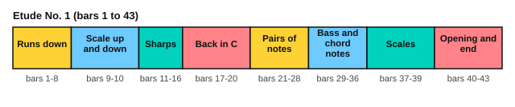

# Carcassi: a study from Opus 60

<span class="tag tag-guitar">Guitar</span>

After this lesson you can play Carcassi's Etude No. 1 from Op. 60 in sections, with eighth-note runs over a held bass note, and you can find its sharps by bar number before you play.

Before this: [Sor: two lessons from Opus 60](04-sor-op-60.md), [Fingerstyle posture and studies](01-fingerstyle-posture-and-studies.md), [Harmonic and melodic minor](../05-minor-keys-and-chord-charts/02-harmonic-and-melodic-minor.md). You need: your guitar and a metronome.

## The idea

### The piece

Matteo Carcassi (1792 to 1853) was an Italian guitarist. His *25 Melodious and Progressive Studies*, Op. 60, are among the most played guitar studies. This lesson uses Etude No. 1. It is in C major, in 4/4, marked Allegro (fast and lively), and has 43 bars. There are no repeat signs. The score gives the tempo as 120 quarter notes a minute.

```abc
%%opts tab=guitar sound=nylon
X:1
T:Etude No. 1 (25 Melodious and Progressive Studies, Op. 60)
C:Matteo Carcassi (1792-1853)
M:4/4
L:1/8
Q:1/4=120
K:C
%%score (Melody Melody2)
V:Melody clef=treble-8
V:Melody2 clef=treble-8
V:Melody
"^Allegro"C2 z4 zD | C2 z6 | zg fe dc BA | G^F z4 zD |
V:Melody2
xc BA GF Ex | xe dc BA GF | E2 x6 | x2 ED CB, A,x |
V:Melody
zG ^FE DC B,A, | zB AG ^FE DC | B,2 z6 | zC B,A, G, z3 |
V:Melody2
G,2 x6 | G,2 x6 | xd cB AG FE | D x4 F ED |
V:Melody
zc de fg ab | c'b ag fe dc | B z6 z | z8 |
V:Melody2
C2 x6 | x8 | xE, ^F,^G, A,B, CD | E^D EF E=D CB, |
V:Melody
zA Bc de ^f^g | ag fe fe dc | B z6 z | z3 A z4 |
V:Melody2
A,2 x6 | x8 | xG, A,B, CD E^F | G^F Gx G=F ED |
V:Melody
zc de fe dc | B z3 GF Ez | ze ^fg ag fe | ^d z3 BA z2 |
V:Melody2
C2 x6 | xG, B,D x3 D | C2 x6 | xB, ^D^F x2 GF |
V:Melody
zG Be ^de de | zG Bf ef ef | eg fe df ed | ce dc Bd cB |
V:Melody2
E4 x4 | D4 x4 | C4 G4 | A4 E4 |
V:Melody
AB cB c^c dc | de fe dc BA | zG AB cd ef | g z6 z |
V:Melody2
F4 x4 | E4 x4 | G,2 x6 | xG, B,D GF ED |
V:Melody
zG ce zB dg | ze gc' zB dg | zG ce zc ^da | zc eg zd fb |
V:Melody2
C4 G4 | c4 G4 | C4 ^F4 | G4 G4 |
V:Melody
ze gc' zB dg | zG ce zE ^Gd | zE Ac zF Ad | zE Gc zD GB |
V:Melody2
c4 G4 | C4 B,4 | A,4 F,4 | G,4 G,4 |
V:Melody
c z6 B | zc de fg ab | c2 z4 zd | C2 z4 zD |
V:Melody2
xC DE FG Ax | C2 x6 | xc' ba gf ex | xc BA GF Ex |
V:Melody
C2 z6 | z8 | z8 |]
V:Melody2
x8 | [CEGc]2 x2 [CGce]2 x2 | [CEGc]4 x4 |]
```

Source: Mutopia Project Mutopia-2015/08/18-13 (maintainer Jeff Covey), Public Domain, source edition not named by Mutopia.

### How the study works

Most bars have a long note in one voice and a run of eight eighth notes in the other. In bar 1, the long bass note C is held while the other voice plays a descending run: c, B, A, G, F, E. In bar 3 the jobs swap: the run is now in the upper voice (G down to A) and the bass E is held below it. The study is about keeping the run even while a held note rings underneath.



| Bars | What happens |
|---|---|
| 1 to 8 | Descending runs over held notes. The music moves from C to G: F# appears in bars 4 to 6. |
| 9 to 10 | A C major scale up in bar 9 and down in bar 10 |
| 11 to 16 | Runs with F#, G# and D# (bars 11 to 13), then F# and a natural F (bar 16) |
| 17 to 20 | Back to C major, with F# in bar 19 and D# in bar 20 |
| 21 to 28 | Pairs of notes that repeat (bars 21 and 22), then a rising run in bar 28 |
| 29 to 36 | A bass that changes every half bar under two upper notes; sharps in bars 31 and 34 |
| 37 to 39 | Scales up and down in C, like bars 9 and 10 |
| 40 to 43 | Bar 40 repeats bar 1; bars 42 and 43 are the final chords |

## Hard spots

| Bars | Why they are hard | What to do |
|---|---|---|
| 1 to 8 | Eight eighth notes in a row, with a held bass note | Hold the bass with p and play the run with i and m alternating |
| 11 to 13, 15 to 16 | Sharps and a natural in a quick run | Say the notes with their sharps aloud before you play |
| 12 | D# followed by D natural | The sharp lasts to the bar line, so the natural sign cancels it |
| 21 to 26 | Pairs of notes repeated: de de | Alternate i and m and keep the second of each pair as strong as the first |
| 28 | The run is in the bass voice | Practise it alone, with the thumb and finger i |
| 29 to 36 | Two upper notes between each bass note | Count the half-bar groups, 1 2 3 4, and give the bass note a small accent |

## Learning order

1. Bars 1 to 8, the run alone in the upper voice, then the bass alone, then together.
2. Bars 9 to 10 as a warm-up scale.
3. Bars 11 to 20, a pair of bars at a time.
4. Bars 21 to 28, then 29 to 36.
5. Bars 37 to 43.
6. Join the sections at 50 bpm, then at 60 bpm.

Here are bars 1 to 4 as an exercise. Play the run with alternating i and m, and hold the bass note until the end of its value.

```abc
%%opts tab=guitar sound=nylon
X:1
M:4/4
L:1/8
Q:1/4=60
K:C
%%score (Melody Melody2)
V:Melody clef=treble-8
V:Melody2 clef=treble-8
V:Melody
C2 z4 zD | C2 z6 | zg fe dc BA | G^F z4 zD |]
V:Melody2
xc BA GF Ex | xe dc BA GF | E2 x6 | x2 ED CB, A,x |]
```

## Try it

Exercise 1. In bar 3, which voice has the held note, and which has the run?

<details class="solution" markdown>
<summary>Answer</summary>

The lower voice holds the note E for a quarter note, and the upper voice has the run from G down to A. In bars 1 and 2 it is the other way round.

</details>

Exercise 2. Which bars hold the F# that shows the music has moved to G?

<details class="solution" markdown>
<summary>Answer</summary>

Bars 4 to 6.

</details>

Exercise 3. At 60 bpm, how long is one eighth note, and how many notes a second is the run?

<details class="solution" markdown>
<summary>Answer</summary>

One quarter note lasts 1 second, so an eighth note lasts 0.5 seconds, and the run plays 2 notes a second. At the score's 120 bpm it plays 4 notes a second.

</details>

<div class="practice" markdown>

### Practice routine (30 minutes)

| Minutes | What to do | Tempo | Listen for |
|---|---|---|---|
| 5 | Warm-up: the C major scale on strings 2 and 1, then on strings 3 and 2, alternating i and m | 60 bpm | Even volume between the fingers |
| 15 | Bars 1 to 8 in three steps (run, bass, together), then bars 9 to 20 | 50 bpm, then 60 | The bass note keeps ringing under the run |
| 5 | Sight reading: the exercise above, then bars 11 to 16 read aloud with the sharps | 50 bpm | The sharps named before they are played |
| 5 | Piano: Minuet in G, hands together | 80 bpm | A steady beat |

Repeat this routine on at least three days. Then move the 15 minutes to bars 21 to 43.

</div>

<div class="move-on" markdown>

### Move on when

- [ ] You can play bars 1 to 10 at 60 bpm, three times in a row with no stops.
- [ ] You can play bars 11 to 20 at 60 bpm, three times in a row.
- [ ] You can play the whole etude at 60 bpm without stopping at the hard spots.
- [ ] You can name every bar with an F#, a G# or a D# without looking at the score.

</div>

## Common mistakes

Letting the run speed up in the middle of the bar. Count 1 & 2 & 3 & 4 & against the metronome and keep each eighth note the same length.

Dropping the held bass note early. Steel strings keep ringing, but a bass note can fade if the finger lifts. Keep the left-hand finger down for the full length.

Playing the sharps late. Mark each one in pencil first, and learn the shape before the speed.

## Key terms

- **Etude**: another word for a study, from the French.
- **Allegro**: fast and lively.
- **Run**: a quick series of notes moving by step in one direction.

Next: [Clementi: Sonatina in C, first movement](06-clementi-sonatina-op-36-1.md)
