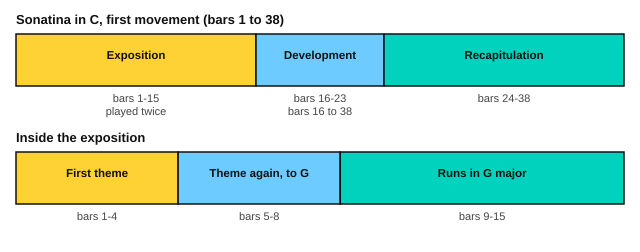

# Clementi: Sonatina in C, first movement

<span class="tag tag-piano">Piano</span>

After this lesson you can play the first movement of Clementi's Sonatina in C, Op. 36 No. 1, in sections, count it in 2/2, and name its three parts: exposition, development and recapitulation.

Before this: [Minuet in G](../03-the-major-scale-and-keys/10-minuet-in-g.md), [The G and D major scales](../03-the-major-scale-and-keys/08-g-and-d-major-scales.md), [Easy classical pieces: a musette and a minuet](../04-intervals-and-triads/11-easy-classical-pieces.md). You need: your piano and a metronome.

## The idea

### The piece

Muzio Clementi (1752 to 1832) was an Italian pianist and composer who worked mostly in London. His six Sonatinas, Op. 36, are teaching pieces. This lesson uses the first movement of No. 1. A **movement** is one self-contained part of a longer work. The first movement is in C major, marked Spiritoso (with spirit), and has 38 bars.

The time signature is 2/2, also called **cut time**. There are two beats in a bar, and a half note is one beat. Count "1 2", not "1 2 3 4". The score gives the tempo as 76 half notes a minute, which is 152 quarter notes a minute. Start much slower, at 40 half notes a minute.

```abc
X:1
T:Sonatina in C, Op. 36 No. 1, first movement
C:Muzio Clementi (1752-1832)
M:2/2
L:1/8
Q:1/4=120
K:C
%%score {RH LH}
V:RH clef=treble
V:LH clef=bass
V:RH
|: "^Spiritoso"c2 ec G2 G2 | c2 ec G2 g2 | fe dc Bc Bc | dc BA G2 z2 |
V:LH
|: C,2 z6 | C,2 z6 | C,2 z2 C,2 z2 | G,,2 z2 G,F, E,D, |
V:RH
c2 ec G2 G2 | e2 ge c2 ec | dB cA BG A^F | GA Bc de ^fg |
V:LH
C,2 z6 | C2 z4 ^F,2 | G,2 C,2 D,2 D,,2 | G,,2 z6 |
V:RH
A2 a2 a2 a2 | Bc de ^fg ab | c2 c'2 c'2 c'2 | dg bd' c'b ag |
V:LH
^F,D A,D F,D A,D | G,2 z6 | A,D CD A,D CD | B,2 z6 |
V:RH
^fe gf ag fe | ed cB dc BA | G4 z4 :: B2 dB G2 G2 |
V:LH
C2 z2 C,2 z2 | D,2 z2 D,,2 z2 | G,,B,, D,G, G,,2 z2 :: F8 |
V:RH
c2 _ec G2 g2 | f2 d2 _e2 c2 | Bc dB G2 G2 | gG gG gG gG |
V:LH
_E8 | B,4 C4 | G,4 z4 | F2 G,2 D2 G,2 |
V:RH
gG gG gG gG | d_e fd fe dc | [Bg]2 z6 | C2 EC G,2 G,2 |
V:LH
_E2 G,2 C2 G,2 | B,2 z2 C2 z2 | G,2 G,,2 G,F, E,D, | C,2 z6 |
V:RH
C2 EC G,2 G2 | FE DC B,C B,C | DC B,A, G,2 z2 | C2 G,C E2 E2 |
V:LH
C,2 z6 | C,2 z2 C,2 z2 | G,,2 z2 G,,F,, E,,D,, | C,,2 z6 |
V:RH
E2 CE G2 c2 | [EG]2 [DF]2 [CE]2 [B,D]2 | CD EF GA Bc | D2 d2 d2 d2 |
V:LH
C,2 z6 | G,2 z2 G,,2 z2 | C,2 z6 | B,,G, D,G, B,,G, D,G, |
V:RH
EF GA Bc de | F2 f2 f2 f2 | Gc eg fe dc | ag fe dc BA |
V:LH
C,2 z6 | D,G, F,G, D,G, F,G, | E,2 z6 | F,2 z2 F,2 z2 |
V:RH
GA FG EF DE | C2 z6 :|]
V:LH
G,2 z2 G,,2 z2 | C,,E,, G,,C, C,,2 z2 :|]
```

Source: Mutopia Project Mutopia-2016/11/30-804 (maintainer Brian D. Rude), Public Domain, from the G. Schirmer 1893 Sonatina Album edition.

### Sonatina form

A **sonatina** is a short sonata. A **sonata** is a work for one or two instruments in several movements, and its first movement usually has a shape called sonata form, with three parts.

| Part | What it does | Bars here |
|---|---|---|
| Exposition | States the themes, and moves from C to the key of G | 1 to 15 |
| Development | Plays with the material in other keys | 16 to 23 |
| Recapitulation | Brings the themes back, now staying in C | 24 to 38 |



The exposition is repeated: play bars 1 to 15, go back to the repeat sign at bar 1, play them again. At the end of bar 15 the second repeat sign starts bars 16 to 38, which are also played twice.

### The bars in detail

| Bars | What happens |
|---|---|
| 1 to 4 | The first theme: a C major chord split into notes, then a short run down, ending on G |
| 5 to 8 | The theme again, then it turns toward G major: F# appears from bar 6 |
| 9 to 15 | Runs in G major, ending with a G major chord in bar 15 |
| 16 to 19 | The development: Eb in bars 17 and 18 (and again in 21 and 22) shows the music has left C major |
| 20 to 21 | Four jumps a bar between a G and the G an octave higher in the right hand |
| 22 to 23 | A run that leads to a G chord, ready for the return |
| 24 to 27 | The first theme comes back in C major, an octave lower |
| 28 to 38 | The ideas of bars 5 to 15 return, now staying in C major with no F# |

The left hand mostly plays a bass note with rests, or a simple broken-chord pattern, as in bars 9, 11, 32 and 34. A pattern like this is a cousin of the one in [Alberti bass and waltz bass](../07-pedal-texture-and-ambient/04-alberti-and-waltz-bass.md).

## Hard spots

| Bars | Why they are hard | What to do |
|---|---|---|
| 6 and 7 | The left hand jumps to a new note while the right hand is busy | Practise the left-hand jump alone, then add the right hand |
| 9 and 11 | Left hand plays eighth notes alternating low and high | Play the left hand alone at 40 half notes a minute until it is even |
| 12 and 13 | A run up in bar 12 and down in bar 13 | Use the scale fingering you know, and play it in two halves |
| 20 and 21 | Octave jumps in the right hand, four a bar | Use a loose wrist and a small bounce, and repeat one bar five times at a time |
| 22 | A fast run | Play the first half, then the second half, then join them |
| 32 and 34 | A broken-chord pattern in the left hand | Play the left-hand notes as a chord first, then break them |

## Learning order

1. The left hand of bars 1 to 15, alone.
2. The right hand of bars 1 to 8, then hands together.
3. Bars 9 to 15, hands separately, then together.
4. The development, bars 16 to 23, with the octave jumps slowly.
5. The recapitulation, bars 24 to 38. It is the exposition again in C, so most of it is familiar.
6. The whole movement at 40 half notes a minute with both repeats.

Here are bars 1 to 4 as an exercise.

```abc
X:1
M:2/2
L:1/8
Q:1/2=40
K:C
%%score {RH LH}
V:RH clef=treble
V:LH clef=bass
V:RH
c2 ec G2 G2 | c2 ec G2 g2 | fe dc Bc Bc | dc BA G2 z2 |]
V:LH
C,2 z6 | C,2 z6 | C,2 z2 C,2 z2 | G,,2 z2 G,F, E,D, |]
```

Here are bars 20 and 21, the octave jumps.

```abc
X:1
M:2/2
L:1/8
Q:1/2=40
K:C
%%score {RH LH}
V:RH clef=treble
V:LH clef=bass
V:RH
gG gG gG gG | gG gG gG gG |]
V:LH
F2 G,2 D2 G,2 | _E2 G,2 C2 G,2 |]
```

## Try it

Exercise 1. In 2/2, how many beats are in a bar, and what note gets one beat?

<details class="solution" markdown>
<summary>Answer</summary>

Two beats, and the half note gets one beat.

</details>

Exercise 2. Which bars are the exposition, and what key does it end in?

<details class="solution" markdown>
<summary>Answer</summary>

Bars 1 to 15, ending in G major.

</details>

Exercise 3. At 40 half notes a minute, how long is one bar?

<details class="solution" markdown>
<summary>Answer</summary>

A bar is two half notes, so it lasts 2 divided by 40 minutes, which is 3 seconds.

</details>

<div class="practice" markdown>

### Practice routine (30 minutes)

| Minutes | What to do | Tempo | Listen for |
|---|---|---|---|
| 5 | Warm-up: C major and G major scales, one octave, hands separately | 60 bpm | Even notes through the thumb-under |
| 15 | Bars 1 to 15 in steps (left hand, right hand, together), then bars 16 to 23 | 40 half notes a minute | A light left hand under the right |
| 5 | Sight reading: the first exercise above, then bars 24 to 27 | 40 half notes a minute | Finding the theme you already know |
| 5 | Guitar: Carulli Waltz, bars 1 to 8 | 80 on the eighth note | A quiet bass |

Repeat this routine on at least three days. Then switch the 15 minutes to bars 24 to 38.

</div>

<div class="move-on" markdown>

### Move on when

- [ ] You can play the exposition, bars 1 to 15, at 40 half notes a minute, three times in a row with no stops.
- [ ] You can play bars 20 and 21 at 40 half notes a minute with the octave jumps even.
- [ ] You can play the whole movement with both repeats at 40 half notes a minute.
- [ ] You can name the three parts of the movement and their bar numbers.

</div>

## Common mistakes

Counting four beats in a bar. In 2/2 the count is "1 2", with half notes as the beats.

Tightening the wrist in bars 20 and 21. The octave jump is a small bounce from a loose arm, not a stretch.

Rushing the runs. Play each run at the speed of the slowest bar, and keep the left hand quiet.

## Key terms

- **Movement**: one self-contained part of a longer work.
- **Sonatina**: a short sonata.
- **Sonata form**: the shape of a first movement, in three parts.
- **Exposition**: the part of sonata form that states the themes.
- **Development**: the part that plays with the themes in other keys.
- **Recapitulation**: the part that brings the themes back in the home key.
- **Cut time (2/2)**: two beats in a bar, with the half note as the beat.

Next: [Burgmüller: Arabesque](07-burgmuller-arabesque.md)
