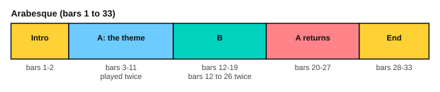

# Burgmüller: Arabesque

<span class="tag tag-piano">Piano</span>

After this lesson you can play Burgmüller's Arabesque, Op. 100 No. 2, in sections, with fast slurred groups in the right hand over light staccato chords, and follow its repeats and endings in the right order.

Before this: [Burgmüller: two easy studies](../06-meter-terms-and-rhythm/08-burgmuller-easy-studies.md), [The A minor and D minor scales](../05-minor-keys-and-chord-charts/03-a-and-d-minor-scales.md), [Articulation and repeat signs](../06-meter-terms-and-rhythm/04-articulation-and-repeat-signs.md). You need: your piano and a metronome.

## The idea

### The piece

Johann Friedrich Burgmüller (1806 to 1874) wrote the *25 Easy Studies*, Op. 100, for young pianists. No. 2 is called L'Arabesque. An **arabesque** is a decorative pattern, and here it is a fast, curling melody. The piece is in A minor, in 2/4, marked Allegro scherzando (fast and playful) with the word leggieremente (lightly) under the first bars. It has 33 bars, and the score gives the tempo as 132 quarter notes a minute.

```abc
X:1
T:L'Arabesque (25 Easy Studies, Op. 100 No. 2)
C:Johann Friedrich Burgmuller (1806-1874)
M:2/4
L:1/16
Q:1/4=120
K:Am
%%score {RH LH}
V:RH clef=treble
V:LH clef=bass
V:RH
"^Allegro scherzando"z8 | z8 |: !p!"_leggieremente"(ABcB .A2)z2 | (ABcd .e2)z2 |
V:LH
!p!.[A,CE]4 .[A,CE]4 | .[A,CE]4 .[A,CE]4 |: [A,CE]4 [A,CE]4 | [A,CE]4 [A,CE]4 |
V:RH
(defg .a2)z2 | (abc'd' .e'2)z2 | z2.e2 (e2f2 | .d2)z2 !accent!d4- |
V:LH
"^cresc."[A,DF]4 [A,DF]4 | [A,CE]4 [A,CE]4 | [G,CE]4 [G,CE]4 | [G,B,F]4 [G,B,F]4 |
V:RH
d2(g2 d2e2 |[1 .c2)z2 !sfz!e4 :|[2 c4 .c'2z2 |: !f!(e6 B2 |
V:LH
[G,B,F]4 [G,B,F]4 |[1 [CE]2z2 E4 :|[2 [CE]6 z2 |: (^G,A,B,A, .G,2)z2 |
V:RH
c6) (A2 | e6 B2 | c6) (A2 | !accent!a6 e2 |
V:LH
(A,B,CD .E2)z2 | (^G,A,B,A, .G,2)z2 | (A,B,CD .E2)z2 | (^CDED .C2)z2 |
V:RH
f6 (e2) | "_dim. e poco rall."d2c2 B2A2 | ^G4 e4 | ("^a tempo"!p!A)BcB .A2)z2 |
V:LH
[K:clef=treble](DEFG .A2)G2 | F2E2 D2^D2 | E2D2 C2B,2 | [K:clef=bass][A,CE]4) [A,CE]4 |
V:RH
(ABcd .e2)z2 | (defg .a2)z2 | (abc'd' .e'2)z2 | z2.B2 (B2c2 |
V:LH
[A,CE]4 [A,CE]4 | "^cresc."[A,DF]4 [A,DF]4 | [A,CE]4 [A,CE]4 | !p![A,DE]4 [A,DE]4 |
V:RH
A4 e4- | e2).B2 (B2c2 |[1 A8) :|[2 (ABcB .A2)z2 |
V:LH
[A,CE]4 [A,CE]4 | [A,DE]4 [A,DE]4 |[1 [A,CE]4 [A,CE]4 :|[2 [A,CE]4 [A,CE]4 |
V:RH
(defg .a2)z2 | (abc'b .a2)z2 | (d'e'f'g' .a'2)z2 | "^risoluto"!f!(EDCB, .A,2)z2 |
V:LH
"^cresc."[A,DF]4 [A,DF]4 | [A,CE]4 [A,CE]4 | [A,DF]4 [A,DF]4 | (E,D,C,B,, .A,,2)z2 |
V:RH
!fermata!!sfz![ca]8 |]
V:LH
!fermata![A,E]8 |]
```

Source: Mutopia Project Mutopia-2013/01/12-203, Public Domain, from the Collection Litolff edition.

### The order of play

Bars 1 and 2 are an introduction: the left hand plays two bars of chords alone, and the right hand rests. The theme starts in bar 3. There are two repeats, and each has a first ending and a second ending.



| Bars | What happens |
|---|---|
| 1 to 2 | Introduction, left hand chords alone, piano |
| 3 to 11 | The theme. Play bars 3 to 10 (first ending), repeat bars 3 to 9, then jump to bar 11 (second ending) |
| 12 to 19 | The contrasting part, loud (forte), with long notes in the right hand and a four-note figure in the left |
| 20 to 27 | The theme comes back, marked a tempo (back to the first speed). Bar 27 is a first ending |
| 28 to 33 | The second ending leads to the end: runs up to a high A, then a falling run and a held chord with a fermata |

Because the second repeat starts at bar 12 and ends at bar 27, the order is: bars 1 to 2, 3 to 10, 3 to 9, 11, 12 to 27, 12 to 26, then 28 to 33. The first time through the second repeat you play bar 27, and the second time you skip it and play bar 28.

In bars 17 to 19 the left hand plays in the treble clef. Read those three bars with the clef sign at the start of bar 17, and return to the bass clef at bar 20.

## Hard spots

| Bars | Why they are hard | What to do |
|---|---|---|
| 3 to 6, 20 to 23, 28 to 31 | Groups of four fast notes under a slur, rising each bar | Play the groups alone at half speed, lifting the hand at the end of each slur |
| 3 to 11 left hand | Chords repeated and short | Play staccato from the wrist, with the weight of the arm |
| 7 to 9 | A tie across the bar line and leaps in the right hand | Count the tied note's full length before the next note |
| 10 | A sudden loud note (sfz) | Practise the jump from piano to sforzando on its own |
| 12 to 16 | A left hand figure of four sixteenth notes under long right hand notes | Play the left hand alone until it is even |
| 17 to 19 | The left hand reads in the treble clef | Say the notes of those three bars aloud before you play them |
| 29 to 31 | Runs up to a high A | Practise each run to the top, hands apart |
| 32 | Both hands play the same falling run, an octave apart | Play each hand alone, then together slowly |

## Learning order

1. The left hand of bars 3 to 11, staccato and light.
2. The right hand of bars 3 to 6, in slurred groups.
3. Hands together for bars 3 to 11, at half speed.
4. The contrast, bars 12 to 19, one hand at a time.
5. The return, bars 20 to 27, then the ending, bars 28 to 33.
6. The whole piece in the order of play, at 80 bpm, then 100 bpm.

Here are bars 3 and 4, the first two slurred groups.

```abc
X:1
M:2/4
L:1/16
Q:1/4=80
K:Am
%%score {RH LH}
V:RH clef=treble
V:LH clef=bass
V:RH
!p!(ABcB .A2)z2 | (ABcd .e2)z2 |]
V:LH
!p!.[A,CE]4 .[A,CE]4 | [A,CE]4 [A,CE]4 |]
```

Here are bars 12 and 13 of the contrasting part.

```abc
X:1
M:2/4
L:1/16
Q:1/4=80
K:Am
%%score {RH LH}
V:RH clef=treble
V:LH clef=bass
V:RH
!f!(e6 B2 | c6) (A2) |]
V:LH
(^G,A,B,A, .G,2)z2 | (A,B,CD .E2)z2 |]
```

## Try it

Exercise 1. In what order do you play bars 1 to 11?

<details class="solution" markdown>
<summary>Answer</summary>

Bars 1 and 2, then bars 3 to 10, back to bar 3 and play to bar 9, then jump to bar 11.

</details>

Exercise 2. How many sixteenth notes are in a bar of 2/4?

<details class="solution" markdown>
<summary>Answer</summary>

Eight, because a 2/4 bar has two quarter notes and each quarter note has four sixteenth notes.

</details>

Exercise 3. At 80 bpm, how long does one slurred group of four sixteenth notes last?

<details class="solution" markdown>
<summary>Answer</summary>

Four sixteenth notes are one quarter note, which at 80 bpm is 60 divided by 80, or 0.75 seconds.

</details>

<div class="practice" markdown>

### Practice routine (30 minutes)

| Minutes | What to do | Tempo | Listen for |
|---|---|---|---|
| 5 | Warm-up: A minor scale, harmonic form, hands separately, one octave | 60 bpm | An even touch with the thumb under |
| 15 | Bars 3 to 11, left hand, right hand, together; then bars 12 to 19 | 60 bpm, then 80 | Light left hand chords, clear slurs |
| 5 | Sight reading: the exercises above, then bars 20 to 23 | 60 bpm | Finding the repeat of the theme |
| 5 | Guitar: Carulli Waltz, bars 17 to 24 | 80 on the eighth note | Even arpeggio notes |

Repeat this routine on at least three days. Then move the 15 minutes to bars 20 to 33.

</div>

<div class="move-on" markdown>

### Move on when

- [ ] You can play bars 3 to 11 hands together at 80 bpm, three times in a row with no stops.
- [ ] You can play bars 12 to 19 at 80 bpm, including the treble-clef left hand.
- [ ] You can play the whole piece in the right order, with both repeats, at 80 bpm.
- [ ] You can say the order of play from memory.

</div>

## Common mistakes

Playing the left hand chords too long. They are staccato, short and light, and a heavy left hand covers the right.

Dropping the first note of a slurred group. Lift the hand at the end of each slur, and start the next group with a fresh, small movement.

Taking the wrong ending. Mark the first and second endings in pencil before you play.

## Key terms

- **Arabesque**: a decorative, curling pattern, used as the title of a piece.
- **Allegro scherzando**: fast and playful.
- **Leggieremente**: lightly.
- **Sforzando (sfz)**: a sudden strong accent on one note.
- **A tempo**: return to the original speed.

Next: [Burgmüller: Ballade](08-burgmuller-ballade.md)
