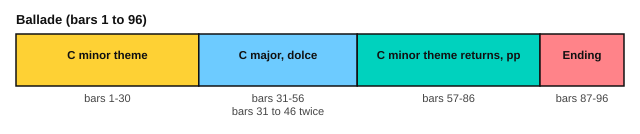

# Burgmüller: Ballade

<span class="tag tag-piano">Piano</span>

After this lesson you can play Burgmüller's Ballade, Op. 100 No. 15, in sections, count it in 3/8, and play its change from C minor to C major and back.

Before this: [Burgmüller: Arabesque](07-burgmuller-arabesque.md), [Compound meter](../06-meter-terms-and-rhythm/01-compound-meter.md), [Tempo and dynamics terms](../06-meter-terms-and-rhythm/03-tempo-and-dynamics-terms.md). You need: your piano and a metronome.

## The idea

### The piece

The Ballade is No. 15 of Burgmüller's *25 Easy Studies*, Op. 100. A **ballade** is a piece that tells a story, and this one is marked Allegro con brio (fast, with vigour) and misterioso (mysteriously). It has 96 bars. The key signature is C minor (three flats), and the middle part changes to C major. The score gives the tempo as 104 quarter notes a minute.

The time signature is 3/8: three eighth notes in a bar. A bar lasts 1.5 quarter notes, and at 104 a bar passes in about 0.87 seconds, so you feel one beat in each bar, "1 2 3" quickly. Learn it at 60 quarter notes a minute first, which makes a bar 1.5 seconds.

```abc
X:1
T:Ballade (25 Easy Studies, Op. 100 No. 15)
C:Johann Friedrich Burgmuller (1806-1874)
M:3/8
L:1/16
Q:1/4=104
K:Cm
%%score {RH LH}
V:RH clef=treble
V:LH clef=bass
V:RH
"^Allegro con brio""_misterioso"!p!.[CEG]2.[CEG]2[CEG]2 | .[CEG]2.[CEG]2[CEG]2 | .[CEG]2.[CEG]2[CEG]2 | .[CEG]2.[CEG]2[CEG]2 |
V:LH
z6 | z6 | !mp!(C,=B,,C,G,,=A,,B,, | C,=B,,C,G,,=A,,B,, |
V:RH
.[CEG]2.[CEG]2[CEG]2 | .[CEG]2.[CEG]2[CEG]2 | .[CEG]2.[CEG]2[CEG]2 | .[CE^F]2.[CEF]2.[CEF]2 |
V:LH
.C,2)z2.E,2 | .G,2z2.C,2 | !sfz!=A,6- | =A,4 .C,2 |
V:RH
.[CEG]2.[CEG]2[CEG]2 | .[CE^F]2.[CEF]2.[CEF]2 | .[CEG]2.[CEG]2[CEG]2 | .[CEG]2.[CEG]2[CEG]2 |
V:LH
!sfz!=A,6- | =A,4 z2 | !mp!(C,=B,,C,G,,=A,,B,, | C,=B,,C,G,,=A,,B,, |
V:RH
.[CEG]2.[CEG]2[CEG]2 | .[CEG]2.[CEG]2[CEG]2 | .[CEG]2.[CEG]2[CEG]2 | .[CE^F]2.[CEF]2.[CEF]2 |
V:LH
.C,2)z2.E,2 | .G,2z2.C,2 | !sfz!=A,6- | =A,4 .C,2 |
V:RH
.[CEG]2.[CEG]2[CEG]2 | .[CE^F]2.[CEF]2.[CEF]2 | .[CEG]2.[CEG]2z2 | ."_cresc."[Gc]2.[Gc]2z2 |
V:LH
!sfz!=A,6- | =A,4 z2 | G,2G,2z2 | [E,G,]2[E,G,]2z2 |
V:RH
.[G=B]2.[GB]2z2 | .[Gf]2.[Gf]2z2 | .[Ge]2.[Ge]2z2 | .!f!g2.e2.c2 |
V:LH
[D,G,]2[D,G,]2z2 | [=B,,G,]2[B,,G,]2z2 | [C,G,]2[C,G,]2z2 | z6 |
V:RH
.G2.E2.C2 | z6 | z6 | !marcato![EG]4 z2 |
V:LH
z6 | .G,2.E,2.C,2 | G,,4 z2 | [G,C]4 z2 |
V:RH
!marcato!G,4 z2 | !marcato!!fermata![DG]4 z2 |: [K:C]"_dolce"(G6 | c6 |
V:LH
G,,4 z2 | !fermata![G,=B,]4 z2 |: [K:C]z2[E,G,C]2[E,G,C]2 | z2[E,G,C]2[E,G,C]2 |
V:RH
B6 | g6) | (G6 | "_cresc."c6 |
V:LH
z2[F,G,D]2[F,G,D]2 | z2[F,G,D]2[F,G,D]2 | z2[E,G,C]2[E,G,C]2 | z2[E,G,C]2[E,G,C]2 |
V:RH
B6 | a4 g2) | (g6 | f4 e2 |
V:LH
z2[F,G,D]2[F,G,D]2 | z2[F,G,D]2[F,G,D]2 | z2[E,G,C]2[E,G,C]2 | z2[A,^C]2[A,C]2 |
V:RH
!diminuendo(!g4 "^poco rit."f2 | e4) !diminuendo)!(d2 | c6 | e4 d2 |
V:LH
z2[D,F,A,]2[D,F,A,]2 | z2[F,A,D]2[F,A,D]2 | z2[G,CE]2[G,CE]2 | z2[G,B,F]2[G,B,F]2 |
V:RH
."^animato"c2).c2.B2 | ._B2.A2._A2 :| !diminuendo(!(_A4 !diminuendo)!G2) | !diminuendo(!(_A4 !diminuendo)!G2) |
V:LH
[CE]2 z4 | z6 :| z2[G,B,D]2[G,B,D]2 | z2[G,B,D]2[G,B,D]2 |
V:RH
"_cresc."(G2c2).B2 | ._B2.A2._A2 | !diminuendo(!(_A4 !diminuendo)!G2) | !diminuendo(!(_A4 !diminuendo)!G2) |
V:LH
[CE]2 z4 | z6 | z2[G,B,D]2[G,B,D]2 | z2[G,B,D]2[G,B,D]2 |
V:RH
!sfz!!accent!(_A6 | "_dim."F6 | D6 | G6) |
V:LH
_A,6 | F,6 | D,6 | G,6 |
V:RH
[K:Cm]!pp!.[CEG]2.[CEG]2[CEG]2 | .[CEG]2.[CEG]2[CEG]2 | .[CEG]2.[CEG]2[CEG]2 | .[CEG]2.[CEG]2[CEG]2 |
V:LH
[K:Cm]C,4 z2 | z6 | !mp!(C,=B,,C,G,,=A,,B,, | C,=B,,C,G,,=A,,B,, |
V:RH
.[CEG]2.[CEG]2[CEG]2 | .[CEG]2.[CEG]2[CEG]2 | .[CEG]2.[CEG]2[CEG]2 | .[CE^F]2.[CEF]2.[CEF]2 |
V:LH
.C,2)z2.E,2 | .G,2z2.C,2 | !sfz!=A,6- | =A,4 .C,2 |
V:RH
.[CEG]2.[CEG]2[CEG]2 | .[CE^F]2.[CEF]2.[CEF]2 | .[CEG]2.[CEG]2[CEG]2 | .[CEG]2.[CEG]2[CEG]2 |
V:LH
!sfz!=A,6- | =A,4 z2 | !mp!(C,=B,,C,G,,=A,,B,, | C,=B,,C,G,,=A,,B,, |
V:RH
.[CEG]2.[CEG]2[CEG]2 | .[CEG]2.[CEG]2[CEG]2 | .[CEG]2.[CEG]2[CEG]2 | .[CE^F]2.[CEF]2.[CEF]2 |
V:LH
.C,2)z2.E,2 | .G,2z2.C,2 | !sfz!=A,6- | =A,4 .C,2 |
V:RH
.[CEG]2.[CEG]2[CEG]2 | .[CE^F]2.[CEF]2.[CEF]2 | .[CEG]2.[CEG]2z2 | ."_cresc.""_cresc."[Gc]2.[Gc]2z2 |
V:LH
!sfz!=A,6- | =A,4 z2 | G,2G,2z2 | [E,G,]2[E,G,]2z2 |
V:RH
.[G=B]2.[GB]2z2 | .[Gf]2.[Gf]2z2 | .[Ge]2.[Ge]2z2 | .!f!g2.e2.c2 |
V:LH
[D,G,]2[D,G,]2z2 | [=B,,G,]2[B,,G,]2z2 | [C,G,]2[C,G,]2z2 | z6 |
V:RH
.G2.E2.C2 | z6 | z6 | !marcato![EG]4 z2 |
V:LH
z6 | .G,2.E,2.C,2 | G,,4 z2 | [G,C]4 z2 |
V:RH
!marcato!G,4 z2 | [DG]4 z2 | !f!(C=B,CG,=A,B, | C=B,CG,=A,B, |
V:LH
G,,4 z2 | [G,=B,]4 z2 | C,=B,,C,G,,=A,,B,, | C,=B,,C,G,,=A,,B,, |
V:RH
"_dim."C=B,CG,=A,B, | C=B,CG,=A,B, | C4) z2 | !p!.[Gc]2.[Gc]2z2 |
V:LH
C,=B,,C,G,,=A,,B,, | C,=B,,C,G,,=A,,B,, | C,4 z2 | [K:clef=treble].[CE]2.[CE]2z2 |
V:RH
"_dim.".[gc']2.[gc']2z2 | .[g'c'']2.[g'c'']2z2 | !sfz!!diminuendo(![CE]6- | [CE]4!diminuendo)! z2 |]
V:LH
.[ce]2.[ce]2z2 | .[c'e']2.[c'e']2z2 | [K:clef=bass][C,G,]6- | [C,G,]4 z2 |]
```

Source: Mutopia Project Mutopia-2013/01/12-227 (maintainer Bas Wassink), Public Domain, from the Collection Litolff edition.

### The parts



| Bars | What happens |
|---|---|
| 1 to 30 | The C minor theme: the right hand repeats a short, detached C minor chord, and the left hand has a six-note figure from bar 3. Bar 30 has a fermata (a pause). |
| 31 to 56 | A change to C major, marked dolce (sweetly). A long right hand tune over left hand chords on beats 2 and 3. Bars 31 to 46 are repeated. |
| 57 to 86 | The C minor theme comes back, very soft (pp), the same as bars 1 to 30 |
| 87 to 96 | The ending: a loud six-note figure in both hands, then chords climbing two octaves and fading to a held C minor chord |

Within the first part, bars 1 and 2 have the right hand alone with the left hand resting, and the left hand enters in bar 3. In bars 7 to 10 the left hand holds a long A with a sforzando, and the right hand chords have an F# in bars 8 and 10. In bars 19 to 25 the music grows louder (cresc.), reaching forte in bar 24. Bars 28 to 30 are marked marcato, with strong accents, and stop on the fermata.

## Hard spots

| Bars | Why they are hard | What to do |
|---|---|---|
| 3 to 6, 11 to 14 | The left hand's six-note figure with naturals (B natural, A natural) | Play the left hand alone at 40 quarter notes a minute, saying the notes aloud |
| 7 to 10, 15 to 18 | A long tied left hand note with a loud start (sfz), against right hand chords | Count the tie, and practise the sforzando alone |
| 19 to 25 | Detached chords with rests, and a crescendo | Practise the loud-soft shape with only the right hand |
| 30 | The fermata | Hold it, then breathe, then start bar 31 in the new key |
| 31 to 44 | The key signature changes to C major, so there are no flats | Say "no flats" before you start bar 31 |
| 45 to 52 | The right hand slides down by half steps (Bb, A, Ab) | Play it hands apart and listen for the sinking sound |
| 87 to 91 | The six-note figure is in both hands, an octave apart | Play each hand alone, then together, slowly |
| 92 to 96 | The left hand moves to the treble clef in bar 92 and back to the bass clef in bar 95 | Mark the clef changes with a pencil |

## Learning order

1. Bars 1 to 10, the left hand alone, then hands together.
2. Bars 11 to 30, in two-bar and four-bar pieces, with the dynamics.
3. The C major part, bars 31 to 56, right hand first.
4. Bars 57 to 86 need no new learning, but play them softly, pp.
5. The ending, bars 87 to 96, one hand at a time.
6. The whole piece at 60 quarter notes a minute, then 80.

Here are bars 3 to 6 as an exercise: the right hand repeats the chord, the left hand has the figure.

```abc
X:1
M:3/8
L:1/16
Q:1/4=60
K:Cm
%%score {RH LH}
V:RH clef=treble
V:LH clef=bass
V:RH
.[CEG]2.[CEG]2[CEG]2 | .[CEG]2.[CEG]2[CEG]2 | .[CEG]2.[CEG]2[CEG]2 | .[CEG]2.[CEG]2[CEG]2 |]
V:LH
!mp!C,=B,,C,G,,=A,,B,, | C,=B,,C,G,,=A,,B,, | .C,2z2.E,2 | .G,2z2.C,2 |]
```

Here are bars 31 to 34 of the C major part.

```abc
X:1
M:3/8
L:1/16
Q:1/4=60
K:C
%%score {RH LH}
V:RH clef=treble
V:LH clef=bass
V:RH
(G6 | c6 | B6 | g6) |]
V:LH
z2[E,G,C]2[E,G,C]2 | z2[E,G,C]2[E,G,C]2 | z2[F,G,D]2[F,G,D]2 | z2[F,G,D]2[F,G,D]2 |]
```

## Try it

Exercise 1. How many sixteenth notes are in a bar of 3/8, and how many are in the six-note left hand figure?

<details class="solution" markdown>
<summary>Answer</summary>

Six sixteenth notes in a bar of 3/8, and the figure has six notes, so it fills one bar.

</details>

Exercise 2. Which bars are in C major, and which repeat?

<details class="solution" markdown>
<summary>Answer</summary>

Bars 31 to 56 are in C major, and bars 31 to 46 are repeated.

</details>

Exercise 3. At 60 quarter notes a minute, how long is a bar of 3/8?

<details class="solution" markdown>
<summary>Answer</summary>

A bar is 1.5 quarter notes, so 1.5 seconds.

</details>

<div class="practice" markdown>

### Practice routine (30 minutes)

| Minutes | What to do | Tempo | Listen for |
|---|---|---|---|
| 5 | Warm-up: C minor scale, natural form, hands separately, one octave | 60 bpm | Even touch |
| 15 | Bars 1 to 18, left hand alone, then hands together; then bars 19 to 30 | 40, then 60 quarter notes a minute | The left hand figure stays soft |
| 5 | Sight reading: the first exercise above, then bars 31 to 34 | 50 bpm | Seeing the key change before it comes |
| 5 | Guitar: Carcassi, bars 1 to 8 | 60 bpm | Even eighth notes |

Repeat this routine on at least three days. Then move the 15 minutes to the C major part, and later to the ending.

</div>

<div class="move-on" markdown>

### Move on when

- [ ] You can play bars 1 to 30 hands together at 60 quarter notes a minute, three times in a row with no stops.
- [ ] You can play bars 31 to 46 with the repeat at 60 quarter notes a minute.
- [ ] You can play the whole piece at 60 quarter notes a minute, with the dynamics.
- [ ] You can say which bars are minor and which are major.

</div>

## Common mistakes

Playing every chord at the same volume. The piece starts piano, builds to forte, and the return is pianissimo. Mark each dynamic in pencil.

Counting three beats in a bar. In 3/8 at this speed there is one beat, so count "1 2 3" in eighth notes, fast.

Missing the naturals in the left hand. B natural and A natural cancel flats from the key signature. Circle them.

## Key terms

- **Ballade**: a piece that tells a story, from a song form.
- **Allegro con brio**: fast, with vigour.
- **Misterioso**: mysteriously.
- **Dolce**: sweetly.
- **Marcato**: with strong accents.
- **Fermata**: a pause on a note or chord, held longer than its written length.

Next: [The Minuet in G on guitar](09-bach-minuet-for-guitar.md)
