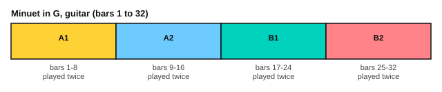

# The Minuet in G on guitar

<span class="tag tag-guitar">Guitar</span>

After this lesson you can play the Minuet in G on guitar from a two-voice score, in sections, with a melody on the top strings and a bass line under it, and say what changes from the piano version you already know.

Before this: [Minuet in G](../03-the-major-scale-and-keys/10-minuet-in-g.md), [Sor: two lessons from Opus 60](04-sor-op-60.md), [Key signatures with sharps](../03-the-major-scale-and-keys/07-sharp-key-signatures.md). You need: your guitar and a metronome.

## The idea

### The same minuet

This is the Minuet in G (BWV Anh. 114) that you learned on piano in stage 3, arranged for guitar. It comes from the Anna Magdalena Bach Notebook of 1725. It was long credited to J. S. Bach and is now credited to Christian Petzold (1677 to 1733). The guitar version is by Emre Akbas.

It is in G major, in 3/4, and has 32 bars. The key signature has one sharp, F#. The score gives the tempo as 120 quarter notes a minute, and each half is repeated: bars 1 to 16, then bars 17 to 32. Because you know the tune from the piano, you know where it goes, and the work is on the guitar.

```abc
%%opts tab=guitar sound=nylon
X:1
T:Minuet in G (BWV Anh. 114), guitar version
C:Christian Petzold (1677-1733), once attributed to J. S. Bach
M:3/4
L:1/8
Q:1/4=120
K:G
%%score (Melody Melody2)
V:Melody clef=treble-8
V:Melody2 clef=treble-8
V:Melody
|: d2 GA Bc | d2 G2 G2 | e2 cd ef | g2 G2 G2 |
V:Melody2
|: G,4 A,2 | B,6 | C6 | B,6 |
V:Melody
c2 dc BA | B2 cB AG | [DF]2 GA BG | A6 |
V:Melody2
A,6 | G,6 | x2 B,2 G,2 | D2 DC B,A, |
V:Melody
d2 GA Bc | [G,d]2 [B,G]2 [G,G]2 | e2 cd ef | [B,g]2 G2 G2 |
V:Melody2
B,4 A,2 | x6 | C6 | x2 CB, A,G, |
V:Melody
c2 dc BA | B2 cB AG | [CA]2 BA GF | G6 ::
V:Melody2
A,4 F,2 | G,4 B,2 | x2 D4 | G,4 G,2 ::
V:Melody
b2 ga bg | a2 de fd | [Eg]2 ef gd | ^c2 Bc z2 |
V:Melody2
G6 | F4 x2 | x2 G2 E2 | A4 A2 |
V:Melody
AB ^cd ef | [B,g]2 [Df]2 [^Ce]2 | [Df]2 [F,A]2 [A,^c]2 | d6 |
V:Melody2
A,6 | x6 | x6 | D2 D2 C2 |
V:Melody
d2 GF [B,G]2 | e2 GF [CG]2 | [B,d]2 [A,c]2 [G,B]2 | AG FG A2 |
V:Melody2
B,4 x2 | C4 x2 | x6 | D6 |
V:Melody
zE FG AB | [Ec]2 [GB]2 [FA]2 | Bd z4 | G6 :|]
V:Melody2
D4 F2 | x6 | G2 [B,G]2 [DF]2 | G,2 D2 G,2 :|]
```

Source: Mutopia Project Mutopia-2013/01/06-102 (guitar arrangement by Emre Akbas), Public Domain.



| Bars | What happens |
|---|---|
| 1 to 8 | The first tune, with a held bass note under most bars |
| 9 to 16 | The first tune again, with fuller chords in bars 10 and 12 |
| 17 to 24 | The second half starts high, with C# in bars 20 to 23 |
| 25 to 32 | The ending, with a turn in bar 28, a rising run in bar 29, and final chords |

### What changes from the piano

The melody stays in the same pitch as on the piano, so on the guitar it sits high on the neck. In the score, the melody is the upper voice (stems up) and the bass is the lower voice (stems down). The thumb p plays the bass, and the fingers play the melody.

The whole minuet sits low on the neck: the melody stays within the first seven frets, and the bass uses the open strings and the lowest frets. If the tab puts a note somewhere awkward, play it in first position instead.

The piano left hand moves more than the guitar bass does. In the guitar version, bars 2 to 6 each have one bass note held for the whole bar. Steel strings ring a long time, so the held bass sounds full, but a note that rings through a change of harmony can blur. Stop the bass with your finger when the next bass note arrives.

## Hard spots

| Bars | Why they are hard | What to do |
|---|---|---|
| 3 and 4, 11 and 12 | High notes, up to fret 15 | Find the position on string 1 with the tab before you play |
| 10, 12, 22 and 23, 31 | Two-note chords with a bass note | Play the chord with i and m, the bass with p, together |
| 17 to 19 | The highest bars, with a quick turn of notes | Practise on the piano first to hear the tune, then on the guitar |
| 20 to 23 | C# notes | Circle every C# in pencil before you play |
| 28 and 29 | A turn of eighth notes, then a rising run that starts after an eighth rest | Count 1 & 2 & 3 &, and start the run on the first "&" of bar 29 |
| 31 to 32 | The final bars with chords | Play the chords as written, then let the last chord ring |

## Learning order

1. Bars 1 to 8, the melody alone, with p i m a free strokes, then the bass alone.
2. Bars 1 to 8 together at 60 bpm.
3. Bars 9 to 16, noting how they differ from 1 to 8.
4. Bars 17 to 24 in two-bar pieces, with the C# circled.
5. Bars 25 to 32.
6. The whole minuet at 60 bpm, with both repeats, then at 80 bpm.

Here are bars 1 to 4 as an exercise.

```abc
%%opts tab=guitar sound=nylon
X:1
M:3/4
L:1/8
Q:1/4=60
K:G
%%score (Melody Melody2)
V:Melody clef=treble-8
V:Melody2 clef=treble-8
V:Melody
d'2 ga bc' | d'2 g2 g2 | e'2 c'd' e'f' | g'2 g2 g2 |]
V:Melody2
G4 A2 | B6 | c6 | B6 |]
```

Here are bars 17 to 20, the high start of the second half.

```abc
%%opts tab=guitar sound=nylon
X:1
M:3/4
L:1/8
Q:1/4=60
K:G
%%score (Melody Melody2)
V:Melody clef=treble-8
V:Melody2 clef=treble-8
V:Melody
b'2 g'a' b'g' | a'2 d'e' f'd' | [eg']2 e'f' g'd' | ^c'2 bc' z2 |]
V:Melody2
g6 | f4 x2 | x2 g2 e2 | a4 a2 |]
```

## Try it

Exercise 1. How many sharps does the key signature have, and which one?

<details class="solution" markdown>
<summary>Answer</summary>

One sharp, F#. G major has one sharp.

</details>

Exercise 2. Which bars are repeated, and which bars hold C#?

<details class="solution" markdown>
<summary>Answer</summary>

Bars 1 to 16 are repeated, and bars 17 to 32 are repeated. C# is in bars 20 to 23.

</details>

Exercise 3. In bar 1, the bass plays G for 4 eighth notes and A for 2. How many beats in total?

<details class="solution" markdown>
<summary>Answer</summary>

Six eighth notes are 3 quarter-note beats, one full bar of 3/4.

</details>

<div class="practice" markdown>

### Practice routine (30 minutes)

| Minutes | What to do | Tempo | Listen for |
|---|---|---|---|
| 5 | Warm-up: G major scale on strings 3 to 1, free strokes alternating i and m | 60 bpm | Even tone |
| 15 | Bars 1 to 16: melody alone, bass alone, then together; then bars 17 to 24 | 50 bpm, then 60 | The bass sits under the melody |
| 5 | Sight reading: the exercises above | 60 bpm | Reading high notes by the tab |
| 5 | Piano: Minuet in G, hands together | 80 bpm | The same tune on both instruments |

Repeat this routine on at least three days. Then move the 15 minutes to bars 25 to 32.

</div>

<div class="move-on" markdown>

### Move on when

- [ ] You can play bars 1 to 16 at 60 bpm, three times in a row with no stops.
- [ ] You can play bars 17 to 32 at 60 bpm, three times in a row.
- [ ] You can play the whole minuet with the repeats at 60 bpm.
- [ ] You can say what is different between the guitar and piano versions.

</div>

## Common mistakes

Letting the bass ring over a change of harmony. Touch the string with a finger to stop it.

Playing the high bars out of tune because the fretting hand is far from the body. Press close behind the fret, and move the whole hand with the fingers.

Rushing through the repeats. Count the repeat as a full pass.

## Key terms

- **Minuet**: a dance in 3/4 with a strong first beat.
- **Arrangement**: a piece rewritten for a different instrument.

Next: [Sight-reading classical pieces](10-sight-reading-classical.md)
