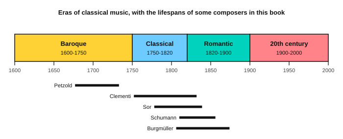

# The eras of classical music

<span class="tag tag-theory">Theory</span>

After this lesson you can name the four eras of classical music with their dates, say which features you can hear in each, and place the pieces in this book in their eras.

Before this: [Minuet in G](../03-the-major-scale-and-keys/10-minuet-in-g.md), [Clementi: Sonatina in C, first movement](06-clementi-sonatina-op-36-1.md), [Burgmüller: Arabesque](07-burgmuller-arabesque.md). You need: your piano or guitar, and the play bars on this page.

## The idea

### Four eras

Historians divide classical music into eras, periods with a common style. The dates are approximate, because composers did not change style on one day. The usual names are Baroque, Classical, Romantic and 20th century.



| Era | Dates | What you can hear |
|---|---|---|
| Baroque | about 1600 to 1750 | A steady, driving rhythm that rarely changes within a piece. A moving bass line. Two or more melodies at once. Ornaments such as the mordent. Harpsichord and organ. |
| Classical | about 1750 to 1820 | Clear tunes in balanced four-bar phrases. A light left hand, such as Alberti bass. Cadences that end phrases plainly. The piano replaces the harpsichord. Forms such as the sonata. |
| Romantic | about 1820 to 1900 | Long, song-like melodies. Big changes in volume and speed. Use of the damper pedal. Chords that move through more keys. Short pieces with titles about a mood or a story. |
| 20th century | about 1900 to 2000 | Many styles at once: new scales and unusual chords, sharp dissonance, jazz and dance rhythms, and later film and electronic music. |

### Listening for the differences

The play bar lets you hear the same ideas in short examples. Each one is written for this lesson. Example 1 is Baroque in style: a steady line of eighth notes in the right hand over a bass that walks.

```abc
X:1
M:4/4
L:1/8
Q:1/4=80
K:C
%%score {RH LH}
V:RH clef=treble
V:LH clef=bass
V:RH
e d c d e c e g | f e d e f d f a |]
V:LH
C,2 E,2 G,2 E,2 | F,2 A,2 D,2 A,2 |]
```

Example 2 is Classical in style: a clear tune in two short phrases over an Alberti bass. Listen for the plain stop at the end of each phrase.

```abc
X:1
M:4/4
L:1/8
Q:1/4=80
K:C
%%score {RH LH}
V:RH clef=treble
V:LH clef=bass
V:RH
E4 G4 | c4 B4 | A4 F4 | G8 |]
V:LH
C,G,E,G, C,G,E,G, | G,,D,B,,D, G,,D,B,,D, | F,CA,C F,CA,C | G,,D,B,,D, G,,D,B,,D, |]
```

Example 3 is Romantic in style: a slow, singing line that gets louder and softer, with one note from outside the key (the F# in bar 3).

```abc
X:1
M:3/4
L:1/4
Q:1/4=60
K:C
%%score {RH LH}
V:RH clef=treble
V:LH clef=bass
V:RH
!p!E2 G | !crescendo(!c2 e | !f!g2 ^f | !diminuendo(!e2 !diminuendo)!c |]
V:LH
[C,G,E]3 | [A,,E,A,]3 | [C,G,]3 | [G,,D,G,]3 |]
```

### The pieces in this book

| Piece | Composer and dates | Era |
|---|---|---|
| Minuet in G, Minuet in G minor, Musette in D | Anna Magdalena Bach Notebook, 1725; the minuets are by Petzold (1677 to 1733) | Baroque |
| Clementi, Sonatina in C | Clementi (1752 to 1832), published about 1797 | Classical |
| Giuliani, Carulli, Sor, Aguado, Carcassi guitar studies | Giuliani (1781 to 1829), Carulli (1770 to 1841), Sor (1778 to 1839), Aguado (1784 to 1849), Carcassi (1792 to 1853) | The end of the Classical era and the start of the Romantic |
| Schumann, Album for the Young | Schumann (1810 to 1856), 1848 | Romantic |
| Burgmüller, Op. 100 studies | Burgmüller (1806 to 1874), about 1851 | Romantic |
| [Chopin: Prelude in A major](../09-harmony/10-chopin-prelude-in-a-major.md) | Chopin (1810 to 1849), 1839 | Romantic |
| Tchaikovsky, Old French Song | Tchaikovsky (1840 to 1893), 1878 | Romantic |
| The book's own ambient and film-style pieces | Written for this book | 20th century and later styles |

The guitar composers lived across the boundary between two eras, so the table names them separately from the Classical and Romantic pieces. Their studies are neat and balanced like Classical music, and they were written for a six-string guitar that was becoming common in the early 1800s.

## Try it

Exercise 1. Which era is a steady, driving rhythm with a moving bass, and which has balanced four-bar phrases over an Alberti bass?

<details class="solution" markdown>
<summary>Answer</summary>

The first is Baroque. The second is Classical.

</details>

Exercise 2. Burgmüller's Arabesque is a short piece with a title about a mood, and it has sudden changes in loudness. Which era is it, and what are its dates?

<details class="solution" markdown>
<summary>Answer</summary>

Romantic, about 1820 to 1900. Burgmüller lived from 1806 to 1874.

</details>

Exercise 3. How many years does the Classical era span, going by the dates in this lesson?

<details class="solution" markdown>
<summary>Answer</summary>

70 years, from about 1750 to about 1820.

</details>

<div class="practice" markdown>

### Practice routine (30 minutes)

| Minutes | What to do | Tempo | Listen for |
|---|---|---|---|
| 5 | Warm-up: C major scale on piano, then G major on guitar | 60 bpm | Even notes |
| 10 | Piano: play Example 1 and Example 2 from the page | 60 bpm | The Baroque line is steady, the Classical bass is light |
| 10 | Listening: play each example with the play bar, then a piece from this book for each era, and say the era | Untimed | The features in the table |
| 5 | Guitar: Bach minuet for guitar, bars 1 to 8 | 60 bpm | The Baroque dance beat |

Repeat this routine on at least three days.

</div>

<div class="move-on" markdown>

### Move on when

- [ ] You can say the four eras and their approximate dates from memory.
- [ ] You can name one feature you can hear in each era.
- [ ] You can place five pieces from this book in their eras.
- [ ] You can play Examples 1 and 2 and say which is Baroque and which is Classical.

</div>

## Common mistakes

Treating the dates as hard borders. A composer born in 1810 can write in a Romantic style and also use older forms.

Mixing up the era and the style. "Classical music" in everyday speech means all of it, while the Classical era is only 1750 to 1820.

Judging an era by one piece. Listen for the features in several pieces first.

## Key terms

- **Baroque**: the era from about 1600 to 1750.
- **Classical (era)**: the era from about 1750 to 1820.
- **Romantic**: the era from about 1820 to 1900.
- **20th century**: the era from about 1900 to 2000, with many styles.
- **Era**: a period of music history with a common style.

Next: [Aguado: a little piece](12-aguado-study.md)
