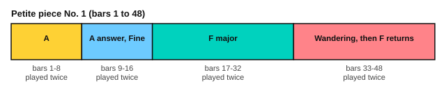

# Aguado: a little piece

<span class="tag tag-guitar">Guitar</span> <span class="tag tag-optional">Optional</span>

After this lesson you can play Aguado's Petite pièce No. 1, Op. 3, in sections, follow its key change from C major to F major, and keep three voices clear on the staff.

Before this: [Carulli: a waltz](03-carulli-study.md), [Sor: two lessons from Opus 60](04-sor-op-60.md), [Flat keys and the circle of fifths](../03-the-major-scale-and-keys/09-flat-keys-and-the-circle-of-fifths.md). You need: your guitar and a metronome.

## The idea

### The piece

Dionisio Aguado (1784 to 1849) was a Spanish guitarist and a friend of Sor. This lesson uses No. 1 of his eight Petites pièces, Op. 3, published about 1830. The title says "small piece", and it is a short piece, not a study, though it is used for practice. It is in 3/8, with the score giving 84 quarter notes a minute. It has 48 bars. It starts in C major and changes to F major at bar 17.

3/8 means three eighth notes in a bar, as in the Carulli waltz. Count "1 2 3" and feel one beat in a bar. At the score's tempo a bar lasts about 1.07 seconds. Begin at 60 quarter notes a minute, about 1.5 seconds a bar.

```abc
%%opts tab=guitar sound=nylon
X:1
T:Petite piece No. 1 (8 Petites Pieces, Op. 3)
C:Dionisio Aguado (1784-1849)
M:3/8
L:1/16
Q:1/4=84
K:C
%%score (Melody Melody2 Melody3)
V:Melody clef=treble-8
V:Melody2 clef=treble-8
V:Melody3 clef=treble-8
V:Melody
|: [Cc]2c3/2B/c3/2d/ | e3d[Gc]2 | [Cc]2c3/2B/c3/2d/ | g3f[Gd]2 |
V:Melody2
|: x2E2G2 | C2E2x2 | x2E2G2 | B,2D2x2 |
V:Melody3
|: x6 | x6 | x6 | x6 |
V:Melody
d3e^fg | d3^fed | dccBcA | [G,G]4 z2 ::
V:Melody2
B,2D2G2 | C2E2G2 | ^F,2A,2D2 | x6 ::
V:Melody3
x6 | x6 | x6 | x6 ::
V:Melody
gffefd | e3d[Gc]2 | G3GAB | cBcdef |
V:Melody2
B,2D2G2 | C2E2x2 | F,2B,2D2 | E,6 |
V:Melody3
x6 | x6 | x6 | x6 |
V:Melody
g3gfe | gfefga- | acBce3/2d/ | [CEc]4 "^Fine."z2 ::
V:Melody2
^C2E2A2 | D4 F2 | G4 [G,F]2 | x6 ::
V:Melody3
x6 | x6 | x6 | x6 ::
V:Melody
[K:F]=BcBcBc | c3d[FAc]2 | =BcdcB3/2c/ | a4 [FAf]2 |
V:Melody2
[K:F]x6 | F,6 | x6 | F,6 |
V:Melody3
[K:F]x6 | x2[FA]2x2 | x6 | x2[FA]2x2 |
V:Melody
z2efga | b4 ag | b4 ag | f4 [EGc]2 |
V:Melody2
x6 | C6 | C6 | F,6 |
V:Melody3
cd x4 | x2[GB]2[GB]2 | x2[GB]2[GB]2 | x2[EG]2x2 |
V:Melody
=BcBcBc | c3d[FAc]2 | =BcdcB3/2c/ | a4 [FAf]2 |
V:Melody2
x6 | F,6 | x6 | F,6 |
V:Melody3
x6 | x2[FA]2x2 | x6 | x2[FA]2x2 |
V:Melody
z2efga | a4 ge | g4 fd | [CEc]4 z2 ::
V:Melody2
x6 | C6 | =B,6 | x6 ::
V:Melody3
cd x4 | x2[EG]2[EG]2 | x2[FG]2[FG]2 | x6 ::
V:Melody
bac'bge | c3_d[EBc]2 | =Bc^cd^de | f4 [FAc]2 |
V:Melody2
x6 | C6 | x6 | F,6 |
V:Melody3
x6 | x2[EB]2x2 | x6 | x2[FA]2x2 |
V:Melody
fegfaz | z2_AGAG | z2_AGAG | z6 |
V:Melody2
x6 | x2F2F2 | x2F2F2 | x6 |
V:Melody3
x4 xc | [D=B]6 | [D=B]6 | [CEc]4 x2 |
V:Melody
z6 | c3d[FAc]2 | =BcdcB3/2c/ | a4 [FAf]2 |
V:Melody2
x6 | F,6 | x6 | F,6 |
V:Melody3
=BcBcBc | x2[FA]2x2 | x6 | x2[FA]2x2 |
V:Melody
z2efga | b4 ag | b4 ag | [FAf]4 z2 :|]
V:Melody2
x6 | C6 | C6 | x6 :|]
V:Melody3
cd x4 | x2[GB]2[GB]2 | x2[GB]2[GB]2 | x6 :|]
```

Source: Mutopia Project Mutopia-2016/02/12-2041 (maintainer Glen Larsen), CC BY-SA 4.0, from the Schott edition, plate 2674.

### The sections



| Bars | What happens |
|---|---|
| 1 to 8 | The first part in C major, repeated. F# in bars 5 to 7 shows a move toward G, and bar 13 has a C# in the answer. |
| 9 to 16 | The answer, repeated, ending in bar 16 at the word Fine |
| 17 to 32 | The key changes to F major, one flat, Bb. B natural appears in several bars as an accidental. Repeated. |
| 33 to 48 | Bars 34 to 39 wander, with Db, C#, D# and Ab. Bars 41 to 48 bring back the music of bars 17 to 24. Repeated. |

The Fine at the end of bar 16 means the piece ends there after a return to the start. After bar 48, go back to bar 1 and play to the Fine, as with a D.C. al Fine. The score as printed here may not show the D.C. words, so follow this line.

The score has three voices on one staff. The top voice has the tune, and the other two voices have a bass line and middle notes, with invisible rests between them. Do not try to read three lines at once. Read the top voice and the lowest voice first, and add the middle notes last.

## Hard spots

| Bars | Why they are hard | What to do |
|---|---|---|
| 1, 3 and 15 | A dotted sixteenth note followed by a very short thirty-second note | Count in thirty-second notes, with the dotted note lasting three of them, and slow down |
| 13 to 15 | A run of sixteenth notes and a tie over the bar line | Play the notes of the run alone, then add the tie |
| 17 | The key changes and B natural appears | Say "one flat, B natural" before you play |
| 25 to 32 | The F major section, with B natural in several bars | Circle every B natural first |
| 34 to 39 | Accidentals, with Db, C#, D#, Ab | Play it hands-slow, one bar at a time, naming each note |
| 41 to 48 | The F major music returns with the figure moved to a different voice | Read it against bars 17 to 24 and see what moved |

## Learning order

1. Bars 1 to 8, the top voice alone, then with the bass.
2. Bars 9 to 16, then the Fine.
3. Bars 17 to 24 as a separate piece in F major.
4. Bars 25 to 32.
5. Bars 33 to 48, starting from the hard bars 34 to 39.
6. Put the sections in order with the repeats, then go back to the start and play to the Fine.

Here are bars 1 to 4 as an exercise.

```abc
%%opts tab=guitar sound=nylon
X:1
M:3/8
L:1/16
Q:1/4=60
K:C
%%score (Melody Melody2)
V:Melody clef=treble-8
V:Melody2 clef=treble-8
V:Melody
[Cc]2c3/2B/c3/2d/ | e3d[Gc]2 | [Cc]2c3/2B/c3/2d/ | g3f[Gd]2 |]
V:Melody2
x2E2G2 | C2E2x2 | x2E2G2 | B,2D2x2 |]
```

Here are bars 17 to 20, the first bars in F major.

```abc
%%opts tab=guitar sound=nylon
X:1
M:3/8
L:1/16
Q:1/4=60
K:F
%%score (Melody Melody2 Melody3)
V:Melody clef=treble-8
V:Melody2 clef=treble-8
V:Melody3 clef=treble-8
V:Melody
=BcBcBc | c3d[FAc]2 | =BcdcB3/2c/ | a4 [FAf]2 |]
V:Melody2
x6 | F,6 | x6 | F,6 |]
V:Melody3
x6 | x2[FA]2x2 | x6 | x2[FA]2x2 |]
```

## Try it

Exercise 1. How many flats does the key signature have in bar 17 on, and what are they?

<details class="solution" markdown>
<summary>Answer</summary>

One flat, Bb. F major has one flat.

</details>

Exercise 2. How many sixteenth notes are in a bar of 3/8?

<details class="solution" markdown>
<summary>Answer</summary>

Six.

</details>

Exercise 3. Which bars come back at the end of the piece, and which bars do they match?

<details class="solution" markdown>
<summary>Answer</summary>

Bars 41 to 48 bring back the music of bars 17 to 24.

</details>

<div class="practice" markdown>

### Practice routine (30 minutes)

| Minutes | What to do | Tempo | Listen for |
|---|---|---|---|
| 5 | Warm-up: C major scale, then F major scale, on guitar, free strokes | 60 bpm | Even tone |
| 15 | Bars 1 to 16: top voice alone, bass alone, then together; then bars 17 to 24 | 50, then 60 quarter notes a minute | A clear tune above the bass |
| 5 | Sight reading: the exercises above | 60 bpm | Seeing the key change before you reach it |
| 5 | Piano: Clementi, bars 1 to 8 | 40 half notes a minute | Even notes in both hands |

Repeat this routine on at least three days. Then move the 15 minutes to bars 25 to 48.

</div>

<div class="move-on" markdown>

### Move on when

- [ ] You can play bars 1 to 16 at 60 quarter notes a minute, three times in a row with no stops.
- [ ] You can play bars 17 to 32 at 60 quarter notes a minute, three times in a row.
- [ ] You can play bars 33 to 48 at 60 quarter notes a minute, naming each accidental first.
- [ ] You can play the whole piece with the repeats and return to the Fine.

</div>

## Common mistakes

Playing the dotted sixteenth note too long. The thirty-second note is very short, so count it carefully.

Forgetting the new key signature at bar 17. Say "one flat" before the first bar of the F major part.

Reading all three voices at once. Start with the top voice, then the bass, then the middle.

## Key terms

- **Thirty-second note**: a note half as long as a sixteenth note.
- **Fine**: the end of the piece, after a return to the start.
- **Key change**: a change of key signature during a piece.

Next: [The royal road progression](../11-film-game-and-anime-harmony/01-the-royal-road.md)
