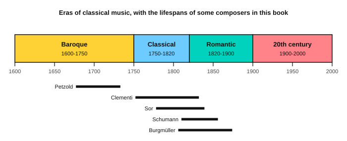

# Stage 10: Classical repertoire

This stage puts the skills of stages 1 to 9 into real classical pieces. On guitar you learn classical posture and the rest and free strokes on your steel-string guitar, then play studies by Giuliani, Carulli, Sor and Carcassi, and a guitar version of the Minuet in G. On piano you play a Clementi sonatina and two Burgmüller pieces. You also practise reading classical patterns at sight, and learn the four eras of classical music. By the end you can learn a real score by sections, from its key, time signature and bar numbers. It usually takes about 6 to 8 weeks at 30 minutes a day.

<!-- lessons:start -->
## Lessons

1. [Fingerstyle posture and studies](01-fingerstyle-posture-and-studies.md) (guitar)
2. [Giuliani: right-hand studies](02-giuliani-right-hand-studies.md) (guitar)
3. [Carulli: a waltz](03-carulli-study.md) (guitar)
4. [Sor: two lessons from Opus 60](04-sor-op-60.md) (guitar)
5. [Carcassi: a study from Opus 60](05-carcassi-op-60.md) (guitar)
6. [Clementi: Sonatina in C, first movement](06-clementi-sonatina-op-36-1.md) (piano)
7. [Burgmüller: Arabesque](07-burgmuller-arabesque.md) (piano)
8. [Burgmüller: Ballade](08-burgmuller-ballade.md) (piano)
9. [The Minuet in G on guitar](09-bach-minuet-for-guitar.md) (guitar)
10. [Sight-reading classical pieces](10-sight-reading-classical.md) (reading)
11. [The eras of classical music](11-music-eras.md) (theory)
12. [Aguado: a little piece](12-aguado-study.md) (guitar, optional)

<!-- lessons:end -->

Download the stage 10 deck: [10-classical-repertoire.apkg](../downloads/anki/10-classical-repertoire.apkg)

## Cheat sheet

Everything to remember from this stage, on one page.

### Guitar right hand

| Term | Meaning |
|---|---|
| p i m a | Thumb, index, middle and ring finger of the picking hand |
| Free stroke | The finger plucks and curls past the next string without touching it. Use it for arpeggios and chords |
| Rest stroke | The finger plucks and comes to rest on the next string. Use it for a melody that must stand out |
| Two voices | Melody (stems up) and bass (stems down) on one staff |

On a steel-string guitar: press lightly close behind the fret, use the flesh of the fingertip or short nails, stop a bass note with a finger when the score shows a rest, and use a footstool or a strap so the guitar rests on the left thigh. The play bar uses a nylon-guitar sound.

### Sonatina form

| Part | What it does |
|---|---|
| Exposition | States the themes and moves from the home key to a new key (Clementi: bars 1 to 15, C to G) |
| Development | Plays with the themes in other keys (bars 16 to 23) |
| Recapitulation | Brings the themes back in the home key (bars 24 to 38) |

A sonatina is a short sonata. A movement is one self-contained part of a longer work. 2/2 (cut time) has two beats in a bar, with the half note as the beat.

### Learning a piece from a score

1. Scan the key, time signature, tempo word, repeats and hard bars.
2. Split the piece into sections by bar number.
3. Learn each section with hands or voices separate, then together, at half speed.
4. Join the sections, then raise the tempo 5 bpm at a time.

### The eras

| Era | Dates | Features |
|---|---|---|
| Baroque | about 1600 to 1750 | Steady driving rhythm, moving bass, several melodies at once, ornaments, harpsichord and organ |
| Classical | about 1750 to 1820 | Clear tunes in balanced phrases, light accompaniment such as Alberti bass, plain cadences, the piano, sonata form |
| Romantic | about 1820 to 1900 | Long song-like melodies, big changes in volume and speed, the pedal, chords through many keys, short pieces with titles |
| 20th century | about 1900 to 2000 | Many styles: new scales, dissonance, jazz and dance rhythms, film and electronic music |
