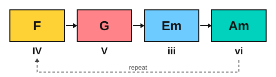
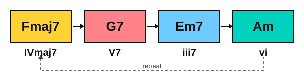

# The royal road progression

<span class="tag tag-theory">Theory</span>

After this lesson you can name the royal road progression (IV V iii vi), spell it in C major and in other keys, play it on the piano, and say why it sounds bittersweet.

Before this: [The chords of a key](../09-harmony/02-diatonic-chords.md), [Roman numerals](../09-harmony/01-roman-numerals.md). You need: your piano.

## The idea

### Hear it first

Play these four chords in C major, one bar each: F, G, Em, Am. Listen to where the progression ends. The first two chords climb and the music seems to be heading home to C. It does not arrive. It drops to Em, then to Am, and stops on a minor chord, still unsettled.

In the example below the left hand plays the root of each chord and the right hand plays the triad, as in stage 9.

```abc
X:1
M:4/4
L:1/4
Q:1/4=60
K:C
%%score {RH LH}
V:RH clef=treble
V:LH clef=bass
[V:RH] "F"[Acf]4 | "G"[Bdg]4 | "Em"[Beg]4 | "Am"[Ace]4 |]
[V:LH] F,4 | G,4 | E,4 | A,4 |]
```

### The numerals

In C major, F is the fourth chord (IV), G is the fifth (V), Em is the third (iii) and Am is the sixth (vi). So the order is **IV V iii vi**. This is the **royal road progression**. In Japan it is called "odo shinko" (royal road progression), and it is very common in J-pop and anime music. Because it uses numerals, it works in every key: start on the fourth chord of whatever key you are in.



| Key | IV | V | iii | vi |
|---|---|---|---|---|
| C major | F | G | Em | Am |
| G major | C | D | Bm | Em |
| D major | G | A | F#m | Bm |
| A major | D | E | C#m | F#m |
| F major | Bb | C | Am | Dm |
| Bb major | Eb | F | Dm | Gm |

### Why it sounds bittersweet

Two chords in this progression act differently from what you learned in stage 9.

First, V does not go to I. In a plain IV V I the dominant (G) pulls back to the tonic (C) and the music rests. Here G goes to Em instead. Em is a tonic-family chord: E, G, B shares E and G with C, E, G, so it is close to home without being home. The pull of G is answered, but only half.

Second, the progression ends on vi, which is minor. Am (A, C, E) also shares two notes with C major, so it is a tonic-family chord too, but it has a minor colour. The key is major, and the last chord is the sad relative of the tonic. The ear holds both feelings at once: a major sound that finishes in a minor one. That mixed feeling is what people mean by bittersweet.

Compare it with the ending that does go home. Play F, G, C: the last chord settles everything.

```abc
X:1
M:4/4
L:1/4
Q:1/4=60
K:C
%%score {RH LH}
V:RH clef=treble
V:LH clef=bass
[V:RH] "F"[Acf]4 | "G"[Bdg]4 | "C"[ceg]4 |]
[V:LH] F,4 | G,4 | C,4 |]
```

### The seventh-chord version

In J-pop and anime the progression is often written with sevenths: IVmaj7 V7 iii7 vi. In C major that is Fmaj7, G7, Em7 and Am. The sevenths add a softer, more wistful colour, and the V7 has a stronger pull that is then refused.

| Chord | Notes |
|---|---|
| Fmaj7 | F, A, C, E |
| G7 | G, B, D, F |
| Em7 | E, G, B, D |
| Am | A, C, E |



Here is a shortcut that makes these chords easy. Each seventh chord here is the bass note plus the triad a third above it. Fmaj7 is an F in the bass with an Am triad (A, C, E) on top. Em7 is an E in the bass with a G triad on top. G7 is a G in the bass with a diminished triad (B, D, F) on top. In the example below the left hand plays the root and the right hand plays that upper triad.

```abc
X:1
M:4/4
L:1/4
Q:1/4=60
K:C
%%score {RH LH}
V:RH clef=treble
V:LH clef=bass
[V:RH] "Fmaj7"[Ace]4 | "G7"[Bdf]4 | "Em7"[Bdg]4 | "Am"[Ace]4 |]
[V:LH] F,4 | G,4 | E,4 | A,4 |]
```

## Try it

Exercise 1. Spell the royal road in G major with triads.

<details class="solution" markdown>
<summary>Answer</summary>

C (IV), D (V), Bm (iii) and Em (vi).

</details>

Exercise 2. In D major, name the vi chord and spell it.

<details class="solution" markdown>
<summary>Answer</summary>

The sixth note of D major is B, so vi is Bm. Bm: B, D, F#.

</details>

Exercise 3. Why does the royal road end less settled than IV V I?

<details class="solution" markdown>
<summary>Answer</summary>

The V goes to iii instead of I, and the last chord is the minor vi instead of the major I. Neither is the tonic itself, so the ear never hears the major home chord.

</details>

<div class="practice" markdown>

### Practice routine (30 minutes)

| Minutes | What to do | Tempo | Listen for |
|---|---|---|---|
| 5 | Warm-up: C major scale, one octave, each hand alone | 60 bpm | Even volume, no bump at the thumb |
| 10 | New skill: Example 1 and the sevenths example, hands together, saying the numerals aloud (IV V iii vi) | 50 bpm, then 60 | The change from G to Em, where the music does not go home |
| 5 | Ear: play F G C, then F G Em Am, and say which one goes home | Untimed | The last chord settling or not settling |
| 5 | Guitar: changes between Em and Am, one minute, counting each clean change | 60 bpm | Every string ringing |
| 5 | Theory: write the royal road in G, D and F from memory, then check against the table | Untimed | Naming each chord from its place in the scale |

Repeat this routine on at least three days before you check the boxes below.

</div>

<div class="move-on" markdown>

### Move on when

- [ ] You can play Example 1 hands together at 60 bpm, three times in a row with no stops.
- [ ] You can write the royal road in G, D and F from memory in under a minute.
- [ ] You can say the notes of Fmaj7, G7 and Em7 without looking.
- [ ] Someone plays you F G C or F G Em Am, and you say which one goes home, correct 4 times out of 5.

</div>

## Common mistakes

Starting on the wrong chord. The royal road starts on IV, not on I. In C major the first chord is F, not C.

Reading iii and vi as major. Lower-case numerals are minor chords: Em and Am in C major. Play them as minor or the progression loses its bittersweet sound.

Rushing the sevenths. Playing four notes in the right hand makes the chords heavy. Use the three-note upper triad from the last example.

## Key terms

- **Royal road progression**: the chord progression IV V iii vi, common in J-pop and anime.
- **Tonic-family chord**: a chord that shares two notes with the tonic and can stand in for home, such as iii and vi.
- **Bittersweet**: a mix of major brightness and a minor ending, which the royal road gives by finishing on vi.

Next: [The royal road on piano](02-royal-road-on-piano.md)
