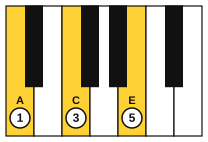
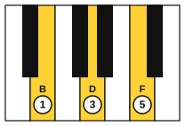
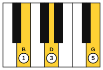

# The royal road on piano

<span class="tag tag-piano">Piano</span>

After this lesson you can play the royal road with seventh chords in C major with both hands, play it in G major, and play a right-hand melody over it.

Before this: [The royal road progression](01-the-royal-road.md), [Broken-chord accompaniment](../05-minor-keys-and-chord-charts/11-broken-chord-accompaniment.md), [Inversions on piano](../04-intervals-and-triads/08-inversions-on-piano.md). You need: your piano.

## The idea

### Three notes on top, one below

In lesson 1 you saw that each seventh chord in the royal road is a bass note with a triad on top. That gives a right-hand shape that is easy to reach and easy to move. The left hand plays the root, and the right hand plays three notes.

| Chord | Left hand | Right hand | Fingers |
|---|---|---|---|
| Fmaj7 | F | A, C, E | 1 3 5 |
| G7 | G | B, D, F | 1 3 5 |
| Em7 | E | B, D, G | 1 3 5 |
| Am | A | A, C, E | 1 3 5 |







### Moving between the shapes

These shapes sit close together, so the right hand moves very little. This is the nearest-inversion idea from stage 4.

1. From Fmaj7 to G7, slide the whole hand up one white key. Every finger moves a step.
2. From G7 to Em7, fingers 1 and 3 stay where they are (B and D). Only finger 5 moves, up from F to G.
3. From Em7 to Am, the hand moves down: B to A, D to C, G to E. Use fingers 1, 3 and 5 again.

Common mistake at step 2: lifting the whole hand when only one finger moves. Keep the two common notes down and change only the one that moves.

### An accompaniment for the left hand

You can play the left hand as a whole note, or as the broken-chord pattern from stage 5: root, fifth, tenth, fifth, twice per bar. A tenth is a third plus an octave, so the pattern spans a wide stretch. It gives the progression a flowing feel, like a game or anime ballad.

## Hear and see

Example 1: the sevenths with a broken-chord left hand. The right hand holds each chord for the whole bar. Listen for the left hand staying even while the right hand changes.

```abc
X:1
M:4/4
L:1/8
Q:1/4=56
K:C
%%score {RH LH}
V:RH clef=treble
V:LH clef=bass
[V:RH] "Fmaj7"[Ace]8 | "G7"[Bdf]8 | "Em7"[Bdg]8 | "Am"[Ace]8 |]
[V:LH] F,,C,A,C, F,,C,A,C, | G,,D,B,D, G,,D,B,D, | E,,B,,G,B,, E,,B,,G,B,, | A,,E,CE, A,,E,CE, |]
```

Example 2: a melody over the progression. Each bar of melody has a chord note on beat 1, so the tune always fits the harmony. The left hand holds a chord. The melody is original and goes around the loop twice.

```abc
X:1
M:4/4
L:1/4
Q:1/4=60
K:C
%%score {RH LH}
V:RH clef=treble
V:LH clef=bass
[V:RH] "Fmaj7"c2 c A | "G7"d2 B d | "Em7"B2 G B | "Am"A4 |
[V:RH] c2 e c | d2 f d | e d B G | A4 |]
[V:LH] [F,A,C]4 | [G,B,D]4 | [E,G,B,]4 | [A,CE]4 |
[V:LH] [F,A,C]4 | [G,B,D]4 | [E,G,B,]4 | [A,CE]4 |]
```

Play the melody with the right hand alone first. Put finger 1 on A and play with one finger per key. In bars 6 and 7 shift the hand up one key, so that finger 1 is on B. Then add the left-hand chords, then play the melody over the left-hand broken pattern from Example 1.

Example 3: the royal road in G major with triads. The chords are C, D, Bm and Em. Listen for the same shape of tension as in C major, only higher. The right-hand notes are in the key of G, so every F is F#.

```abc
X:1
M:4/4
L:1/4
Q:1/4=60
K:G
%%score {RH LH}
V:RH clef=treble
V:LH clef=bass
[V:RH] "C"[Gce]4 | "D"[Adf]4 | "Bm"[Bdf]4 | "Em"[Beg]4 |]
[V:LH] C,4 | D,4 | B,,4 | E,4 |]
```

## Try it

Exercise 1. In G major, what is the vi chord, and what are its notes?

<details class="solution" markdown>
<summary>Answer</summary>

Em. Em: E, G, B.

</details>

Exercise 2. In F major the royal road is Bb, C, Am, Dm. Spell the first chord.

<details class="solution" markdown>
<summary>Answer</summary>

Bb major: Bb, D, F.

</details>

Exercise 3. In Example 2, which melody note in bar 6 is the seventh of G7?

<details class="solution" markdown>
<summary>Answer</summary>

The f in bar 6 (F5). G7: G, B, D, F, so F is the seventh. The melody lands on it only for a short note, then returns to D.

</details>

<div class="practice" markdown>

### Practice routine (30 minutes)

| Minutes | What to do | Tempo | Listen for |
|---|---|---|---|
| 5 | Warm-up: the right-hand shapes alone, Fmaj7 to G7 to Em7 to Am, holding each for 4 counts | 50 bpm | Only the moving fingers lift |
| 15 | New skill: Example 1 hands together, then the Example 2 melody alone, then Example 2 hands together | 50 bpm, then 60 | The melody louder than the chords |
| 5 | Sight reading: Example 3, read once, then play it | 50 bpm | Keep going after a wrong note |
| 5 | Guitar: Em and Am changes, then Em7 (0 2 0 0 0 0) and Am | 60 bpm | Every string ringing |

Repeat this routine on at least three days before you check the boxes below.

</div>

<div class="move-on" markdown>

### Move on when

- [ ] You can play Example 1 hands together at 60 bpm, three times in a row with no stops.
- [ ] You can play the melody of Example 2 with the right hand over left-hand chords at 60 bpm, three times in a row.
- [ ] You can play Example 3 in G major and name each chord and its numeral as you play.
- [ ] You can play the four right-hand shapes of Example 1 in order, with no extra lifting, in under 10 seconds.

</div>

## Common mistakes

Playing the melody and chords at the same volume. Make the melody the loudest part, as in stage 7: keep the left hand quieter.

Forgetting the F# in G major. The key signature covers it, but the notes of the D and Bm chords sit in the middle of the staff and the sharp is easy to lose. Say "F sharp" under your breath at the Bm.

Stretching for the tenth with a tight hand. If your left hand hurts or cannot reach, play the root and fifth only, or stop and rest. Pain is a stop sign.

## Key terms

- **Upper triad**: the three notes of a triad played above a bass note to make a seventh chord, such as A, C, E over F for Fmaj7.
- **Common note**: a note that two chords share, which a finger can hold while the others move.

Next: [The royal road on guitar](03-royal-road-on-guitar.md)
