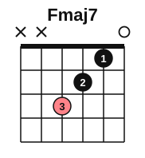
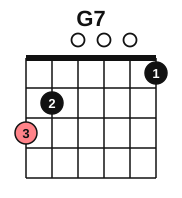
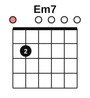
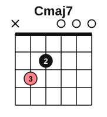
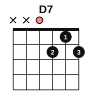
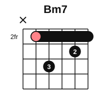

# The royal road on guitar

<span class="tag tag-guitar">Guitar</span>

After this lesson you can play the royal road with seventh chords in C major and in G major on the guitar, strum it, and play it with a picking pattern.

Before this: [The royal road progression](01-the-royal-road.md), [Major 7 and minor 7 barre shapes](../09-harmony/06-maj7-and-min7-barre-shapes.md), [Fingerpicking patterns](../06-meter-terms-and-rhythm/07-fingerpicking-patterns.md), [Sus and add9 chords](../07-pedal-texture-and-ambient/06-sus-and-add9-chords.md). You need: your guitar, a pick and a tuner.

## The idea

### Open shapes in C major

In C major the royal road is Fmaj7, G7, Em7 and Am. All four have an open-string shape, and you have met three of them already: Fmaj7 in stage 9, Em7 in stage 7 and Am in stage 2. G7 is new, but it is the G chord you know with one change: the high string plays F (finger 1, fret 1) instead of G. Strum only the strings marked on each diagram.








| Chord | Notes |
|---|---|
| Fmaj7 | F, A, C, E |
| G7 | G, B, D, F |
| Em7 | E, G, B, D |
| Am | A, C, E |

Here are the changes to practise, one pair at a time.

1. Fmaj7 to G7. Lift all three fingers and move to the low strings. Finger 3 goes to string 6, fret 3, first.
2. G7 to Em7. Lift fingers 3 and 1. Finger 2 stays on string 5, fret 2. Em7 needs only that one finger, so this change is quick.
3. Em7 to Am. Finger 2 moves from string 5 to string 4. Add fingers 3 and 1 on strings 3 and 2.
4. Am to Fmaj7. Let the thumb stay behind the neck and keep your fingers curved so they do not touch string 1, which must ring open.

Common mistake at step 1: strumming strings 6 and 5 on Fmaj7. They are not played. Start the strum on string 4.

### A key with a barre: G major

In G major the royal road is C, D, Bm, Em. With sevenths, that is Cmaj7, D7, Bm7 and Em7. Three of these are open shapes. Bm7 is a barre shape, the one from stage 9 with its root on string 5 and the barre at fret 2.







| Chord | Notes |
|---|---|
| Cmaj7 | C, E, G, B |
| D7 | D, F#, A, C |
| Bm7 | B, D, F#, A |
| Em7 | E, G, B, D |

The Bm7 sounds on strings 5 to 1. If the barre buzzes, press with the side of finger 1 close behind fret 2, and check that the strings you do not need are not touched.

If you play these shapes with a capo, the key moves. Capo at fret 2 with the G major shapes sounds in A major, with the same numerals.

## Hear and see

Example 1: the C major royal road, one strum per bar. Let each chord ring and listen for the sad turn at Am. The notes are written an octave above where they sound, as for all guitar music in this book.

```abc
%%opts tab=guitar
X:1
M:4/4
L:1/4
Q:1/4=60
K:C clef=treble-8
"Fmaj7"[FAce]4 | "G7"[G,B,DGBf]4 | "Em7"[E,B,DGBe]4 | "Am"[A,EAce]4 |]
```

Example 2: a picking pattern. The thumb (p) plays the bass note, then fingers i, m and a play strings 3, 2 and 1, and the pattern comes back down through strings 2 and 3 to string 1: bass, 3, 2, 1, 2, 3, 2, 1. Play eight eighth notes per bar. Listen for the thumb being a little louder than the fingers.

```abc
%%opts tab=guitar
X:1
M:4/4
L:1/8
Q:1/4=60
K:C clef=treble-8
"Fmaj7"F A c e c A c e | "G7"G, G B f B G B f | "Em7"E, G B e B G B e | "Am"A, A c e c A c e |]
```

Example 3: the G major royal road with the Bm7 barre. Listen for the barre chord ringing as cleanly as the open ones.

```abc
%%opts tab=guitar
X:1
M:4/4
L:1/4
Q:1/4=60
K:G clef=treble-8
"Cmaj7"[CEGBe]4 | "D7"[DAc^f]4 | "Bm7"[B,^FAd^f]4 | "Em7"[E,B,DGBe]4 |]
```

## Try it

Exercise 1. Which string is the bass note of Fmaj7, and which fret is it on?

<details class="solution" markdown>
<summary>Answer</summary>

String 4, fret 3. D plus three frets is F.

</details>

Exercise 2. In the picking pattern of Example 2, which strings are played, in order, in one bar of Am?

<details class="solution" markdown>
<summary>Answer</summary>

Bass on string 5 (open A), then strings 3, 2, 1, 2, 3, 2, 1.

</details>

Exercise 3. The royal road in D major is G, A, F#m, Bm. If you play the G major shapes with a capo, where does the capo go to get D major?

<details class="solution" markdown>
<summary>Answer</summary>

Fret 7. G up seven half steps is D. In practice, a capo that high is awkward, so most players use the barre shapes instead.

</details>

<div class="practice" markdown>

### Practice routine (30 minutes)

| Minutes | What to do | Tempo | Listen for |
|---|---|---|---|
| 5 | Warm-up: Fmaj7 to G7, G7 to Em7, Em7 to Am, each change four times | 60 bpm | Every string ringing after the change |
| 15 | New skill: Example 1, then Example 2 with the picking pattern, then Example 3 | 50 bpm, then 60 | The thumb a little louder than the fingers |
| 5 | Ear: play the loop of Example 1 and sing the bass notes F, G, E, A | 60 bpm | The bass going up, down, up |
| 5 | Piano: the sevenths of the royal road, right-hand shapes and left-hand roots | 60 bpm | Only the moving fingers lift |

Repeat this routine on at least three days before you check the boxes below.

</div>

<div class="move-on" markdown>

### Move on when

- [ ] You can play Example 1 at 60 bpm, three times in a row with no stops and no buzz.
- [ ] You can play the picking pattern of Example 2 through all four bars at 60 bpm, three times in a row.
- [ ] You can play Example 3 including the Bm7 barre at 60 bpm, twice in a row.
- [ ] You can name the numeral of each chord in Examples 1 and 3.

</div>

## Common mistakes

Strumming string 6 on Fmaj7. The shape starts on string 4, so aim the pick there.

Letting the pattern speed up. The eight notes are even eighths. Count "1 & 2 & 3 & 4 &" out loud at 60 bpm.

Squeezing the barre. Press only as hard as needed. If your hand hurts, stop, shake it out, and see a teacher if the pain returns.

## Key terms

- **Picking pattern**: a fixed order of strings that you repeat over each chord, such as bass, 3, 2, 1, 2, 3, 2, 1.
- **Open shape**: a chord shape that uses open strings and can only be played in one place on the neck.

Next: [Aeolian loops](04-aeolian-loops.md)
