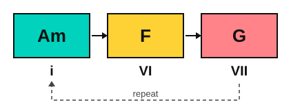
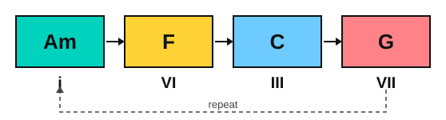

# Aeolian loops

<span class="tag tag-theory">Theory</span>

After this lesson you can name and play the Aeolian loops i VI VII and i VI III VII in A minor and E minor, and explain why they sound wide and open.

Before this: [Natural minor](../05-minor-keys-and-chord-charts/01-natural-minor.md), [Roman numerals](../09-harmony/01-roman-numerals.md), [The chords of a key](../09-harmony/02-diatonic-chords.md). You need: your piano and your guitar.

## The idea

### Hear it first

Play Am, F and G in a loop, one bar each, and go back to Am without stopping. Then play Am, F, C and G. Both loops can run for as long as you like. They never need to stop, and the minor key does not feel tense or sad so much as large.

```abc
X:1
M:4/4
L:1/4
Q:1/4=60
K:Am
%%score {RH LH}
V:RH clef=treble
V:LH clef=bass
[V:RH] "Am"[Ace]4 | "F"[Acf]4 | "G"[Bdg]4 | "Am"[Ace]4 |]
[V:LH] A,,4 | F,,4 | G,,4 | A,,4 |]
```

### Where the chords come from

All the chords come from the natural minor scale you learned in stage 5. Here it is in A minor.

The A natural minor scale: A, B, C, D, E, F, G, A.

Build a triad on each note, as you did in stage 9, and you get Am, Bdim, C, Dm, Em, F and G. The loops use only the chords on the 1st, 6th, 3rd and 7th notes: Am, F, C and G. They come from the **Aeolian** scale, which is another name for natural minor. Stage 12 covers the modes (see [The modes](../12-modes-and-improvising/01-modes.md)), so for now Aeolian means "the natural minor scale".

### The numerals

In stage 9 the chords of a minor key were written i, ii°, III, iv, v, VI and VII. So the loops are i VI VII (Am, F, G) and i VI III VII (Am, F, C, G). Film and game writers often write the same chords as i bVI bVII and i bVI bIII bVII, counting from a major scale and flattening the notes that differ: the b means "a half step lower than the same note of the major scale". For A, the major scale has F# and G#, and the minor has F and G, which is why they are bVI and bVII. Both spellings mean the same chords. This book uses the plain stage 9 form (VI, VII) in the lessons and the b form when comparing with major keys.





### Why it sounds open

The ear is used to the V chord pulling toward i. In natural minor the chord on the 5th note is Em, a minor chord, and it is weaker than a major V. Aeolian loops do not use a V at all. They use VII (G), a major chord a whole step below Am.

G does not contain a leading tone. Its notes are G, B, D, and none of them is a half step from A. So the move from G to Am has no tight pull, and the loop sounds as if it can continue. Three of the four chords are major (F, C and G), so the loop is bright, with a minor tonic as the ground. That mix gives the wide, open sound heard in many film and game scores.

The bass line of the four-chord loop is A, F, C, G. Sing the roots as you play. The move from G back up to A is a whole step, the smallest move in the loop, and it is what carries you round again.

| Key | i | VI | III | VII |
|---|---|---|---|---|
| A minor | Am | F | C | G |
| E minor | Em | C | G | D |
| D minor | Dm | Bb | F | C |
| B minor | Bm | G | D | A |

## Hear and see

Example 1: the four-chord loop on piano. The bass line moves with the right hand moving only by steps. Listen for how the loop turns back to Am without a stop.

```abc
X:1
M:4/4
L:1/4
Q:1/4=60
K:Am
%%score {RH LH}
V:RH clef=treble
V:LH clef=bass
[V:RH] "Am"[Ace]4 | "F"[Acf]4 | "C"[Gce]4 | "G"[GBd]4 |
[V:RH] "Am"[Ace]4 | "F"[Acf]4 | "C"[Gce]4 | "G"[GBd]4 |]
[V:LH] A,,4 | F,,4 | C,4 | G,,4 |
[V:LH] A,,4 | F,,4 | C,4 | G,,4 |]
```

Example 2: the same kind of loop in E minor on guitar, with the open chords Em, C, G and D. Strum two half notes per bar. Listen for the D chord leading back to Em without a strong pull.

```abc
%%opts tab=guitar
X:1
M:4/4
L:1/4
Q:1/4=60
K:Em clef=treble-8
"Em"[E,B,EGBe]2 [E,B,EGBe]2 | "C"[CEGce]2 [CEGce]2 | "G"[G,B,DGBg]2 [G,B,DGBg]2 | "D"[DAd^f]2 [DAd^f]2 |]
```

## Try it

Exercise 1. Write the four-chord loop in D minor.

<details class="solution" markdown>
<summary>Answer</summary>

The D natural minor scale: D, E, F, G, A, Bb, C, D. The chords on the 1st, 6th, 3rd and 7th notes are Dm, Bb, F and C.

</details>

Exercise 2. Why do Aeolian loops have no strong pull back to the tonic?

<details class="solution" markdown>
<summary>Answer</summary>

They have no V chord, and the VII chord (G in A minor) has no leading tone: none of its notes is a half step below A.

</details>

Exercise 3. A loop in E minor is Em, C, G, D. Write its numerals.

<details class="solution" markdown>
<summary>Answer</summary>

i, VI, III, VII.

</details>

<div class="practice" markdown>

### Practice routine (30 minutes)

| Minutes | What to do | Tempo | Listen for |
|---|---|---|---|
| 5 | Warm-up: A natural minor scale, one octave, right hand | 60 bpm | The half steps B to C and E to F |
| 10 | Piano: Example 1, hands together, looping it four times without a stop | 50 bpm, then 60 | The bass leading you round the loop |
| 10 | Guitar: Example 2, then the same loop in A minor with Am, F, C, G | 60 bpm | Clean changes, with the F shape ready early |
| 5 | Ear: play the loops i VI VII and i VI III VII, and say how many chords you hear before the loop repeats | Untimed | The place where the loop starts again |

Repeat this routine on at least three days before you check the boxes below.

</div>

<div class="move-on" markdown>

### Move on when

- [ ] You can play Example 1 on piano at 60 bpm, looped four times with no stops.
- [ ] You can play Example 2 on guitar at 60 bpm, looped four times with no stops.
- [ ] You can write the four-chord loop in A minor, E minor, D minor and B minor from memory.
- [ ] You can explain in one sentence why VII to i has no strong pull.

</div>

## Common mistakes

Changing the G to G7 or the E to E major at the end of the loop. That adds a leading tone and a pull, and the loop turns into an ordinary minor cadence. Keep the VII a plain major triad.

Counting the numerals from the wrong scale. VI and VII in a minor key are chords on the 6th and 7th notes of the minor scale, not the major one.

Slow F changes on the guitar. Place finger 1 on the first string early while the other chord is still playing.

## Key terms

- **Aeolian**: another name for the natural minor scale; used for the loops built on its chords.
- **Loop**: a short progression that repeats, with the last chord leading back to the first.
- **bVI, bVII**: chords built on the 6th and 7th notes of the minor scale, written with a b when counted from the major scale.

Next: [Borrowed chords and the Mario cadence](05-borrowed-chords-and-the-mario-cadence.md)
