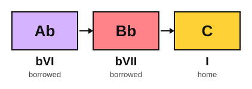

# Borrowed chords and the Mario cadence

<span class="tag tag-theory">Theory</span>

After this lesson you can name a borrowed chord, play the bVI bVII I move and the bIII chord in a major key, and hear the difference between them and the diatonic chords of the key.

Before this: [Relative and parallel keys](../05-minor-keys-and-chord-charts/05-relative-and-parallel-keys.md), [Cadences](../09-harmony/03-cadences.md), [Aeolian loops](04-aeolian-loops.md). You need: your piano and your guitar.

## The idea

### Hear it first

Play F, G and C in C major. This is IV V I, a cadence you know from stage 9. Now play Ab, Bb and C. The last chord is the same C, but the way you arrive is different: the three chords climb in steps, and none of the first two is in C major. This is Example 1.

```abc
X:1
M:4/4
L:1/4
Q:1/4=60
K:C
%%score {RH LH}
V:RH clef=treble
V:LH clef=bass
[V:RH] "F"[Acf]2 "G"[Bdg]2 | "C"[ceg]4 | "Ab"[c_e_a]2 "Bb"[df_b]2 | "C"[egc']4 |]
[V:LH] F,2 G,2 | C,4 | _A,,2 _B,,2 | C,4 |]
```

### Borrowing from the parallel minor

C major and C minor are parallel keys (stage 5): they have the same tonic, C, and different notes. C minor is C, D, Eb, F, G, Ab, Bb, C. Three of those notes are lower than in C major: Eb instead of E, Ab instead of A and Bb instead of B.

The C natural minor scale: C, D, Eb, F, G, Ab, Bb, C.

A chord taken from the parallel minor and used inside a major key is a **borrowed chord**. Using them is called **modal interchange**, because a key swaps chords with its parallel minor. Three common borrowed chords are major triads built on the lowered notes:

| Numeral | Name in C major | Notes | Borrowed note |
|---|---|---|---|
| bIII | Eb | Eb, G, Bb | Eb and Bb |
| bVI | Ab | Ab, C, Eb | Ab and Eb |
| bVII | Bb | Bb, D, F | Bb |

The b in front of a numeral means the chord is built on a note a half step below the one in the major scale. In C major the third note is E, so bIII is built on Eb. The numerals use the major scale as the measuring stick, which is why VI and VII lose their b only when you count from the minor scale, as in lesson 4.



### The Mario cadence

The progression **bVI bVII I** is often called the "Mario cadence". This is a fan name, used by players and online writers, and it has no standard textbook name. The move is common in video game music, which is where the nickname comes from. It is a cadence because it ends on I.

Why it sounds the way it does: the bass climbs Ab, Bb, C, three steps in a row. The bVII chord (Bb, D, F) is a whole step below C, not a half step, so it has no leading tone to pull the tonic. Instead of the tension of V, the music lifts into the tonic from below. The ear hears a bright arrival, and composers use it for fanfares and big arrivals.

### The bIII chord

The bIII in C major is Eb. It sits between C and F in a progression such as C, Eb, F, C. Because Eb has no notes in common with the F chord and shares only G with C, the move up to it feels like a sudden change of colour, and then F pulls it back into the key. In Example 2 the lowest note of the right hand falls by steps: C, Bb, A.

```abc
X:1
M:4/4
L:1/4
Q:1/4=60
K:C
%%score {RH LH}
V:RH clef=treble
V:LH clef=bass
[V:RH] "C"[ceg]4 | "Eb"[_B_eg]4 | "F"[Acf]4 | "C"[ceg]4 |]
[V:LH] C,4 | _E,4 | F,4 | C,4 |]
```

## Hear and see

Example 1 in the first section shows IV V I and then bVI bVII I with the same ending. Play both and say which is the brighter lift. Example 2 shows the bIII chord. Play it and listen for the sudden change of colour at the Eb.

Example 3 is the Mario cadence on guitar in E major: the chords C, D and E, all open shapes you know. C is bVI and D is bVII in E major. In E major, E is the tonic.

```abc
%%opts tab=guitar
X:1
M:4/4
L:1/4
Q:1/4=60
K:C clef=treble-8
"C"[CEGce]2 "D"[DAd^f]2 | "E"[E,B,E^GBe]4 | "C"[CEGce]2 "D"[DAd^f]2 | "E"[E,B,E^GBe]4 |]
```

The chords: C: C, E, G. D: D, F#, A. E: E, G#, B. C and D are the borrowed chords here. E is the tonic.

## Try it

Exercise 1. What is the Mario cadence in D major?

<details class="solution" markdown>
<summary>Answer</summary>

The D natural minor scale: D, E, F, G, A, Bb, C, D. The bVI is built on Bb and the bVII on C. The cadence is Bb, C, D. Bb major: Bb, D, F. C major: C, E, G. D major: D, F#, A.

</details>

Exercise 2. Which note in the Ab chord is not in C major?

<details class="solution" markdown>
<summary>Answer</summary>

Ab and Eb. Ab major: Ab, C, Eb. The note C is in C major.

</details>

Exercise 3. What is the bIII chord in G major?

<details class="solution" markdown>
<summary>Answer</summary>

The G natural minor scale: G, A, Bb, C, D, Eb, F, G. The third note is Bb, so bIII is Bb major: Bb, D, F.

</details>

<div class="practice" markdown>

### Practice routine (30 minutes)

| Minutes | What to do | Tempo | Listen for |
|---|---|---|---|
| 5 | Warm-up: the loop Am, F, C, G from lesson 4, on piano | 60 bpm | The bass line |
| 10 | Piano: Example 1 and Example 2 hands together, and say the numerals as you play | 50 bpm, then 60 | The rising lift of Ab, Bb, C |
| 10 | Guitar: Example 3 in E major, then try C, D, E in a different rhythm, down strokes on every beat | 60 bpm | The change from D to E |
| 5 | Ear: alternate F, G, C and Ab, Bb, C and say which one lifts | Untimed | Steps in the bass |

Repeat this routine on at least three days before you check the boxes below.

</div>

<div class="move-on" markdown>

### Move on when

- [ ] You can play Examples 1 and 2 hands together at 60 bpm, three times in a row with no stops.
- [ ] You can play Example 3 on guitar at 60 bpm, three times in a row.
- [ ] You can spell bIII, bVI and bVII in C major and in G major in under a minute.
- [ ] You can explain in one sentence why the Mario cadence has no leading tone.

</div>

## Common mistakes

Calling Ab, Bb, C the same as VI VII I. In C major, VI would be Am and VII would be Bdim. The flat signs matter.

Playing Bb as B. The borrowed chord has a flatted root. Read the flat sign before you move.

Using the fan name as a technical term. Write bVI bVII I when you talk to a teacher or write a score.

## Key terms

- **Borrowed chord**: a chord taken from the parallel minor key and used in a major key.
- **Modal interchange**: borrowing chords from the parallel minor key.
- **Mario cadence**: a fan name for bVI bVII I.
- **bIII, bVI, bVII**: major chords built on the lowered 3rd, 6th and 7th notes of the major scale.

Next: [The minor iv and the Picardy third](06-minor-iv-and-the-picardy-third.md)
