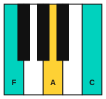
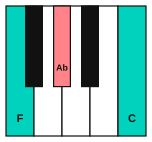
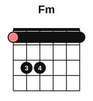

# The minor iv and the Picardy third

<span class="tag tag-theory">Theory</span>

After this lesson you can play and hear the minor iv in a major key (C, F, Fm, C), and the Picardy third, a major chord that ends a piece in a minor key.

Before this: [Borrowed chords and the Mario cadence](05-borrowed-chords-and-the-mario-cadence.md), [Cadences](../09-harmony/03-cadences.md), [E-shape barre chords](../08-fretboard-barre-chords-and-caged/02-e-shape-barre-chords.md). You need: your piano and your guitar.

## The idea

### One note changes

Play the C major chord, then F, then F minor, then C again. F and Fm differ by one note. F major is F, A, C, and F minor is F, Ab, C. The A drops by a half step to Ab and the colour of the chord darkens at once, like a cloud crossing a bright room. Then the Fm resolves to C.





The Fm is the **minor iv**: the chord on the 4th note of the key, but minor. In C major the IV is F major. The iv is borrowed from C minor, as in lesson 5, and it is the most common borrowed chord. It is written with a lower-case iv, because it is minor.

Example 1 plays C, F, Fm, C with the left hand on the root of each chord.

```abc
X:1
M:4/4
L:1/4
Q:1/4=60
K:C
%%score {RH LH}
V:RH clef=treble
V:LH clef=bass
[V:RH] "C"[ceg]4 | "F"[Acf]4 | "Fm"[_Acf]4 | "C"[Gce]4 |]
[V:LH] C,4 | F,4 | F,4 | C,4 |]
```

Listen to the lowest note of each right-hand chord: A, then Ab, then G. It falls by two half steps and lands on a note of the C chord. This falling line is why the move feels smooth, even though the Fm is a surprise.

### On the guitar

The guitar plays the F and Fm shapes as E-shape barre chords at fret 1, from stage 8. F is 1 3 3 2 1 1. For Fm, lift finger 2 off string 3. The strings 6 to 1 are then 1 3 3 1 1 1, and the barre does the rest.



### The Picardy third

A piece in a minor key normally ends on a minor tonic chord. The **Picardy third** is a major tonic chord used for the last chord of a minor-key piece. In A minor the tonic chord is Am, with the notes A, C, E. In a Picardy ending the chord is A major, with the notes A, C#, E. The third of the chord is raised by a half step, from C to C#, which is where the name comes from. Only the last chord changes. The key and the rest of the piece stay minor.

Am: A, C, E.

A major: A, C#, E.

The ending sounds like a door opening after a dark passage. You hear it at the end of many Baroque pieces in minor keys, and film and game composers use it for a hopeful last chord.

The Picardy third needs no special preparation. In A minor the V chord (E major, with G#) leads to i. If you swap the final Am for A major, the G# in the V chord still resolves up to A, and the C# is a new note.

Example 2 plays the progression Am, Dm, E, Am twice. The first time it ends on Am. The second time it ends on A major. The right hand uses C and then C#; listen to the last chord of each four-bar line.

```abc
X:1
M:4/4
L:1/4
Q:1/4=60
K:Am
%%score {RH LH}
V:RH clef=treble
V:LH clef=bass
[V:RH] "Am"[Ace]4 | "Dm"[Adf]4 | "E"[Be^g]4 | "Am"[cea]4 |
[V:RH] "Am"[Ace]4 | "Dm"[Adf]4 | "E"[Be^g]4 | "A"[^cea]4 |]
[V:LH] A,,4 | D,,4 | E,,4 | A,,4 |
[V:LH] A,,4 | D,,4 | E,,4 | A,,4 |]
```

On the guitar the same two endings use the open Am, Dm, E and A shapes. E is the shape with the G# on string 3.


```abc
%%opts tab=guitar
X:1
M:4/4
L:1/4
Q:1/4=60
K:Am clef=treble-8
"Am"[A,EAce]4 | "Dm"[DAdf]4 | "E"[E,B,E^GBe]4 | "Am"[A,EAce]4 |
"Am"[A,EAce]4 | "Dm"[DAdf]4 | "E"[E,B,E^GBe]4 | "A"[A,EA^ce]4 |]
```

## Try it

Exercise 1. Spell the minor iv in G major.

<details class="solution" markdown>
<summary>Answer</summary>

The IV chord is C. The iv is Cm. Cm: C, Eb, G.

</details>

Exercise 2. In D minor, what is the Picardy third ending chord, and which note changes?

<details class="solution" markdown>
<summary>Answer</summary>

D major instead of Dm. The F in Dm becomes F#. Dm: D, F, A. D major: D, F#, A.

</details>

Exercise 3. Over C, F, Fm, C the lowest voice of the right hand plays A, Ab, G. What are the intervals between those notes?

<details class="solution" markdown>
<summary>Answer</summary>

A to Ab is a half step, and Ab to G is a half step. The line falls by two half steps in a row.

</details>

<div class="practice" markdown>

### Practice routine (30 minutes)

| Minutes | What to do | Tempo | Listen for |
|---|---|---|---|
| 5 | Warm-up: change between F and Fm on the guitar, four strums each | 60 bpm | Only finger 2 moves |
| 10 | Piano: the C, F, Fm, C example, then the same in G major (G, C, Cm, G) | 50 bpm, then 60 | The falling line in the right hand |
| 10 | Piano and guitar: Example 2 on piano, then the guitar version | 60 bpm | The last chord of each line |
| 5 | Ear: ask someone to play C, F, C or C, F, Fm, C, and say which one has the minor iv | Untimed | The cloud passing |

Repeat this routine on at least three days before you check the boxes below.

</div>

<div class="move-on" markdown>

### Move on when

- [ ] You can play C, F, Fm, C on piano at 60 bpm, three times in a row with no stops.
- [ ] You can play Am, Dm, E, A on guitar at 60 bpm with the Picardy ending, three times in a row.
- [ ] You can name the one note that changes between F and Fm.
- [ ] You can tell the two endings of Example 2 apart by ear, 4 times out of 5.

</div>

## Common mistakes

Writing Fm as IV. The numeral must be lower case, iv, because the chord is minor.

Raising the third in the wrong place. The Picardy third is only the last chord. If the C# appears earlier in a bar, the key changes to A major.

Muting the barre. For Fm, press finger 1 across all six strings evenly. If string 3 buzzes, move the pressure closer to the fret.

## Key terms

- **Minor iv**: the minor chord on the 4th note of a major key, borrowed from the parallel minor.
- **Picardy third**: the raised third that turns the last chord of a minor-key piece into a major chord.

Next: [Pedal points and ostinatos](07-pedal-points-and-ostinatos.md)
