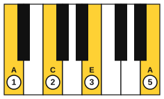
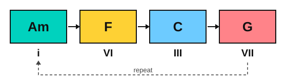

# An arpeggio prelude

<span class="tag tag-piano">Piano</span>

After this lesson you can play a 16-bar original piano prelude built on rolling arpeggios, and use the pattern as a texture of your own for game-style music.

Before this: [Broken-chord accompaniment](../05-minor-keys-and-chord-charts/11-broken-chord-accompaniment.md), [Legato pedalling](../07-pedal-texture-and-ambient/02-legato-pedalling.md), [The royal road progression](01-the-royal-road.md), [Aeolian loops](04-aeolian-loops.md), [The minor iv and the Picardy third](06-minor-iv-and-the-picardy-third.md). You need: your piano.

## The idea

### A texture, not a tune

A **prelude** is a short piece built on one repeating figure. This one is called Far Tower, and it is an original piece for this book. Its figure is a rolling **arpeggio**: the notes of a chord played one after another, here as a stream of eighth notes in the right hand. The chords change once a bar, and the stream never stops. A stream like this sounds like movement over a still scene, which is why it is a common texture in piano music for games and films.

There is no separate tune. The harmony moves slowly, and the interest is in the chord changes, the dynamics and the pedal.

### The pattern

Each bar has eight eighth notes. For a chord with notes 1, 3 and 5 and the root again an octave higher (call it 8), the pattern is:

1, 3, 5, 8, 5, 3, 5, 3

For Am that is A, C, E, A, E, C, E, C. The pattern is the same in every bar, only the chord changes. This is an ostinato, as in lesson 7, with the bass moving under it.



For Am use fingers 1, 2, 3 and 5 for the first four notes, then 3, 2, 3, 2 on the way back. Keep the wrist loose and let the hand rock rather than reach. Count "1 & 2 & 3 & 4 &" and play every eighth note at the same volume. The top note A may be a little brighter, but it must not jump out.

### The harmony

Here is where each chord comes from.

| Bars | Chords | What it is |
|---|---|---|
| 1 to 4 | Am, F, C, G | The Aeolian loop of lesson 4 |
| 5 to 8 | Am, F, C, G | The same loop, with an octave in the left hand |
| 9 to 12 | F, G, Em, Am | The royal road of lesson 1 (IV V iii vi in C major), ending on Am |
| 13 to 16 | Dm, E, Am, A | iv, V, i in A minor, with a Picardy third at the end |



The royal road works here because C major and A minor share a key signature (stage 5). The piece stays in A minor, and bars 9 to 12 are the same chords you met in lesson 1 in C major, with Am as the point of arrival. In bar 14 the E chord has a G#, so watch the sharp in the pattern: E, G#, B, E, B, G#, B, G#.

### Pedal and dynamics

Change the damper pedal once per bar, only after the left hand plays the new bass note, as in legato pedalling. The arpeggio notes of one bar then blend into a soft wash without the previous chord leaking in. If the sound is muddy, change the pedal slightly later or play the right hand lighter.

The dynamics rise in steps. Bars 1 to 4 are soft (p), bars 5 to 8 a little louder (mp), bars 9 to 12 louder (mf), bars 13 and 14 loud (f), then the music falls back to mp in bar 15 and ends softly on the last chord.

## Hear and see

Far Tower is 16 bars in A minor in 4/4 at about 66 bpm. Learn it in four sections of four bars: bars 1 to 4, 5 to 8, 9 to 12 and 13 to 16. Play each section hands separately, then hands together at half speed, before you move on. The pedal marks are under the left hand: Ped. at the start, then change each bar.

```abc
X:1
T:Far Tower
C:Original, for this book
M:4/4
L:1/8
Q:1/4=66
K:Am
%%score {RH LH}
V:RH clef=treble
V:LH clef=bass
[V:RH] !p!!1!A!2!c!3!e!5!a ecec | "F"FAcf cAcA | "C"CEGc GEGE | "G"GBdg dBdB |
[V:LH] "_Ped. (change each bar)""Am"A,,8 | "F"F,,8 | "C"C,8 | "G"G,,8 |
[V:RH] !mp!"Am"Acea ecec | "F"FAcf cAcA | "C"CEGc GEGE | "G"GBdg dBdB |
[V:LH] [A,,A,]8 | [F,,F,]8 | [C,,C,]8 | [G,,G,]8 |
[V:RH] !mf!"F"FAcf cAcA | "G"GBdg dBdB | "Em"EGBe BGBG | "Am"Acea ecec |
[V:LH] [F,,F,]8 | [G,,G,]8 | [E,,E,]8 | [A,,A,]8 |
[V:RH] !f!"Dm"DFAd AFAF | "E"E^GBe B^GB^G | !mp!"Am"Acea ecec | !fermata!"A"[A^cea]8 |]
[V:LH] [D,,D,]8 | [E,,E,]8 | [A,,A,]8 | [A,,A,]8 |]
```

## Try it

Exercise 1. Write out the eight notes of the pattern for the F chord, starting on F4.

<details class="solution" markdown>
<summary>Answer</summary>

F, A, C, F, C, A, C, A. That is notes 1, 3, 5, 8, 5, 3, 5, 3 of the F chord (F, A, C, F).

</details>

Exercise 2. Which bar of Far Tower contains a G#, and why?

<details class="solution" markdown>
<summary>Answer</summary>

Bar 14, the E chord. E major: E, G#, B. The G# is the leading tone of A minor, so the V chord is major, as in stage 9.

</details>

Exercise 3. Which chord in the last bar changes the colour of the ending, and what note changes?

<details class="solution" markdown>
<summary>Answer</summary>

The final chord is A major, not Am. The C becomes C#, which is the Picardy third. A major: A, C#, E.

</details>

<div class="practice" markdown>

### Practice routine (30 minutes)

| Minutes | What to do | Tempo | Listen for |
|---|---|---|---|
| 5 | Warm-up: the Am arpeggio pattern alone, right hand, eight notes, ten times | 60 bpm | Every eighth note the same volume |
| 15 | New skill: Far Tower in sections, hands separately, then together: section 1 and 2 on day 1, sections 3 and 4 on day 2, all together after that | 50 bpm, then 60 | Even eighths, a clean pedal change each bar |
| 5 | Sight reading: read the right hand of bars 9 to 12 once, then play it | 50 bpm | Keep going after a wrong note |
| 5 | Guitar: Am, F, C, G, picking the pattern bass, 3, 2, 1, 2, 3, 2, 1 | 60 bpm | Even picking |

Repeat this routine on at least three days before you check the boxes below.

</div>

<div class="move-on" markdown>

### Move on when

- [ ] You can play bars 1 to 8 hands together at 60 bpm, three times in a row with no stops.
- [ ] You can play all 16 bars hands together at 60 bpm, twice in a row, with the pedal changed once per bar.
- [ ] You can play the right-hand pattern for Am, F, C and G from memory at 66 bpm.
- [ ] You record yourself playing the piece and hear no extra accents in the eighth notes.

</div>

## Common mistakes

Rushing the eighths in the easy part. The first section is the place to set the speed. Keep the metronome on.

Pedalling over a chord change. The old chord keeps ringing under the new one. Press the new bass note, then change the pedal.

Playing every note at full strength. The texture is a wash. Play lightly, from the fingertips, and let the dynamics come from the whole bar.

## Key terms

- **Prelude**: a short piece built on one repeating figure.
- **Arpeggio**: the notes of a chord played one after another.
- **Texture**: how the parts of a piece are arranged, such as a flowing right hand over single bass notes.

Next: [Chromatic mediants](09-chromatic-mediants.md)
