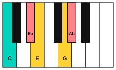
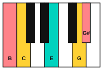
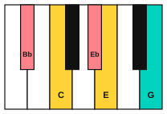

# Chromatic mediants

<span class="tag tag-theory">Theory</span>

After this lesson you can name the chromatic mediant chords of a major key, play the moves I to bVI, I to III and I to bIII on the piano, and hear them as sudden changes of colour.

Before this: [Borrowed chords and the Mario cadence](05-borrowed-chords-and-the-mario-cadence.md), [Triads](../04-intervals-and-triads/04-triads.md), [Inversions on piano](../04-intervals-and-triads/08-inversions-on-piano.md). You need: your piano and your guitar.

## The idea

### Hear it first

Play a C major chord and hold it. Now play an Ab major chord. There is no step in between and no chord that leads there, and the music jumps into a new colour. Go back to C and then play E major. It is another jump, in the other direction. These jumps are chromatic mediants.

### What the name means

A **mediant** is the chord a third away from the tonic. In C major the diatonic mediant is Em. A **chromatic mediant** is a major (or minor) chord whose root is a third above or below the tonic, with the same quality as the tonic, and which does not belong to the key. Because the tonic is major, the chromatic mediants are major chords too.

| Move | Numeral | Chords | Root moves | Notes in the new chord | Shared note |
|---|---|---|---|---|---|
| I to bVI | bVI | C to Ab | down a major 3rd | Ab, C, Eb | C |
| I to III | III | C to E | up a major 3rd | E, G#, B | E |
| I to bIII | bIII | C to Eb | up a minor 3rd | Eb, G, Bb | G |

The chord spellings: C: C, E, G. Ab major: Ab, C, Eb. E major: E, G#, B. Eb major: Eb, G, Bb.

C up to E is a major 3rd. C down to Ab is a major 3rd. C up to Eb is a minor 3rd.

Each pair of chords has exactly one note in common, and the other two notes move by half steps when the voices are kept close. Keep the common note in the same finger and move the other two. This is smooth under the hand, but the ear hears a jump, because the new chord has notes that are not in the old key.

### Why they sound strange

The usual progressions in a key follow the pull of the dominant: V goes to I. A chromatic mediant has no such pull. It does not lead to the tonic through a leading tone, and it does not come from any chord the key owns. The music seems to step into another room with the same furniture, because one note stays the same.

### Two moods

Players and writers often describe bVI and bIII as "hero" moves, bright and big, like a brass chord arriving. The III is often described as a "wonder" move, like a door opening onto a new place. These are descriptions of how the sound feels to many listeners, not rules. Try both moves and decide for yourself. In the next lessons you will use one in a theme.







## Hear and see

Example 1: I to bVI. Hold C and move to Ab. In the right hand the C stays, E drops to Eb and G rises to Ab. Listen for the lift into the new colour.

```abc
X:1
M:4/4
L:1/4
Q:1/4=60
K:C
%%score {RH LH}
V:RH clef=treble
V:LH clef=bass
[V:RH] "C"[ceg]4 | "Ab"[c_e_a]4 | "C"[ceg]4 | "Ab"[c_e_a]4 |]
[V:LH] C,4 | _A,,4 | C,4 | _A,,4 |]
```

Example 2: I to III. The E stays, C drops to B and G rises to G#. Listen for the wide, open effect.

```abc
X:1
M:4/4
L:1/4
Q:1/4=60
K:C
%%score {RH LH}
V:RH clef=treble
V:LH clef=bass
[V:RH] "C"[ceg]4 | "E"[Be^g]4 | "C"[ceg]4 | "E"[Be^g]4 |]
[V:LH] C,4 | E,4 | C,4 | E,4 |]
```

Example 3: I to bIII. The G stays, C drops to Bb and E drops to Eb. Listen for the darker glow compared with Example 1.

```abc
X:1
M:4/4
L:1/4
Q:1/4=60
K:C
%%score {RH LH}
V:RH clef=treble
V:LH clef=bass
[V:RH] "C"[ceg]4 | "Eb"[_B_eg]4 | "C"[ceg]4 | "Eb"[_B_eg]4 |]
[V:LH] C,4 | _E,4 | C,4 | _E,4 |]
```

On the guitar you can play the C to E move with open chords, C and E, as in lesson 5.

```abc
%%opts tab=guitar
X:1
M:4/4
L:1/4
Q:1/4=60
K:C clef=treble-8
"C"[CEGce]4 | "E"[E,B,E^GBe]4 | "C"[CEGce]4 | "E"[E,B,E^GBe]4 |]
```

## Try it

Exercise 1. Which note do C major and Ab major share?

<details class="solution" markdown>
<summary>Answer</summary>

C. C: C, E, G. Ab major: Ab, C, Eb.

</details>

Exercise 2. In G major, what is the III chord, and which note does it share with G?

<details class="solution" markdown>
<summary>Answer</summary>

B major: B, D#, F#. G major: G, B, D. They share B.

</details>

Exercise 3. In G major, what is the bVI chord?

<details class="solution" markdown>
<summary>Answer</summary>

The G natural minor scale: G, A, Bb, C, D, Eb, F, G. The 6th note is Eb, so bVI is Eb major: Eb, G, Bb. It shares G with G major.

</details>

<div class="practice" markdown>

### Practice routine (30 minutes)

| Minutes | What to do | Tempo | Listen for |
|---|---|---|---|
| 5 | Warm-up: C, F, Fm, C from lesson 6 on piano | 60 bpm | The falling line |
| 15 | New skill: Examples 1, 2 and 3, hands together, keeping the shared note on the same finger | 50 bpm, then 60 | One note holding while two move |
| 5 | Guitar: C to E with open chords, then C to Am to E | 60 bpm | The jump of colour at the E |
| 5 | Ear: ask someone to play C then Ab, E or Eb, and say which jump you hear | Untimed | The size and brightness of the jump |

Repeat this routine on at least three days before you check the boxes below.

</div>

<div class="move-on" markdown>

### Move on when

- [ ] You can play Examples 1, 2 and 3 hands together at 60 bpm, three times in a row with no stops.
- [ ] You can name the three chromatic mediants of C major and the shared note of each.
- [ ] You can find the three chromatic mediants in G major in under a minute.
- [ ] You can tell I to bVI from I to III by ear, 4 times out of 5.

</div>

## Common mistakes

Moving every finger. One note stays. Find it first and keep it down.

Calling any chord from outside the key a chromatic mediant. It must be a third from the tonic and have the same quality.

Mixing up the spelling. E major has G#, not Ab, and Ab major has Ab, not G#. Say the letter names in order.

## Key terms

- **Mediant**: the chord whose root is the 3rd note of the scale, such as Em in C major.
- **Chromatic mediant**: a chord a third above or below the tonic, with the same quality as the tonic, that is not in the key.
- **Common note**: a note that two chords share.

Next: [A hero theme on guitar](10-hero-theme-on-guitar.md)
