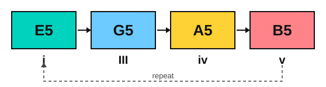
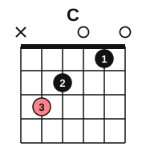

# A hero theme on guitar

<span class="tag tag-guitar">Guitar</span>

After this lesson you can play an original 16-bar hero theme in E minor on guitar, with power chords, a melody, and a chromatic mediant that opens the harmony at the climax.

Before this: [Power chords](../07-pedal-texture-and-ambient/07-power-chords.md), [Chromatic mediants](09-chromatic-mediants.md), [Aeolian loops](04-aeolian-loops.md), [Barre chord pieces](../08-fretboard-barre-chords-and-caged/04-barre-chord-pieces.md). You need: your guitar, a pick, a tuner and a phone to record with.

## The idea

### Two parts

The Long Climb is an original piece for this book. It is 16 bars in E minor in 4/4 at about 72 bpm, and it has two parts that fit together: a chord part of power chords, and a melody. You learn each alone, then record the chord part and play the melody over the recording. Playing both at once on one guitar is not the aim here. Stage 13 has a lesson on this, Play along with yourself<!-- link: ../13-capstones/11-play-along-with-yourself.md -->.

### The chord part

The chords climb the neck on string 6. The power chords are the ones from stage 7, with the root on string 6 and the same shape each time.

| Chord | Numeral | Frets on strings 6, 5, 4 | Bars |
|---|---|---|---|
| E5 | i | 0 2 2 | 1, 5, 11, 16 |
| G5 | III | 3 5 5 | 2, 6 |
| A5 | iv | 5 7 7 | 3, 7 |
| B5 | v | 7 9 9 | 4, 8, 12 |
| C5 | VI | 8 10 10 | 9 |
| D5 | VII | 10 12 12 | 10, 15 |



The first eight bars climb up the neck in steps of E, G, A and B. They are the minor-key chords i, III, iv and v, so the harmony rises like steps. Bars 9 to 12 go to C5, D5, E5 and B5. In bars 13 and 14 the power chords turn into full chords: open E major, then open C major.

### The chromatic mediant

The key is E minor, but the chord in bar 13 is E major, with G# in it. The move from E major to C major is I to bVI, a chromatic mediant from lesson 9. C is a major 3rd below E. E major is E, G#, B and C major is C, E, G, and they share one note, E.




The melody holds E through both bars, which is the common note, so the tune stays still while the chords shift under it. After the big chords, bars 15 and 16 go D5 to E5, bVII to i, and the piece ends on E5, a power chord with no third, so it is neither major nor minor.

### The melody

The melody uses the E natural minor scale, which has one sharp.

The E natural minor scale: E, F#, G, A, B, C, D, E.

It stays on strings 1 and 2, from open B (string 2) up to A on string 1, fret 5, with one high B at fret 7 in bar 6. The notes at frets 5 and 7 need a shift of the whole hand, so look at the fret markers as you move. The long notes in bars 4, 8, 13, 14 and 16 are the places to breathe.

## Hear and see

Example 1: the chord part, one strum per beat, 16 bars. Play it with down strokes at first. When you can play it cleanly, play palm-muted eighth notes on bars 1 to 12 and let the full chords ring in bars 13 and 14, as in stage 7.

```abc
%%opts tab=guitar
X:1
T:The Long Climb (chord part)
C:Original, for this book
M:4/4
L:1/4
Q:1/4=72
K:Em clef=treble-8
"E5"[E,B,E] [E,B,E] [E,B,E] [E,B,E] | "G5"[G,DG] [G,DG] [G,DG] [G,DG] | "A5"[A,EA] [A,EA] [A,EA] [A,EA] | "B5"[B,^FB] [B,^FB] [B,^FB] [B,^FB] |
"E5"[E,B,E] [E,B,E] [E,B,E] [E,B,E] | "G5"[G,DG] [G,DG] [G,DG] [G,DG] | "A5"[A,EA] [A,EA] [A,EA] [A,EA] | "B5"[B,^FB] [B,^FB] [B,^FB] [B,^FB] |
"C5"[CGc] [CGc] [CGc] [CGc] | "D5"[DAd] [DAd] [DAd] [DAd] | "E5"[E,B,E] [E,B,E] [E,B,E] [E,B,E] | "B5"[B,^FB] [B,^FB] [B,^FB] [B,^FB] |
"E"[E,B,E^GBe]4 | "C"[CEGce]4 | "D5"[DAd] [DAd] [DAd] [DAd] | "E5"[E,B,E]4 |]
```

Example 2: the melody. The chord names are above the staff so you can see where each note sits. Listen for the long E over the change from E to C in bars 13 and 14.

```abc
%%opts tab=guitar
X:1
T:The Long Climb (melody)
C:Original, for this book
M:4/4
L:1/4
Q:1/4=72
K:Em clef=treble-8
"E5"B2 e2 | "G5"g2 f e | "A5"a2 g f | "B5"f2 e d |
"E5"B e g e | "G5"g2 b2 | "A5"a2 g f | "B5"f4 |
"C5"g2 e2 | "D5"a2 f2 | "E5"e2 B2 | "B5"d2 f2 |
"E"e4 | "C"e4 | "D5"d2 f2 | "E5"e4 |]
```

How to learn it: sections of four bars, in this order.

1. Chord part, bars 1 to 4. Slide the shape along string 6 and count four strums per bar.
2. Melody, bars 1 to 4, on its own.
3. Repeat for bars 5 to 8, then 9 to 12, then 13 to 16.
4. Record the chord part with your phone, listen to it, then play the melody over it.

## Try it

Exercise 1. Which frets do you play for A5 on strings 6, 5 and 4?

<details class="solution" markdown>
<summary>Answer</summary>

5, 7 and 7. The root is A at fret 5 on string 6, and the shape adds two frets on strings 5 and 4.

</details>

Exercise 2. In bars 13 and 14 the chords are E major and C major. Name the move with its numerals, and the note they share.

<details class="solution" markdown>
<summary>Answer</summary>

I to bVI, a chromatic mediant. E major: E, G#, B. C major: C, E, G. They share E, which the melody holds.

</details>

Exercise 3. Which interval is the root move from E down to C?

<details class="solution" markdown>
<summary>Answer</summary>

C up to E is a major 3rd, so E down to C is a major 3rd.

</details>

<div class="practice" markdown>

### Practice routine (30 minutes)

| Minutes | What to do | Tempo | Listen for |
|---|---|---|---|
| 5 | Warm-up: E5 power chord, palm-muted eighth notes, one bar each on E5, G5, A5 and B5 | 60 bpm | A steady chug with no stray strings |
| 15 | New skill: the chord part (Example 1) in four-bar sections, then the melody (Example 2) in four-bar sections | 50 bpm, then 60 | The long E in bars 13 and 14 |
| 5 | Record: the chord part, then play the melody over the recording | 60 bpm | The melody in time with the chords |
| 5 | Piano: Examples 1 to 3 of lesson 9, chromatic mediants | 60 bpm | One note holding while two move |

Repeat this routine on at least three days before you check the boxes below.

</div>

<div class="move-on" markdown>

### Move on when

- [ ] You can play the chord part through 16 bars at 60 bpm with no stops, twice in a row.
- [ ] You can play the melody through 16 bars at 60 bpm with no stops, twice in a row.
- [ ] You can play the melody over your own recording of the chord part at 60 bpm.
- [ ] You can name the chromatic mediant in the piece and the note it shares.

</div>

## Common mistakes

Strumming extra strings on a power chord. Mute strings 3 to 1 with the underside of finger 1.

Rushing the full chords in bars 13 and 14. They are whole notes. Let them ring for four beats.

Moving the melody to follow the chords. The E stays the same through both bars. Keep it steady.

## Key terms

- **Chord part**: the accompaniment of a piece, written as chords, played apart from the melody.
- **Climax**: the loudest or highest point of a piece, here the chord change in bars 13 and 14.

Next: [Hearing film progressions](11-hearing-film-progressions.md)
