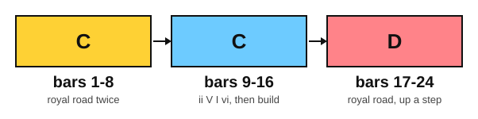

# An anime-style piano piece

<span class="tag tag-piano">Piano</span>

After this lesson you can play a 24-bar original piano piece built on the royal road, with a key change up a whole step, and explain how that change is made.

Before this: [The royal road on piano](02-royal-road-on-piano.md), [Chromatic mediants](09-chromatic-mediants.md), [Hearing film progressions](11-hearing-film-progressions.md), [Voicing the melody](../07-pedal-texture-and-ambient/09-voicing-the-melody.md). You need: your piano.

## The idea

### A piece in three parts

Platform Four is an original piece for this book. It is 24 bars in 4/4 at about 72 bpm, in the style of a song from an anime: a singing right-hand melody over a flowing left hand, built on the royal road, with a lift near the end. It has three parts of eight bars.



| Bars | Key | Chords |
|---|---|---|
| 1 to 4 | C major | Fmaj7, G7, Em7, Am (the royal road) |
| 5 to 8 | C major | the royal road again, the melody a step higher |
| 9 to 12 | C major | Dm7, G7, Cmaj7, Am7 |
| 13 to 16 | C major | Dm7, Em7, Fmaj7, G |
| 17 to 20 | D major | Gmaj7, A7, F#m7, Bm (the royal road, a whole step higher) |
| 21 to 24 | D major | Gmaj7, A7, Dmaj7, D |

The first eight bars are the royal road twice, and the second time the melody sits a little higher. Bars 9 to 12 use ii V I vi from stage 9 (Dm7, G7, Cmaj7, Am7), which settles at home for a moment. Bars 13 to 16 climb through Dm7, Em7 and Fmaj7 to a G chord.

### The key change

The last eight bars repeat the royal road one whole step higher. A **key change** (also called a modulation) moves the music to a new tonic. Here the tonic goes from C to D. C up to D is a major 2nd, a whole step.

Every chord of the royal road moves up a whole step: Fmaj7 becomes Gmaj7, G7 becomes A7, Em7 becomes F#m7 and Am becomes Bm. The chord spellings: Gmaj7: G, B, D, F#. A7: A, C#, E, G. F#m7: F#, A, C#, E. D major has two sharps, F# and C#.

The change is smooth because the G chord at the end of bar 16 belongs to both keys. It is V in C major and IV in D major. The piece reaches G in bar 16 as a V that is waiting for C, and then bar 17 hears the same G as IV, the first chord of the royal road in D. The ear follows the road to a new place. Many pop songs repeat their last section a step higher to raise the energy.

In bar 24 the piece finally lands on the tonic, D. Until then the royal road never arrives at I, so the arrival at the end feels like a door closing.

### Left hand and dynamics

The left hand plays the broken-chord pattern from lesson 2, root, fifth, tenth, fifth, twice per bar. In bars 17 to 23 the pattern has C# and F#, which the key signature of D major gives you. The dynamics rise: mp in bars 1 to 4, mf from bar 5, a crescendo through bars 15 and 16, then f at the key change.

## Hear and see

Learn the piece in sections of four bars: bars 1 to 4, 5 to 8, 9 to 12, 13 to 16, 17 to 20 and 21 to 24. Play each section with the right hand alone first, then the left hand alone, then hands together at half speed. Use the damper pedal once per bar, changed right after the new bass note.

```abc
X:1
T:Platform Four
C:Original, for this book
M:4/4
L:1/8
Q:1/4=72
K:C
%%score {RH LH}
V:RH clef=treble
V:LH clef=bass
[V:RH] !mp!"Fmaj7"c4 A2 c2 | "G7"d4 B2 d2 | "Em7"e4 B2 G2 | "Am"A8 |
[V:LH] "_Ped. (change each bar)"F,,C,A,C, F,,C,A,C, | G,,D,B,D, G,,D,B,D, | E,,B,,G,B,, E,,B,,G,B,, | A,,E,CE, A,,E,CE, |
[V:RH] !mf!"Fmaj7"e4 c2 e2 | "G7"f4 d2 f2 | "Em7"g4 e2 d2 | "Am"c8 |
[V:LH] F,,C,A,C, F,,C,A,C, | G,,D,B,D, G,,D,B,D, | E,,B,,G,B,, E,,B,,G,B,, | A,,E,CE, A,,E,CE, |
[V:RH] "Dm7"A2 d2 f2 a2 | "G7"g4 f2 d2 | "Cmaj7"g2 e2 c4 | "Am7"c2 e2 a4 |
[V:LH] D,,A,,F,A,, D,,A,,F,A,, | G,,D,B,D, G,,D,B,D, | C,,G,,E,G,, C,,G,,E,G,, | A,,E,CE, A,,E,CE, |
[V:RH] "Dm7"a2 f2 d4 | "Em7"g2 e2 B4 | !crescendo(!"Fmaj7"e2 c2 A4 | "G"B4 d4 !crescendo)! |
[V:LH] D,,A,,F,A,, D,,A,,F,A,, | E,,B,,G,B,, E,,B,,G,B,, | F,,C,A,C, F,,C,A,C, | G,,D,B,D, G,,D,B,D, |
[V:RH] [K:D] !f!"Gmaj7"f4 d2 f2 | "A7"g4 e2 g2 | "F#m7"a4 f2 e2 | "Bm"d8 |
[V:LH] [K:D] G,,D,B,D, G,,D,B,D, | A,,E,CE, A,,E,CE, | F,,C,A,C, F,,C,A,C, | B,,F,DF, B,,F,DF, |
[V:RH] "Gmaj7"f2 g2 b4 | "A7"a4 g2 e2 | "Dmaj7"f4 e2 d2 | !fermata!"D"d8 |]
[V:LH] G,,D,B,D, G,,D,B,D, | A,,E,CE, A,,E,CE, | D,,A,,F,A,, D,,A,,F,A,, | [D,,A,,F,]8 |]
```

## Try it

Exercise 1. Write the royal road with seventh chords in D major.

<details class="solution" markdown>
<summary>Answer</summary>

The D major scale: D, E, F#, G, A, B, C#, D. The 4th note is G, the 5th is A, the 3rd is F# and the 6th is B. The chords are Gmaj7, A7, F#m7 and Bm.

</details>

Exercise 2. Which chord is the pivot between C major and D major, and what is its numeral in each key?

<details class="solution" markdown>
<summary>Answer</summary>

G major. It is V in C major and IV in D major.

</details>

Exercise 3. How many half steps is the key change from C to D?

<details class="solution" markdown>
<summary>Answer</summary>

Two. C up to D is a major 2nd, a whole step.

</details>

<div class="practice" markdown>

### Practice routine (30 minutes)

| Minutes | What to do | Tempo | Listen for |
|---|---|---|---|
| 5 | Warm-up: the royal road in C and in D with right-hand shapes and left-hand roots | 60 bpm | The same shape a step higher |
| 15 | New skill: Platform Four in four-bar sections, right hand, left hand, then together: bars 1 to 8 on day 1, bars 9 to 16 on day 2, bars 17 to 24 on day 3, then the whole piece | 50 bpm, then 60 | The melody clearer than the left hand |
| 5 | Sight reading: the right hand of bars 9 to 12 | 50 bpm | Keep going after a wrong note |
| 5 | Guitar: the royal road in C and in G, strumming with sevenths | 60 bpm | Every string ringing |

Repeat this routine on at least three days before you check the boxes below.

</div>

<div class="move-on" markdown>

### Move on when

- [ ] You can play bars 1 to 16 hands together at 60 bpm, three times in a row with no stops.
- [ ] You can play all 24 bars hands together at 60 bpm, twice in a row, with the melody louder than the left hand.
- [ ] You can name the pivot chord and its two numerals without looking.
- [ ] You can play the royal road in C and in D from memory.

</div>

## Common mistakes

Forgetting the sharps in bar 17 onward. The key signature has two sharps from bar 17: F# and C#. Say them before you play.

Letting the left hand cover the melody. Play the broken chords softly, and sing the melody in your head.

Rushing into the key change. The crescendo ends in bar 16, but bar 17 should not speed up. Keep the beat steady and let the new colour arrive.

## Key terms

- **Key change**: moving the music to a new tonic, also called a modulation.
- **Pivot chord**: a chord that belongs to both the old key and the new key.

Next: [The modes](../12-modes-and-improvising/01-modes.md)
