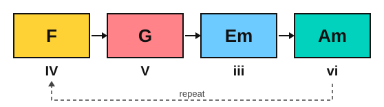
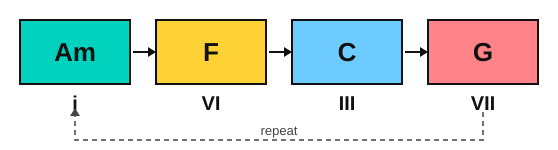

# Stage 11: Film, game and anime harmony

This stage teaches the chord moves behind the music you listen to. You learn the royal road progression and play it on piano and guitar, the Aeolian loops of epic minor music, borrowed chords and the Mario cadence, the minor iv and the Picardy third, pedal points and ostinatos, and chromatic mediants. You play three original pieces: an arpeggio prelude, a hero theme on guitar and an anime-style piano piece with a key change. You also train your ear to name each progression. It usually takes about 6 to 8 weeks at 30 minutes a day.

<!-- lessons:start -->
## Lessons

1. [The royal road progression](01-the-royal-road.md) (theory)
2. [The royal road on piano](02-royal-road-on-piano.md) (piano)
3. [The royal road on guitar](03-royal-road-on-guitar.md) (guitar)
4. [Aeolian loops](04-aeolian-loops.md) (theory)
5. [Borrowed chords and the Mario cadence](05-borrowed-chords-and-the-mario-cadence.md) (theory)
6. [The minor iv and the Picardy third](06-minor-iv-and-the-picardy-third.md) (theory)
7. [Pedal points and ostinatos](07-pedal-points-and-ostinatos.md) (piano)
8. [An arpeggio prelude](08-arpeggio-prelude.md) (piano)
9. [Chromatic mediants](09-chromatic-mediants.md) (theory)
10. [A hero theme on guitar](10-hero-theme-on-guitar.md) (guitar)
11. [Hearing film progressions](11-hearing-film-progressions.md) (ear)
12. [An anime-style piano piece](12-anime-style-piano-piece.md) (piano)

<!-- lessons:end -->

Download the stage 11 deck: [11-film-game-and-anime-harmony.apkg](../downloads/anki/11-film-game-and-anime-harmony.apkg)

## Cheat sheet

Every progression of the stage, with the chords in C major or A minor. The mood column describes how the progression sounds to many listeners. The last column says where each is common, as a style, not a list of songs.

| Progression | Numerals | Chords | Sounds like | Where it is used |
|---|---|---|---|---|
| Royal road | IV V iii vi | F, G, Em, Am, in C major | Climbs, then drops to a minor chord that is not quite home: bittersweet | J-pop and anime songs |
| Royal road with sevenths | IVmaj7 V7 iii7 vi | Fmaj7, G7, Em7, Am, in C major | The same, with a softer, wistful colour | J-pop and anime songs |
| Aeolian loop | i VI VII | Am, F, G, in A minor | Wide and open, with no strong pull to the tonic | Epic minor film and game music |
| Four-chord Aeolian loop | i VI III VII (i bVI bIII bVII) | Am, F, C, G, in A minor | A loop that can repeat for ever | Epic minor film and game music |
| Mario cadence | bVI bVII I | Ab, Bb, C, in C major | Three bass steps up into the tonic, a bright arrival (a fan name) | Video game music |
| Bright borrowed chord | I bIII IV I | C, Eb, F, C, in C major | A sudden change of colour, then back into the key | Film and game music |
| Minor iv | I IV iv I | C, F, Fm, C, in C major | A major chord that darkens by one note | Film, game and pop music |
| Picardy third | i iv V I | Am, Dm, E, A, in A minor | A minor key that ends on a major chord | Baroque pieces, film and game endings |
| Dominant pedal | C/G, F/G, Dm/G, G7, C | G held in the bass, in C major | Tension that builds until the bass note belongs | Film and game build-ups |
| Ostinato | any chords under a repeated figure | Am, F, C, G under E C A C, in A minor | Stays the same while the chords change | Games and film |
| Chromatic mediant, I to bVI | I bVI | C to Ab, in C major | A big, bright jump (a "hero" move) | Film and game themes |
| Chromatic mediant, I to III | I III | C to E, in C major | A wide, opening jump (a "wonder" move) | Film and game themes |
| Chromatic mediant, I to bIII | I bIII | C to Eb, in C major | A darker glow | Film and game themes |
| Key change up a step | royal road, then the same a step higher | Gmaj7, A7, F#m7, Bm, after the move from C to D | A lift for the last section | Pop and anime songs |

### Spellings

| Chord | Notes |
|---|---|
| Fmaj7 | F, A, C, E |
| G7 | G, B, D, F |
| Em7 | E, G, B, D |
| Am | A, C, E |
| Ab major | Ab, C, Eb |
| Bb major | Bb, D, F |
| Eb major | Eb, G, Bb |
| E major | E, G#, B |
| Fm | F, Ab, C |
| A major | A, C#, E |

### The royal road in six keys

| Key | IV | V | iii | vi |
|---|---|---|---|---|
| C major | F | G | Em | Am |
| G major | C | D | Bm | Em |
| D major | G | A | F#m | Bm |
| A major | D | E | C#m | F#m |
| F major | Bb | C | Am | Dm |
| Bb major | Eb | F | Dm | Gm |

### The Aeolian loop in four minor keys

| Key | i | VI | III | VII |
|---|---|---|---|---|
| A minor | Am | F | C | G |
| E minor | Em | C | G | D |
| D minor | Dm | Bb | F | C |
| B minor | Bm | G | D | A |

### Quick rules

- Royal road: starts on IV, ends on vi. The V goes to iii, not to I.
- Aeolian loops: the VII chord is a major triad a whole step below i, with no leading tone.
- The b in front of a numeral lowers the chord's root by a half step from the major scale.
- Minor iv: the third of the IV chord drops by a half step (A to Ab in F).
- Picardy third: only the last chord of a minor-key piece becomes major (C to C# in Am).
- Pedal point: one held note. Ostinato: one repeated pattern.
- Chromatic mediant: a third from the tonic, same quality, one common note.
- A pivot chord belongs to both keys: G is V in C major and IV in D major.

