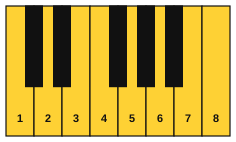
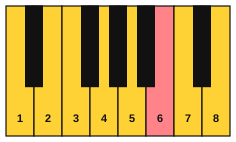
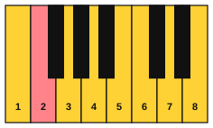
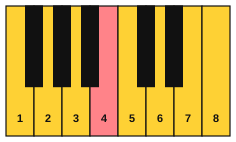
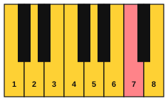
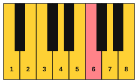
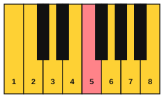

# The modes

<span class="tag tag-theory">Theory</span>

After this lesson you can name the seven modes, play each one on the white keys, and say how a mode differs from the major or minor scale that starts on the same note.

Before this: [The major scale](../03-the-major-scale-and-keys/02-the-major-scale.md), [Whole steps and half steps](../03-the-major-scale-and-keys/01-whole-and-half-steps.md), [The natural minor scale](../05-minor-keys-and-chord-charts/01-natural-minor.md), [Relative and parallel keys](../05-minor-keys-and-chord-charts/05-relative-and-parallel-keys.md). You need: your piano.

## The idea

### Same keys, different home

Play the white keys from C up to the next C. Now play the white keys from D up to the next D, then from E to E. You use the same seven keys every time, but each run sounds different, because the half steps (E to F and B to C) land in different places. Each run is a **mode**: a scale made by starting the same set of notes on a different note. You already know two modes. The C major scale is the first one, and the A natural minor scale (A to A on the white keys) is the sixth.

The seven modes have Greek-sounding names. Each one is a scale with its own step pattern, and each has a mood you can learn to hear.

| Mode | White keys | Steps | Compared with major | Characteristic note | Mood |
|---|---|---|---|---|---|
| Ionian | C to C | W W H W W W H | 1 2 3 4 5 6 7 | none (it is major) | bright, settled |
| Dorian | D to D | W H W W W H W | 1 2 b3 4 5 6 b7 | natural 6 (B) | minor but hopeful |
| Phrygian | E to E | H W W W H W W | 1 b2 b3 4 5 b6 b7 | b2 (F) | dark, tense |
| Lydian | F to F | W W W H W W H | 1 2 3 #4 5 6 7 | #4 (B) | floating, wonder |
| Mixolydian | G to G | W W H W W H W | 1 2 3 4 5 6 b7 | b7 (F) | relaxed, heroic |
| Aeolian | A to A | W H W W H W W | 1 2 b3 4 5 b6 b7 | b6 (F) | sad, epic |
| Locrian | B to B | H W W H W W W | 1 b2 b3 4 b5 b6 b7 | b5 (F) | unstable |

W is a whole step and H is a half step, as in stage 3. The "compared with major" column names each scale degree and marks the ones that are a half step lower (b) or higher (#) than in the major scale on the same note.

### The characteristic note

Two modes can share most of their notes. Dorian and natural minor are both minor, because both have a b3. They differ in one note: Dorian has the natural 6, and natural minor has a b6. That note is the **characteristic note** of the mode, the one that gives it its colour. Each mode in the table has one, except Ionian and Aeolian, which are the plain major and natural minor scales.

### Parallel modes

Modes on the same starting note are **parallel modes**, as C major and C minor are parallel keys. Here are the seven on C. Compare them one at a time with the major scale.

- the C Ionian scale: C, D, E, F, G, A, B, C
- the C Dorian scale: C, D, Eb, F, G, A, Bb, C
- the C Phrygian scale: C, Db, Eb, F, G, Ab, Bb, C
- the C Lydian scale: C, D, E, F#, G, A, B, C
- the C Mixolydian scale: C, D, E, F, G, A, Bb, C
- the C Aeolian scale: C, D, Eb, F, G, Ab, Bb, C
- the C Locrian scale: C, Db, Eb, F, Gb, Ab, Bb, C

Read them in a different order: Lydian, Ionian, Mixolydian, Dorian, Aeolian, Phrygian, Locrian. Each scale has exactly one note a half step lower than the one before it: F# to F, B to Bb, E to Eb, A to Ab, D to Db, G to Gb. That is the order from brightest to darkest.

### A mode needs a home note

The white keys alone do not make a mode. If you play D E F G A B C D with no accompaniment, many ears hear C major in disguise. Hold a low D (the drone from stage 3) and the same keys now sound like D Dorian, because D is home. The mode comes from the home note, so every example in this stage has a drone, a bass note or a chord that tells you where home is.

## Hear and see

Example 1 plays all seven white-key modes, one bar each, eight eighth notes up the scale. Listen for where the half steps fall: they make each mode lean a different way.

```abc
X:1
M:4/4
L:1/8
Q:1/4=66
K:C
C D E F G A B c | D E F G A B c d | E F G A B c d e | F G A B c d e f |
G A B c d e f g | A B c d e f g a | B c d e f g a b |]
```

The seven keyboards below show each mode on the white keys. The number on each key is the scale degree, and the salmon key is the characteristic note.















Example 2 sets D Dorian over a held D. The left hand holds the open fifth D and A, and the right hand walks up the white keys from D. Listen for the B in the second bar: it is the natural 6, and it keeps the minor sound from turning dark.

```abc
X:1
M:4/4
L:1/4
Q:1/4=66
K:C
%%score {RH LH}
V:RH clef=treble
V:LH clef=bass
[V:RH] D E F G | A B c d | c B A G | F E D2 |]
[V:LH] [D,,A,,]4 | [D,,A,,]4 | [D,,A,,]4 | [D,,A,,]4 |]
```

## Try it

Exercise 1. Which white-key mode starts on E, and which note is its characteristic note?

<details class="solution" markdown>
<summary>Answer</summary>

Phrygian. Its characteristic note is the b2, the F directly above the E.

</details>

Exercise 2. Spell the G Dorian scale. Start from the G major scale (G, A, B, C, D, E, F#, G) and lower the 3rd and 7th.

<details class="solution" markdown>
<summary>Answer</summary>

The G Dorian scale: G, A, Bb, C, D, E, F, G. The 3rd is a Bb, and the 7th is an F natural (a half step lower than the F#). The natural 6 is E.

</details>

Exercise 3. Which two modes are major-sounding, apart from Ionian, and what one change from the major scale makes each?

<details class="solution" markdown>
<summary>Answer</summary>

Lydian raises the 4th (#4). Mixolydian lowers the 7th (b7). Both keep the major 3rd.

</details>

<div class="practice" markdown>

### Practice routine (30 minutes)

| Minutes | What to do | Tempo | Listen for |
|---|---|---|---|
| 5 | Warm-up: the C major scale, right hand then left hand, one octave | 66 bpm | Even notes through the thumb crossings |
| 15 | New skill: play Example 1 one bar at a time, then play each white-key mode up and down in the right hand over a held left-hand open fifth on its first note (D and A for Dorian, and so on) | 60 bpm | The half steps, and the drone making each mode sound different |
| 5 | Ear: hold a low D and play D Dorian, then hold a low A and play the same keys as A Aeolian | Untimed | The same notes giving two moods |
| 5 | Guitar: change between C, G, Dm and Am chords, one strum per bar | 60 bpm | Every string ringing |

Repeat this routine on at least three days before you check the boxes below.

</div>

<div class="move-on" markdown>

### Move on when

- [ ] You can play all seven white-key modes up and down with the right hand at 66 bpm, each one with no stops.
- [ ] You can say the seven mode names in order from Ionian to Locrian and the white key each one starts on, in under 20 seconds.
- [ ] You can name the characteristic note of Dorian, Phrygian, Lydian and Mixolydian without looking.
- [ ] You can spell the C Dorian, C Lydian and C Mixolydian scales aloud.

</div>

## Common mistakes

Thinking a mode uses new notes. It does not. A mode is the same seven notes with a different home, which changes the order of whole and half steps.

Playing the right keys with no home note. Without a drone, bass note or chord, the notes lean toward the nearest major or minor key. Hold the first note of the mode.

Mixing up parallel and white-key versions. D Dorian on the white keys has no sharps or flats, but C Dorian has Eb and Bb. The mood is the same; the notes are not.

## Key terms

- **Mode**: a scale made by starting a set of notes on a different note, so the order of whole and half steps changes.
- **Characteristic note**: the scale degree that most separates a mode from the nearest major or minor scale.
- **Parallel modes**: modes that start on the same note, such as C Dorian and C Lydian.
- **Ionian, Dorian, Phrygian, Lydian, Mixolydian, Aeolian, Locrian**: the seven modes, from the white keys C, D, E, F, G, A and B.

Next: [Hearing the modes](02-hearing-modes.md)
